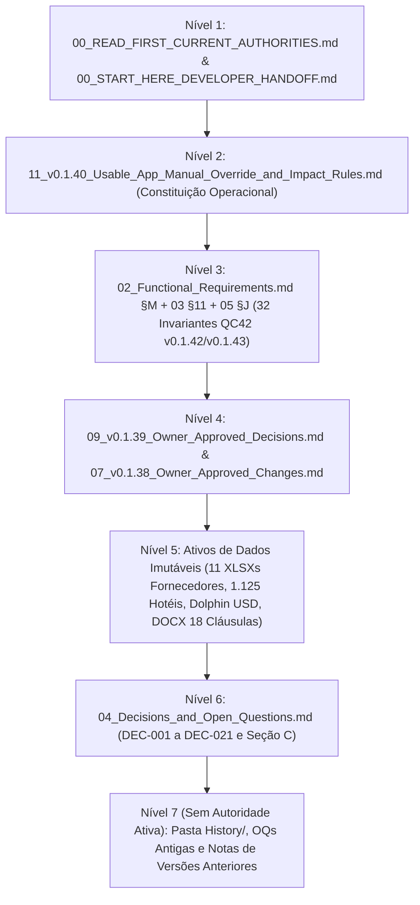
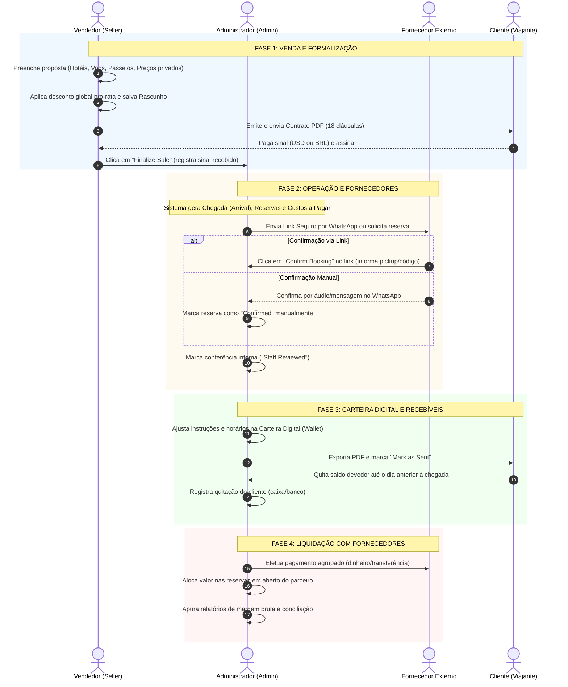
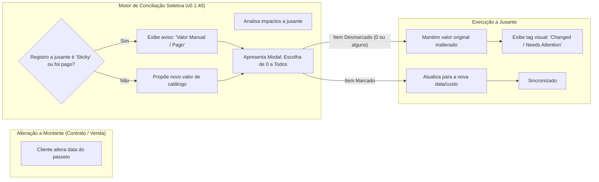
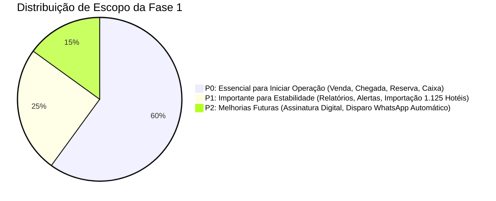

# ANÁLISE COMPLETA DOS REQUISITOS DO CLIENTE — TÍO NENÊ v0.1.43

**Documento:** Relatório Técnico de Engenharia de Requisitos e Auditoria Documental  
**Versão Base Analisada:** Tío Nenê Phase 1 v0.1.43 (Pacote de Entrega do Proprietário / Especificação Congelada)  
**Data da Análise:** 21 de Outubro de 2026  
**Status:** Documento Oficial de Engenharia — Sem Alteração de Código / Sem Modificação de Dados  
**Origem Documental:** `d:\Z_UEB\TIONENE\Tio_Nene_Phase_1_v0.1.43/`

---

## 1. RESUMO EXECUTIVO

Este relatório consolida a análise técnica e minuciosa de todo o acervo documental fornecido pelo cliente para o sistema de gestão da agência de receptivo **Tío Nenê (Cancún, México)**, congelado na versão **v0.1.43**. A análise foi conduzida estritamente em conformidade com as regras de não intervenção no código-fonte, banco de dados, tabelas ou tarifas existentes.

### 1.1 Contexto e Propósito do Sistema
A Tío Nenê opera como agência de turismo receptivo vendendo passeios, traslados, experiências com golfinhos e ingressos para viajantes (primariamente brasileiros) em Cancún e Riviera Maya. O sistema tem como objetivo substituir controles fragmentados e manuais (Trello, planilhas avulsas, WhatsApp) por uma plataforma web operacional e financeira integrada, contemplando:
1. Emissão e versionamento de contratos de venda com cálculo de sinal e saldo;
2. Gestão de chegadas de clientes (*Arrivals*) e itinerários de passeios;
3. Solicitação, confirmação e acompanhamento operacional com dezenas de fornecedores de turismo;
4. Controle financeiro bidirecional: recebíveis de clientes (sinal e saldo em USD/BRL) e obrigações a pagar a fornecedores (em USD e MXN nativo), incluindo adiantamentos e créditos em conta;
5. Geração de voucher/itinerário digital do passageiro (*Digital Wallet* em PDF para WhatsApp).

### 1.2 Princípio Fundamental: Flexibilidade Administrativa e Resiliência Operacional
O achado mais crítico de toda a especificação — formalizado na constituição operacional **`11_v0.1.40_Usable_App_Manual_Override_and_Impact_Rules.md`** e refinado até a **v0.1.43** — é que **o mundo real do turismo de receptivo não tolera automações rígidas ou bloqueios sistêmicos**.
- Preços de fornecedores podem estar pendentes de cotação sem impedir a venda ao cliente (`CON-015`, `PAY-024`).
- Confirmações de fornecedores ocorrem frequentemente por áudio ou mensagem no WhatsApp, sem exigência de código de reserva, horário ou uso de link externo (`DEC-012`, `RES-005`).
- Qualquer alteração a montante (ex.: cliente altera data do contrato ou troca de hotel) gera uma **Revisão Seletiva de Impacto (0 a todos)**: o Administrador visualiza o que mudaria em cascata e decide livremente marcar zero, alguns ou todos os registros dependentes (`V40-001`, `SC-173`).
- Valores e parâmetros editados manualmente pelo operador são **estritos e persistentes (*sticky*)**, jamais sendo sobrescritos silenciosamente por recálculos automáticos (`V40-002`, `SC-018`).
- Inconsistências operacionais geram alertas visuais (`Changed / Needs Attention`, `Out of Sync`), mas **nunca travam a operação nem a exportação do voucher/carteira** (`V40-003`, `WAL-005`).

### 1.3 Dados Mestres Congelados e Validados
A documentação da v0.1.43 estabelece um conjunto de ativos de dados congelados e imutáveis byte a byte:
- **10 Fornecedores Homologados** + 1 pasta de referências compartilhadas (`Data/Supplier_Source_Workbooks/`).
- **52 Produtos/Passeios Visíveis ao Vendedor** (`seller_products`) desdobrados em **80 Tarifas Base de Fornecedor** (`supplier_rates`).
- **Catálogo Mestre de Hotéis:** exatamente **1.125 hotéis** categorizados em **8 zonas canônicas** (`Data/Hotel_Master/Ultimate_Tio_Nene_Hotels_Two_Columns.xlsx`).
- **Tabela de Transporte Dolphin:** 8 zonas, tarifas independentes para Adulto, Criança e Bebê em USD (9,01 / 12,01 / 15,02) a partir de MXN 150/200/250 a câmbio fixo de planejamento de 16,65 (`Data/Dolphin_Transportation/`).
- **Regras Xcaret 2026:** 27 tarifas, 6 janelas de temporada alta/regular, exceções de domingo (128 combinações validadas).
- **Modelo de Contrato:** template DOCX com **18 cláusulas em português** e blocos repetíveis (`Contract_Template/`).

---

## 2. HIERARQUIA DE AUTORIDADE DOCUMENTAL

A documentação do cliente sofreu múltiplas rodadas de refinamento e auditoria externa (v0.1.37 a v0.1.43). Para evitar contradições, o pacote instituiu formalmente uma **ordem estrita de precedência documental** em `00_READ_FIRST_CURRENT_AUTHORITIES.md` e `00_START_HERE_DEVELOPER_HANDOFF.md`. Nenhuma cláusula histórica ou nota arquivada pode sobrepor uma regra mais recente.

### 2.1 Detalhamento dos Níveis de Autoridade

1. **Nível 1 — Regras Mestras de Entrada e Instruções de Transição:**
   - `00_READ_FIRST_CURRENT_AUTHORITIES.md`: Define a suserania das decisões e a invalidade de textos legados arquivados.
   - `00_START_HERE_DEVELOPER_HANDOFF.md`: Estabelece o roteiro de entrega, priorização P0 e validação de engenharia.
2. **Nível 2 — A "Constituição" da Flexibilidade e Resiliência (v0.1.40):**
   - `11_v0.1.40_Usable_App_Manual_Override_and_Impact_Rules.md`: É a autoridade máxima em caso de conflito sobre recálculos, propagação em cascata, valores *sticky*, opções de impacto 0-a-todos e independência de módulos. Revoga qualquer presunção de recálculo automático presente em documentos mais antigos.
3. **Nível 3 — Invariantes de Auditoria e Correções Finais (v0.1.42 / v0.1.43):**
   - `02_Functional_Requirements.md` (Seção M: `QC42-001` a `QC42-032`).
   - `03_Data_Architecture_and_Rules.md` (Seção 11).
   - `05_Acceptance_Scenarios.md` (Seção J: `SC-184` a `SC-215`).
   - `16_v0.1.43_Final_Consistency_Patch_and_Verification.md`: Harmonização da submissão do link do fornecedor (`Save Details` vs `Confirm Booking`), isolamento estrito de permissões Seller vs Admin, e unificação de versões.
4. **Nível 4 — Decisões Específicas Homologadas pelo Proprietário:**
   - `09_v0.1.39_Owner_Approved_Decisions.md`: Adiciona modelo de transporte Dolphin (8 zonas, USD), regra de Xcaret 2027+ não bloqueante, quitação por saldo devedor de fornecedor e permissão de Seller para registrar recebimento de sinal.
   - `07_v0.1.38_Owner_Approved_Changes.md`: Homologa 1.125 hotéis, template de 18 cláusulas DOCX, descontos contratuais pro-rata e contagem obrigatória de pax (adulto, criança, bebê) por linha.
5. **Nível 5 — Ativos Físicos e Dados Estruturados Imutáveis:**
   - 11 planilhas padronizadas em `Data/Supplier_Source_Workbooks/` (52 passeios, 80 tarifas).
   - Planilha mestre `Ultimate_Tio_Nene_Hotels_Two_Columns.xlsx` (1.125 hotéis, 8 zonas).
   - Planilha de transporte Dolphin `Dolphin_Transport_Zone_Seed_USD.xlsx`.
   - Modelo de contrato `Tio_Nene_Contract_Source_Template_UNSIGNED.docx`.
6. **Nível 6 — Registro de Decisões e Perguntas Abertas Ativas:**
   - `04_Decisions_and_Open_Questions.md`: Decisões numeradas confirmadas de **DEC-001 a DEC-021** e tabela da Seção C (limites da Fase 1).
7. **Nível 7 — Material Histórico e Descontinuado (Sem Autoridade Normativa):**
   - Pasta `History/`: Contém arquivos legados pré-v0.1.41. Qualquer menção nesses arquivos que indique "PENDING" ou "BLOCKER" para itens resolvidos a partir da v0.1.38 é explicitamente nula.

---

## 3. INVENTÁRIO COMPLETO DE REQUISITOS FUNCIONAIS

O pacote v0.1.43 consolida **228 identificadores de requisitos únicos** (196 requisitos estruturais nas seções A–L e 32 requisitos de controle de qualidade e integridade `QC42` na seção M). A tabela a seguir categoriza todos os requisitos do cliente com precisão cirúrgica.

### 3.1 Catálogo de Produtos e Fornecedores (`CAT`)

| ID | Descrição Sumária | Objetivo Operacional | Regras de Negócio e Critérios | Origem | Situação |
|---|---|---|---|---|---|
| `CAT-001` | Cadastro de Fornecedor | Permitir que Admin adicione e mantenha operadoras de turismo e receptivo. | Suporta nome, razão social, moeda padrão (USD/MXN), canais de contato (WhatsApp/e-mail) e notas operacionais. | `02` §A | **Obrigatório** |
| `CAT-002` | Cadastro de Passeios/Produtos | Definir os produtos comercializáveis pela equipe de vendas. | Vinculado a um fornecedor primário; possui código único, nome de exibição, tipo/subtipo e status ativo/inativo. | `02` §A | **Obrigatório** |
| `CAT-003` | Variações e Modalidades | Diferenciar opções dentro do mesmo passeio (ex.: Coco Bongo Regular vs Gold Member). | Cada variante possui suas próprias regras de custo, dias operacionais e inclusões. | `02` §A | **Obrigatório** |
| `CAT-004` | Regras de Custo Base | Armazenar tabela de custos acordada com o fornecedor. | Suporta precificação por pessoa (Adulto/Criança/Bebê), por unidade/veículo ou manual. | `02` §A | **Obrigatório** |
| `CAT-005` | Preço de Venda Sugerido | Indicar preço de tabela como referência para o vendedor. | O vendedor pode ajustar o preço de venda no contrato; o preço sugerido é apenas indicativo. | `02` §A | **Obrigatório** |
| `CAT-006` | Moeda Nativa do Fornecedor | Registrar a moeda em que o fornecedor efetivamente fatura. | USD ou MXN. Custo em MXN mantém valor nativo e projeta estimativa em USD por taxa fixa parametrizável. | `02` §A | **Obrigatório** |
| `CAT-007` | Inclusões e Exclusões | Exibir automaticamente nos contratos o que está incluso e o que não está. | Textos higienizados por passeio. Quando não preenchido, não inventar texto; avisar pendência. | `02` §A | **Obrigatório** |
| `CAT-008` | Dias Operacionais da Semana | Restringir ou alertar agendamento de passeios fora dos dias de operação do fornecedor. | Baseado nos dias declarados pelo fornecedor (ex.: Xcaret fecha alguns parques aos domingos). | `02` §A | **Obrigatório** |
| `CAT-009` | Base Múltipla de Custo | Permitir precificação combinada por variante (Pax vs Veículo vs Zona vs Cotação). | O motor de custo deve respeitar a estrutura de cada fornecedor sem forçar um modelo único. | `02` §A | **Obrigatório** |
| `CAT-010` | Passeios Avulsos / Texto Livre | Permitir venda de passeios não cadastrados no catálogo mestre. | Vendedor digita nome livre; não bloqueia finalização; cria pendência de custo (`Cost Required`). | `02` §A, `DEC-003` | **Obrigatório** |
| `CAT-011` | Suporte a Temporadas Xcaret | Aplicar tarifas de Alta e Regular conforme calendários 2026. | 27 tarifas vinculadas a 6 janelas de alta temporada e regras de domingos. | `02` §A, `Data/` | **Obrigatório** |
| `CAT-012` | Operação Xcaret 2027+ | Permitir venda de passeios Xcaret para 2027 sem bloqueio por falta de calendário futuro. | Datas selecionáveis livremente; Admin seleciona tarifa provisória (Regular/Alta); não copia restrições de 2026. | `02` §A, `09` | **Obrigatório** |
| `CAT-013` | Lembrete de Atualização Xcaret | Notificar o Admin no painel para cadastrar as regras oficiais do ano seguinte. | Disparo anual em 15 de Dezembro. | `02` §A, `OPS-013` | **Obrigatório** |

### 3.2 Contratos e Vendas (`CON`)

| ID | Descrição Sumária | Objetivo Operacional | Regras de Negócio e Critérios | Origem | Situação |
|---|---|---|---|---|---|
| `CON-001` | Dados Pessoais do Cliente | Identificar o contratante e responsável legal. | Nome completo, CPF, telefone (WhatsApp), e-mail e quantidade total de passageiros (`pax`). | `02` §B | **Obrigatório** |
| `CON-002` | Voo de Chegada e Partida | Coletar dados de voo para coordenação de transfer. | Obrigatório apenas quando há contratação de transfer de chegada/saída; caso contrário opcional. | `02` §B | **Obrigatório** |
| `CON-003` | Múltiplas Hospedagens com Datas | Registrar estadias do cliente em diferentes hotéis durante a viagem. | Suporta 1 a N hotéis com datas de check-in e check-out; busca no catálogo mestre de 1.125 hotéis ou texto livre. | `02` §B, `DEC-007` | **Obrigatório** |
| `CON-004` | Itens de Itinerário Vendidos | Listar os serviços contratados pelo cliente. | Cada linha tem data, passeio selecionado ou texto livre, e contagem de pax. | `02` §B | **Obrigatório** |
| `CON-005` | Preço de Venda Privado por Linha | Vendedor negocia o valor de cada passeio sem expor no PDF do cliente. | Cada linha possui seu valor de venda interno; o contrato PDF exibe apenas o valor total do contrato. | `02` §B, `DEC-006` | **Obrigatório** |
| `CON-006` | Salvar e Retomar Rascunho | Permitir criação incremental da proposta sem impacto operacional. | Rascunho não cria chegada (*arrival*), reservas em fornecedores, contas a pagar nem voucher. | `02` §B, `DEC-002` | **Obrigatório** |
| `CON-007` | Finalizar Venda (*Finalize Sale*) | Transição atômica da venda para o fluxo operacional. | Cria exatamente 1 Chegada (*Arrival*), as reservas de fornecedor e os custos previstos a pagar. | `02` §B, `DEC-001` | **Obrigatório** |
| `CON-008` | Versionamento de Contrato | Permitir alterações em vendas já finalizadas preservando histórico. | Gera nova versão (V2, V3); mantém versão anterior e seus PDFs imutáveis; não cria segunda chegada. | `02` §B, `DEC-008` | **Obrigatório** |
| `CON-009` | Revisão Seletiva de Impacto | Proteger registros operacionais/financeiros já alterados ou pagos ao revisar contrato. | Admin visualiza impactos a jusante e marca quais deseja atualizar (0 a todos). | `02` §B, `11` | **Obrigatório** |
| `CON-010` | Upload de Contrato Assinado | Armazenar o documento assinado pelo cliente. | Upload vinculado à versão exata do contrato; não exige assinatura digital/e-sign na Fase 1. | `02` §B, `DEC-010` | **Obrigatório** |
| `CON-011` | Acesso Compartilhado de Vendedores | Permitir que qualquer vendedor localize e revise contratos de outros vendedores. | Foco na agilidade do time; vendedor não tem acesso ao financeiro global da agência. | `02` §B, `DEC-011` | **Obrigatório** |
| `CON-012` | Pax Detalhado por Passeio | Registrar quantidade de Adultos, Crianças e Bebês em cada passeio vendido. | Preenchimento obrigatório linha a linha, mesmo que se repita; reflete no cálculo de custos e voucher. | `02` §B, `07` | **Obrigatório** |
| `CON-013` | Desconto Global Pro-Rata | Aplicar desconto percentual ou fixo no valor total da venda. | O desconto é rateado proporcionalmente entre os preços de venda internos das linhas; cliente vê total líquido. | `02` §B, `07` | **Obrigatório** |
| `CON-014` | Geração de PDF em Português | Emitir o contrato formal para o cliente. | 18 cláusulas jurídicas padrão, formatação de datas e moedas, dados dinâmicos de hotéis e passeios. | `02` §B, `Contract_` | **Obrigatório** |
| `CON-015` | Finalização com Custo Desconhecido | Permitir finalizar contrato mesmo sem custo de fornecedor conhecido. | Não bloqueia venda; não assume custo zero; gera alerta `Cost Required` no painel de pendências. | `02` §B, `04` §A | **Obrigatório** |

### 3.3 Chegadas e Itinerários Operacionais (`ARR`)

| ID | Descrição Sumária | Objetivo Operacional | Regras de Negócio e Critérios | Origem | Situação |
|---|---|---|---|---|---|
| `ARR-001` | Registro Único de Chegada | Agrupar toda a operação da viagem de um cliente. | Criado exatamente uma vez na finalização da venda; chave de ligação com voos, estadias e reservas. | `02` §C | **Obrigatório** |
| `ARR-002` | Vinculação Dinâmica de Hotel | Associar automaticamente o hotel correto a cada passeio pela data. | O sistema cruza a data do passeio com as janelas de estadia do cliente; permite override manual do pickup. | `02` §C, `RES-020` | **Obrigatório** |
| `ARR-003` | Inclusão de Serviços Operacionais | Adicionar serviços na chegada que não constavam no contrato como item vendido. | Ex.: transporte contratado com outro fornecedor para atender iate; não altera preço do cliente. | `02` §C, `SC-011` | **Obrigatório** |
| `ARR-004` | Painel Hoje e Amanhã | Visão tática das chegadas e saídas imediatas. | Filtros por data, hotel, status de transfer e pendências de contato. | `02` §C, `OPS-001` | **Obrigatório** |
| `ARR-005` | Alerta de Alteração de Venda | Sinalizar que o contrato foi revisado e exige conferência da equipe. | Exibe tag `Changed / Needs Attention` até que o operador revise e confirme a conciliação. | `02` §C, `V40-003` | **Obrigatório** |

### 3.4 Reservas com Fornecedores (`RES`)

| ID | Descrição Sumária | Objetivo Operacional | Regras de Negócio e Critérios | Origem | Situação |
|---|---|---|---|---|---|
| `RES-001` | Reserva Operacional por Serviço | Representar o compromisso de agendamento com o fornecedor. | Gerada na finalização da venda; possui código permanente, data, fornecedor, pax e status. | `02` §D | **Obrigatório** |
| `RES-002` | Link Único de Fornecedor | Permitir que o fornecedor visualize e informe dados da reserva externamente. | Token seguro, escopo estrito a 1 reserva; sem CPF, sem e-mail, sem valores pagos pelo cliente. | `02` §D, `QC42-022` | **Obrigatório** |
| `RES-003` | Salvar Detalhes no Link | Permitir que o fornecedor atualize pickup/horário/código sem confirmar a reserva. | Ação `Save Details` atualiza apenas os campos digitados; **NÃO** altera status para Confirmado. | `02` §D, `16` | **Obrigatório** |
| `RES-004` | Cinco Status de Reserva | Padronizar a esteira de atendimento com fornecedores. | **Not Requested**, **Awaiting Confirmation**, **Confirmed**, **Unable to Confirm**, **Cancelled**. | `02` §D, `DEC-013` | **Obrigatório** |
| `RES-005` | Confirmação Manual (WhatsApp) | Registrar confirmação obtida por canais informais sem exigir link externo. | Admin marca como `Confirmed` sem exigir código de confirmação, horário ou local de pickup. | `02` §D, `DEC-012` | **Obrigatório** |
| `RES-006` | Indicador "Staff Reviewed" | Registro de conferência interna da equipe. | Campo booleano independente do status do fornecedor; preenchimento manual pela equipe. | `02` §D, `DEC-012` | **Obrigatório** |
| `RES-007` | Ação "Mark as Requested" | Registrar manualmente que a agência contatou o fornecedor. | Muda status de `Not Requested` para `Awaiting Confirmation`. Não é disparado por copiar link. | `02` §D, `DEC-014` | **Obrigatório** |
| `RES-008` | Alteração Manual de Reserva | Modificar data, passeio, fornecedor ou horário de uma reserva existente. | Operador edita livremente; oferece escolha seletiva de impacto no contas a pagar e na carteira. | `02` §D, `DEC-015` | **Obrigatório** |
| `RES-009` | Exclusão de Reserva Operacional | Remover reserva cancelada ou substituída da chegada ativa. | Exclusão da reserva **NÃO** apaga pagamentos reais já efetuados ao fornecedor. | `02` §D, `DEC-015` | **Obrigatório** |
| `RES-010` | Reserva de Serviço Fora do Catálogo | Gerenciar agendamento de passeios customizados. | Permite definir fornecedor e custo manualmente a qualquer momento. | `02` §D, `SC-014` | **Obrigatório** |
| `RES-011` | Confirmação via Link | Ação explícita no link do fornecedor que efetiva a confirmação. | Botão `Confirm Booking` valida versão e move status para `Confirmed`; não marca Staff Reviewed. | `02` §D, `16` | **Obrigatório** |
| `RES-012` | Revogação de Link de Fornecedor | Invalidar link externo caso a reserva seja transferida para outro fornecedor. | Garante que o fornecedor anterior não acesse mais os dados do cliente. | `02` §D, `QC42-026` | **Obrigatório** |
| `RES-013` | Não Bloqueio por Falta de Confirmação | Garantir continuidade dos fluxos downstream mesmo sem confirmação do fornecedor. | Contas a pagar, relatórios e voucher digital são gerados normalmente com status pendente. | `02` §D, `DEC-012` | **Obrigatório** |
| `RES-014` | Tratamento de Indisponibilidade | Registrar recusa do fornecedor em atender o passeio. | Status `Unable to Confirm`; exibido em destaque no painel de pendências operacionais. | `02` §D, `DEC-015` | **Obrigatório** |
| `RES-015` | Notificação de Cancelamento Externo | Alertar operador ao excluir reserva que já havia sido confirmada pelo fornecedor. | Exibe aviso confirmando que o fornecedor precisa ser avisado externamente (WhatsApp/e-mail). | `02` §D, `DEC-015` | **Obrigatório** |
| `RES-016` | Preservação de Histórico de Reserva | Manter rastreabilidade interna sem poluir as telas operacionais do dia a dia. | Registra criação, alterações e cancelamentos em log de auditoria protegido. | `02` §D, `11` | **Obrigatório** |
| `RES-017` | Alocação de Veículo/Guia | Informar dados operacionais de transporte ou guia local quando aplicável. | Campos opcionais informados pelo fornecedor ou digitados pelo operador. | `02` §D | Opcional |
| `RES-018` | Código Único Permanente de Reserva | Identificador imutável para rastreamento interno e referência com o fornecedor. | Gerado automaticamente pelo sistema em formato amigável. | `02` §D, `SC-052` | **Obrigatório** |
| `RES-019` | Herança de Pax por Linha | Propagar a quantidade de adultos, crianças e bebês do contrato para a reserva. | Garante que o fornecedor receba a contagem exata por categoria de idade. | `02` §D, `CON-012` | **Obrigatório** |
| `RES-020` | Override de Local de Pickup | Sobrescrever o hotel de embarque para um ponto de encontro ou outro hotel. | Não altera o hotel da estadia no contrato nem no catálogo mestre. | `02` §D, `SC-057` | **Obrigatório** |

### 3.5 Contas a Pagar e Custos de Fornecedores (`PAY`)

| ID | Descrição Sumária | Objetivo Operacional | Regras de Negócio e Critérios | Origem | Situação |
|---|---|---|---|---|---|
| `PAY-001` | Registro de Custo Previsto (*Planned*) | Projeta a obrigação financeira com o fornecedor assim que a venda é finalizada. | Gerado na finalização; reflete tabela de custo ou cotação manual; status inicial `Planned`. | `02` §E, `DEC-009` | **Obrigatório** |
| `PAY-002` | Painel Agrupado por Fornecedor | Visão estilo planilha do contas a pagar de cada parceiro. | Lista todas as reservas, custos devidos, valores pagos e saldos devedores remanescentes. | `02` §E, `DEC-017` | **Obrigatório** |
| `PAY-003` | Override Manual de Custo na Linha | Permitir que o Admin ajuste o custo a pagar de uma reserva específica. | Custo editado manualmente vira *sticky*; não é sobrescrito por recálculos automáticos. | `02` §E, `DEC-017` | **Obrigatório** |
| `PAY-004` | Três Colunas Financeiras Claras | Distinguir custo devido, montante pago e saldo em aberto. | `Reservation Cost` (devido), `Amount Paid` (alocado) e `Remaining Balance` (saldo devedor). | `02` §E, `DEC-017` | **Obrigatório** |
| `PAY-005` | Despesas Avulsas / Operacionais | Registrar custos extras sem reserva de catálogo (ex.: Uber emergencial, taxas). | Lançamento manual de despesa vinculado ou não a uma chegada; impacta margem da operação. | `02` §E, `DEC-004` | **Obrigatório** |
| `PAY-006` | Custo de Transporte Manual de Iate | Lançar a obrigação financeira do transporte avulso contratado para um passeio. | Vinculado à chegada e ao fornecedor de transporte; independente do fornecedor do barco. | `02` §E, `ARR-003` | **Obrigatório** |
| `PAY-007` | Vinculação Atômica com a Reserva | Manter a relação entre a reserva operacional e seu lançamento financeiro. | Alteração de dados operacionais oferece ajuste opcional no lançamento a pagar. | `02` §E, `SC-019` | **Obrigatório** |
| `PAY-008` | Pagamento Real de Fornecedor | Registrar saídas efetivas de caixa ou transferência bancária para o fornecedor. | Registro manual com data, valor total, forma de pagamento (caixa/banco), comprovante/nota. | `02` §E, `DEC-017` | **Obrigatório** |
| `PAY-009` | Alocação Multi-Reserva | Um único pagamento quita diversas reservas pendentes do mesmo fornecedor. | O operador distribui o valor pago entre as linhas de reservas em aberto. | `02` §E, `DEC-017` | **Obrigatório** |
| `PAY-010` | Pagamento Parcial de Reserva | Registrar quitação parcial do custo de um passeio. | A linha mantém o custo total original, atualiza o valor pago e reduz o saldo devedor. | `02` §E, `DEC-017` | **Obrigatório** |
| `PAY-011` | Pagamento Antecipado / Crédito | Registrar adiantamentos financeiros a fornecedores antes de alocar em reservas. | Valor pago fica registrado como saldo de crédito credor da agência com aquele fornecedor. | `02` §E, `DEC-018` | **Obrigatório** |
| `PAY-012` | Alocação Posterior de Crédito | Aplicar saldo de adiantamento em reservas futuras ou já existentes. | Não cria nova saída de caixa; consome o saldo de crédito existente do fornecedor. | `02` §E, `DEC-018` | **Obrigatório** |
| `PAY-013` | Liberação de Alocação para Crédito | Desvincular pagamento de reserva cancelada, voltando o saldo para crédito em conta. | Acionada manualmente pelo Admin; **NÃO** apaga a saída de caixa original. | `02` §E, `DEC-019` | **Obrigatório** |
| `PAY-014` | Registro de Reembolso de Fornecedor | Registrar entrada de dinheiro devolvido pelo fornecedor (caixa/banco). | Entrada real de caixa que reduz o saldo de crédito com o fornecedor; **NÃO** é receita de cliente. | `02` §E, `DEC-019` | **Obrigatório** |
| `PAY-015` | Ajuste de Taxa de Cancelamento | Definir o custo final efetivo cobrado pelo fornecedor em caso de cancelamento. | Admin edita o custo da linha ($0, valor parcial ou total); ajusta saldo devedor. | `02` §E, `DEC-020` | **Obrigatório** |
| `PAY-016` | Oferta de Liberação de Excesso | Oferecer conversão do valor pago excedente em crédito com o fornecedor. | Disparado se o custo for reduzido abaixo do valor já alocado; requer confirmação do Admin. | `02` §E, `DEC-021` | **Obrigatório** |
| `PAY-017` | Preservação de Saídas de Caixa | Proibir exclusão automática de pagamentos reais ao deletar reservas. | O registro financeiro histórico permanece intocado mesmo se a reserva for excluída. | `02` §E, `DEC-015` | **Obrigatório** |
| `PAY-018` | Quitação por Saldo Devedor | Permitir que o Admin marque uma linha de custo como liquidada pelo saldo devedor. | Cria automaticamente o pagamento exato necessário para zerar o saldo pendente. | `02` §E, `09` | **Obrigatório** |
| `PAY-019` | Notas em Pagamentos de Fornecedor | Armazenar observações textuais em saídas de pagamento e despesas. | Campo de texto livre opcional (ex.: conta bancária de destino, número do comprovante). | `02` §E, `NOTE-001` | **Obrigatório** |
| `PAY-020` | Proibição de Saldo Negativo Falso | Impedir que pagamentos excedentes apareçam como se fossem dívida da agência. | Excesso é apresentado como crédito a favor da agência, nunca como saldo devedor. | `02` §E, `DEC-021` | **Obrigatório** |
| `PAY-021` | Motor de Tarifas Parametrizado | Calcular custos respeitando a unidade tarifária de cada fornecedor. | Adulto/criança, veículo até 7 pax, jet ski a cada 2 pax, etc. | `02` §E, `04` §B | **Obrigatório** |
| `PAY-022` | Moeda Nativa e Projeção USD | Suportar custos em MXN mantendo valor original e estimativa em USD. | Snapshot da taxa de conversão na data da criação; não recalcula passado retroativamente. | `02` §E, `04` §B | **Obrigatório** |
| `PAY-023` | Taxa de Câmbio de Planejamento | Permitir ao Admin parametrizar a taxa fixa de conversão MXN/USD. | Atualizações afetam apenas novos cálculos a partir da data de alteração. | `02` §E, `SC-087` | **Obrigatório** |
| `PAY-024` | Gestão de Custo Desconhecido | Tratar custos pendentes de cotação sem atribuir valor zero fictício. | Exibido como `Unknown` e listado na fila de pendências operacionais. | `02` §E, `CON-015` | **Obrigatório** |

### 3.6 Recebíveis e Pagamentos de Clientes (`REC`)

| ID | Descrição Sumária | Objetivo Operacional | Regras de Negócio e Critérios | Origem | Situação |
|---|---|---|---|---|---|
| `REC-001` | Contas a Receber por Contrato | Acompanhar a posição financeira de cada venda fechada. | Contratos emitidos em USD; controla valor total, total recebido e saldo devedor em aberto. | `02` §F | **Obrigatório** |
| `REC-002` | Registro Manual de Recebimento | Registrar pagamentos reais feitos pelo cliente (sinal e parcelas). | Data, valor, método (dinheiro, Pix/transferência), moeda (USD ou BRL) e notas. | `02` §F, `DEC-011` | **Obrigatório** |
| `REC-003` | Conversão Explícita de BRL | Creditar pagamentos feitos em BRL pelo valor líquido acordado em USD. | O operador informa o valor em BRL e o crédito equivalente em USD no momento do lançamento. | `02` §F, `04` §C | **Obrigatório** |
| `REC-004` | Múltiplas Parcelas / Saldo em Cancún | Suportar qualquer quantidade de recebimentos ao longo do tempo. | Não se limita a 2 pagamentos; o cliente pode pagar em 1, 2, 3 ou mais parcelas. | `02` §F, `Contract_` | **Obrigatório** |
| `REC-005` | Registro de Sinal na Finalização | Permitir que o Vendedor registre o recebimento do sinal no momento da venda. | Campo integrado no fluxo de finalização; opcional (95% dos casos o cliente paga no ato). | `02` §F, `09` | **Obrigatório** |
| `REC-006` | Registro Tardio de Sinal/Pagamento | Permitir lançamento de pagamentos posteriormente sem revisar o contrato. | Vendedores e Administradores podem registrar sem duplicar chegadas ou invalidar PDF. | `02` §F, `09` | **Obrigatório** |
| `REC-007` | Vencimento Padrão do Saldo | Definir prazo padrão para quitação do saldo do cliente. | Vencimento default no **dia anterior à chegada**; considerado **em atraso (*overdue*) no dia da chegada**. | `02` §F, `04` §B | **Obrigatório** |
| `REC-008` | Ajuste Manual de Vencimento | Permitir ao operador alterar a data combinada para o pagamento do saldo. | Override local por cliente (ex.: combinado pagar no dia 2 da viagem); não altera o contrato. | `02` §F, `04` §B | **Obrigatório** |

### 3.7 Relatórios e Visões Financeiras (`FIN`)

| ID | Descrição Sumária | Objetivo Operacional | Regras de Negócio e Critérios | Origem | Situação |
|---|---|---|---|---|---|
| `FIN-001` | Receita Bruta por Período | Consolidar volume total vendido pela agência. | Filtro por período de chegada ou de emissão do contrato. | `02` §G | **Obrigatório** |
| `FIN-002` | Margem por Fornecedor e Passeio | Apurar margem operacional bruta deduzindo custos diretos de fornecedores. | Baseado nos preços de venda privados por linha rateados com desconto e custos efetivos. | `02` §G, `SC-024` | **Obrigatório** |
| `FIN-003` | Status Financeiro: Previsto vs Pago | Permitir alternar visões de custos planejados, confirmados e efetivamente pagos. | Dá transparência entre o passivo contratado e o fluxo de caixa executado. | `02` §G, `SC-023` | **Obrigatório** |
| `FIN-004` | Painel de Inadimplência de Clientes | Listar clientes com saldos vencidos ou a vencer nos próximos dias. | Baseado na data de vencimento (dia antes da chegada ou override acordado). | `02` §G, `REC-007` | **Obrigatório** |
| `FIN-005` | Saldo em Aberto com Fornecedores | Consolidar o montante total devido a cada parceiro comercial. | Soma dos custos devidos menos valores já alocados em pagamentos. | `02` §G, `PAY-002` | **Obrigatório** |
| `FIN-006` | Alocação de Desconto nos Relatórios | Ratear o desconto contratual entre as linhas para apuração justa de margens. | Evita que uma linha absorva todo o desconto; mantém fidelidade contábil. | `02` §G, `CON-013` | **Obrigatório** |
| `FIN-007` | Relatório de Câmbio e Custos MXN | Apurar divergências entre a projeção USD do custo em MXN e a saída real. | Permite avaliar variações cambiais operacionais. | `02` §G, `PAY-022` | **Obrigatório** |
| `FIN-008` | Regime de Competência por Chegada | Apurar resultados operacionais com base na data de chegada do cliente. | Venda de Outubro com chegada em Novembro é apurada no mês de Novembro. | `02` §G, `04` §B | **Obrigatório** |
| `FIN-009` | Sinalização de Margem Incompleta | Alertar relatórios quando houver passeios com custos pendentes de cotação. | Exibe aviso de que a margem calculada é provisória e não considera custo zero. | `02` §G, `CON-015` | **Obrigatório** |

### 3.8 Voucher / Carteira Digital do Passageiro (`WAL`)

| ID | Descrição Sumária | Objetivo Operacional | Regras de Negócio e Critérios | Origem | Situação |
|---|---|---|---|---|---|
| `WAL-001` | Carteira Digital do Cliente | Gerar o itinerário consolidado e visualmente elegante para envio via WhatsApp. | Contém dados de hotel, voos, passeios em ordem cronológica, horários de pickup e dicas. | `02` §H | **Obrigatório** |
| `WAL-002` | Contagem de Passageiros por Passeio | Exibir no voucher a quantidade exata de pessoas agendadas em cada atividade. | Adultos, crianças e bebês detalhados por passeio. | `02` §H, `CON-012` | **Obrigatório** |
| `WAL-003` | Edição Independente do Voucher | Permitir ao operador ajustar textos no voucher sem alterar a reserva original. | Flexibilidade para adequar instruções amigáveis ao cliente. | `02` §H, `DEC-016` | **Obrigatório** |
| `WAL-004` | Visão Única Atual | Tela administrativa exibe apenas o voucher corrente, sem histórico poluído. | Simplicidade operacional: operador vê e edita a versão que será enviada. | `02` §H, `DEC-016` | **Obrigatório** |
| `WAL-005` | Exportação com Status Pendente | Permitir gerar o PDF da carteira mesmo com reservas ainda não confirmadas. | O PDF indica honestamente quais passeios estão confirmados e quais aguardam detalhes. | `02` §H, `DEC-012` | **Obrigatório** |
| `WAL-006` | Ação "Mark as Sent" | Registrar manualmente que a carteira foi compartilhada com o cliente. | Ação explícita da equipe; não depende de integração automática com WhatsApp. | `02` §H, `DEC-016` | **Obrigatório** |
| `WAL-007` | Alerta "Wallet Update Needed" | Sinalizar quando o itinerário foi modificado após o envio do voucher anterior. | Avisa ao operador que um novo PDF precisa ser gerado e enviado ao cliente. | `02` §H, `DEC-016` | **Obrigatório** |
| `WAL-008` | Preservação de Links e Vouchers | Evitar que alterações na carteira sobrescrevam links externos ou arquivos já enviados. | Cada exportação gera um arquivo autocontido para envio. | `02` §H, `SC-027` | **Obrigatório** |

### 3.9 Traslados e Transportes (`TRF`)

| ID | Descrição Sumária | Objetivo Operacional | Regras de Negócio e Critérios | Origem | Situação |
|---|---|---|---|---|---|
| `TRF-001` | Transfer Aeroporto (Miguel Shuttle) | Gerenciar traslados de chegada e saída em Cancún e Riviera Maya. | Tarifa fixa por veículo para até 7 passageiros, precificada por zona de destino. | `02` §I, `04` §B | **Obrigatório** |
| `TRF-002` | Override de Zona por Reserva | Ajustar a zona tarifária de cobrança de um hotel para um fornecedor específico. | Ex.: hotel na Zona Hoteleira faturado pelo fornecedor como Centro; não altera o hotel mestre. | `02` §I, `SC-015` | **Obrigatório** |
| `TRF-003` | Independência da Zona Mestre | Proibir que alterações operacionais de rota modifiquem a zona do catálogo mestre. | Garante integridade do banco de hotéis. | `02` §I, `SC-015` | **Obrigatório** |
| `TRF-004` | Ajuste Exclusivo de Custo de Transfer | Permitir alterar apenas o valor a pagar do traslado mantendo a zona. | Flexibilidade para negociações pontuais de frete. | `02` §I, `SC-016` | **Obrigatório** |
| `TRF-005` | Traslado de Ida e Volta Separados | Tratar transfer in e transfer out como reservas operacionais e contas a pagar distintos. | Cria 2 reservas e 2 lançamentos a pagar, exibindo no contrato de forma integrada. | `02` §I, `11` | **Obrigatório** |
| `TRF-006` | Capacidade Máxima do Veículo | Respeitar limite de 7 passageiros por van no Miguel Shuttle. | 8 ou mais passageiros exigem 2 vans (e 2 tarifas de custo). | `02` §I, `CAT-009` | **Obrigatório** |
| `TRF-007` | Transporte Dolphin Integrado | Aplicar custos de transporte por pessoa conforme a zona do hotel. | 8 zonas canônicas; tarifas USD 9,01 / 12,01 / 15,02; ida e volta inclusa. | `02` §I, `09` | **Obrigatório** |
| `TRF-008` | Transporte Dolphin Opcional (*Opt-out*) | Permitir ao Admin desmarcar o transporte Dolphin em casos de cliente com carro. | Padrão ativado (ON); botão de desativação simples no agendamento. | `02` §I, `09` | **Obrigatório** |
| `TRF-009` | Transporte Dolphin por Categoria de Idade | Tarifas independentes para adulto, criança e bebê no transporte da Dolphin. | Parametrizável no painel administrativo. | `02` §I, `09` | **Obrigatório** |
| `TRF-010` | Alerta de Cobertura Sul Dolphin | Sinalizar que hotéis ao sul de Tulum podem não ter cobertura de pickup pela Dolphin. | Utiliza tarifa de fallback da zona sul ($15,02) e avisa sobre necessidade de confirmação. | `02` §I, `09` | **Obrigatório** |
| `TRF-011` | Transporte Adicionado a Iate Privado | Cadastrar transporte terrestre avulso para marinas sem alterar preço do cliente. | Cria reserva com fornecedor de van e lançamento financeiro correspondente. | `02` §I, `ARR-003` | **Obrigatório** |
| `TRF-012` | Regras de Embarque Playa Mía | Suportar 3 pontos de saída (Cancún, Playa del Carmen e Cozumel). | Saída de Cozumel é estritamente manual (`PLY-R003`); saídas continentais calculam transfer. | `02` §I, `Data/` | **Obrigatório** |

### 3.10 Painéis e Operações Diárias (`OPS`)

| ID | Descrição Sumária | Objetivo Operacional | Regras de Negócio e Critérios | Origem | Situação |
|---|---|---|---|---|---|
| `OPS-001` | Painel de Controle de Chegadas | Monitorar o fluxo de clientes chegando em Cancún nos próximos 7 dias. | Visão rápida de status de contato, pagamento do saldo e pendências de voucher. | `02` §J | **Obrigatório** |
| `OPS-002` | Painel de Ações Pendentes (*Action Required*) | Centralizar todas as tarefas pendentes da agência em uma única fila de trabalho. | Reservas não solicitadas, aguardando confirmação, custos pendentes e vouchers a atualizar. | `02` §J, `DEC-014` | **Obrigatório** |
| `OPS-003` | Filtro por Fornecedor e Data | Facilitar a conferência em lote com fornecedores específicos. | Permite extrair lista de passageiros do dia para envio pelo WhatsApp. | `02` §J | **Obrigatório** |
| `OPS-004` | Independência de Revisão da Equipe | Conferência da equipe não pode bloquear o trabalho operacional de outros setores. | Permite operação fluida sem gargalos burocráticos. | `02` §J, `DEC-012` | **Obrigatório** |
| `OPS-005` | Alerta de Reservas Não Solicitadas | Listar passeios de clientes já finalizados que ainda estão como `Not Requested`. | Evita esquecimento de envio de reservas para fornecedores. | `02` §J, `DEC-013` | **Obrigatório** |
| `OPS-006` | Alerta de Falha de Confirmação | Destacar reservas marcadas como `Unable to Confirm` para recolocação urgente. | Prioridade máxima no painel operacional. | `02` §J, `DEC-015` | **Obrigatório** |
| `OPS-007` | Alerta de Alteração de Venda | Destacar vendas revisadas pelo vendedor que exigem revisão operacional. | Tag `Changed / Needs Attention` com botão para marcar como revisado. | `02` §J, `ARR-005` | **Obrigatório** |
| `OPS-008` | Alerta de Saldo Devedor de Cliente | Sinalizar passageiros que chegam hoje ou amanhã e ainda não quitaram o saldo. | Alerta visual vermelho para cobrança da equipe receptiva. | `02` §J, `REC-007` | **Obrigatório** |
| `OPS-009` | Alerta de Voucher Não Enviado | Sinalizar chegadas próximas cujo voucher digital ainda não foi marcado como enviado. | Garante que nenhum cliente chegue a Cancún sem itinerário. | `02` §J, `WAL-006` | **Obrigatório** |
| `OPS-010` | Alerta de Voucher Desatualizado | Identificar clientes que receberam uma versão anterior do voucher que mudou. | Tag `Wallet Update Needed`. | `02` §J, `WAL-007` | **Obrigatório** |
| `OPS-011` | Fila de Custos Pendentes (*Cost Required*) | Listar todas as reservas que precisam de definição de custo por cotação manual. | Alerta financeiro para cotação de iates e passeios customizados. | `02` §J, `CON-015` | **Obrigatório** |
| `OPS-012` | Alerta de Temporada Xcaret 2026 | Bloquear agendamento de passeios em parques Xcaret fechados aos domingos. | Validação baseada no calendário oficial 2026. | `02` §J, `CAT-008` | **Obrigatório** |
| `OPS-013` | Alerta Anual Xcaret 2027+ | Notificar anualmente em 15 de Dezembro para recadastro das tabelas Xcaret. | Garante transição tranquila de ano fiscal. | `02` §J, `CAT-013` | **Obrigatório** |

### 3.11 Segurança, Permissões e Auditoria (`SEC`)

| ID | Descrição Sumária | Objetivo Operacional | Regras de Negócio e Critérios | Origem | Situação |
|---|---|---|---|---|---|
| `SEC-001` | Apenas Dois Papéis na Fase 1 | Estrutura enxuta e clara de controle de acesso: **Seller** e **Admin**. | Não inventar perfis intermediários (Financeiro, Gerente, etc.) na Fase 1. | `02` §K, `DEC-011` | **Obrigatório** |
| `SEC-002` | Permissões do Vendedor (*Seller*) | Autonomia comercial com proteção financeira. | Pode ver, criar e revisar contratos de qualquer vendedor; registrar e visualizar recebimentos de clientes. | `02` §K, `DEC-011` | **Obrigatório** |
| `SEC-003` | Permissões do Administrador (*Admin*) | Controle total da retaguarda da agência. | Gestão de reservas com fornecedores, contas a pagar, adiantamentos, cancelamentos, estornos e cadastros. | `02` §K, `DEC-011` | **Obrigatório** |
| `SEC-004` | Proteção de Dados de Clientes no Link | Isolar dados confidenciais do cliente nos links externos enviados a parceiros. | O fornecedor **JAMAIS** tem acesso a CPF, e-mail, notas internas ou valor cobrado do cliente. | `02` §K, `QC42-022` | **Obrigatório** |
| `SEC-005` | Armazenamento Seguro de Documentos | Proteger PDFs de contratos, comprovantes de pagamento e documentos assinados. | Acesso autenticado via storage seguro; URLs assinadas temporárias; auditoria de downloads. | `02` §K, `04` §C | **Obrigatório** |

### 3.12 Observações e Notas Operacionais (`NOTE`)

| ID | Descrição Sumária | Objetivo Operacional | Regras de Negócio e Critérios | Origem | Situação |
|---|---|---|---|---|---|
| `NOTE-001` | Campo de Notas Leves e Opcionais | Permitir anotações textuais contextuais sem complexidade de subsistema de notas. | Presente em recebimentos, saídas de pagamento, ajustes de custo e reservas de passeios. | `02` §L, `04` §B | **Obrigatório** |

### 3.13 Adições Aprovadas v0.1.38 a v0.1.40 (`V38`, `V39`, `V40`)

| ID | Descrição Sumária | Objetivo Operacional | Regras de Negócio e Critérios | Origem | Situação |
|---|---|---|---|---|---|
| `V38-001` | Importação Mestre de 1.125 Hotéis | Carga da base limpa de hotéis e suas 8 zonas canônicas sem duplicidades. | Importação do arquivo `Ultimate_Tio_Nene_Hotels_Two_Columns.xlsx`. | `07`, `Data/` | **Obrigatório** |
| `V38-002` | Desconto Contratual Pro-Rata | Rateio de descontos globais (percentual ou valor fixo) pelas linhas vendidas. | Preserva preços negociados originais e registra receita líquida por passeio. | `07`, `CON-013` | **Obrigatório** |
| `V38-003` | Contagem Obrigatória de Pax por Linha | Exigência de preenchimento de Adultos, Crianças e Bebês em todos os passeios. | Elimina ambiguidade na reserva do fornecedor e na formação de custos. | `07`, `CON-012` | **Obrigatório** |
| `V38-004` | Template DOCX de 18 Cláusulas | Adoção do modelo de contrato jurídico fornecido pelo cliente. | Substituição de marcadores dinâmicos preservando o texto legal integral. | `07`, `Contract_` | **Obrigatório** |
| `V38-005` | Capacidade e Unidade Jet Ski | Regra de precificação de Jet Ski: máximo 2 pax por equipamento. | Unidades de jet ski = $\lceil \text{passag}/2 \rceil$; $90 (30 min) e $120 (60 min) por moto. | `07`, `Data/` | **Obrigatório** |
| `V38-006` | Catálogo Dolphin Homologado | 17 experiências com golfinhos homologadas; remoção do barco Columbus. | Reflete catálogo oficial e tabela de custos acordada. | `07`, `Data/` | **Obrigatório** |
| `V38-007` | Exclusão de Recálculo Retroativo | Proibição de alterações automáticas em reservas ou contratos antigos ao editar catálogo. | Edições em fornecedores ou tabelas afetam somente novos contratos/reservas futuras. | `07`, `SC-030` | **Obrigatório** |
| `V38-008` | Autonomia de Zonas de Fornecedor | Fornecedores podem categorizar zonas de hotéis de forma diferente da zona agência. | Mapeamento independente sem corromper o cadastro mestre do hotel. | `07`, `SC-015` | **Obrigatório** |
| `V39-001` | Transporte Dolphin em 8 Zonas | Estrutura de custos de transporte por pessoa em USD para passeios Dolphin. | USD 9,01 (Zonas 1-4), USD 12,01 (Zonas 5-6) e USD 15,02 (Zonas 7-8). | `09`, `Data/` | **Obrigatório** |
| `V39-002` | Transporte Dolphin Ativado por Padrão | Inclusão automática do custo de transporte ao selecionar passeios Dolphin. | Pode ser desmarcado (*opt-out*) pelo operador para clientes que vão por conta própria. | `09`, `TRF-008` | **Obrigatório** |
| `V39-003` | Regras Xcaret 2027+ Não Bloqueantes | Garantir venda de parques Xcaret para datas futuras sem calendário publicado. | Não impede venda; seleção de tarifa provisória com revisão manual posterior. | `09`, `CAT-012` | **Obrigatório** |
| `V39-004` | Quitação Rápida por Saldo Devedor | Atalho financeiro no contas a pagar para liquidar o valor pendente com 1 clique. | Agiliza conferência e pagamento a parceiros de grande volume. | `09`, `PAY-018` | **Obrigatório** |
| `V40-001` | Revisão Seletiva de Impacto 0 a Todos | Regra suprema de integridade em alterações a montante. | Ao revisar venda ou reserva, operador escolhe quais registros a jusante serão atualizados. | `11` | **Obrigatório** |
| `V40-002` | Valores Manuais Persistentes (*Sticky*) | Proibição de sobreposição de campos que sofreram intervenção manual do usuário. | Valores editados manualmente nunca são alterados por automações subsequentes. | `11` | **Obrigatório** |
| `V40-003` | Alertas Sem Bloqueio Sistêmico | Filosofia de tolerância a inconsistências com sinalização visual ostensiva. | O sistema alerta discrepâncias sem impedir a emissão de contratos ou vouchers. | `11` | **Obrigatório** |
| `V40-004` | Isolamento do Link Externo | Token único por reserva, revogável a qualquer momento e livre de dados sensíveis. | Proteção contra vazamento de margem, dados bancários e dados de outros passageiros. | `11`, `SEC-004` | **Obrigatório** |
| `V40-005` | Recuperabilidade Sem Poluição Visual | Rastreabilidade e logs de alteração gravados em segundo plano. | Telas operacionais limpas e focadas na produtividade; logs acessíveis sob demanda. | `11`, `RES-016` | **Obrigatório** |
| `V40-006` | Resiliência a Falhas de Automação | Todos os fluxos automáticos devem possuir fallback manual completo. | Se o link falhar ou o fornecedor confirmar por voz, o operador executa o fluxo manualmente. | `11` | **Obrigatório** |
| `V40-007` | Preservação de Transações Financeiras | Pagamentos reais executados nunca são excluídos em cascata por alterações de agenda. | Independência entre compromissos operacionais e transações de caixa/banco. | `11`, `PAY-017` | **Obrigatório** |
| `V40-008` | Independência de Módulos | Vendas, Operações, Contas a Pagar, Contas a Receber e Carteira são autônomos. | Um módulo consome dados do outro sem amarras rígidas que travem o trabalho da equipe. | `11` | **Obrigatório** |

### 3.14 Invariantes de Integridade e Auditoria Técnica (`QC42` v0.1.42 / v0.1.43)

| ID | Descrição da Invariante de Controle de Qualidade | Impacto Técnico e Regra Estrita | Origem | Prioridade |
|---|---|---|---|---|
| `QC42-001` | Unicidade Estrita de Hotéis | Importação de exatamente 1.125 hotéis; proibição de duplicatas normalizadas por pontuação. | `02` §M, `15` | **P0** |
| `QC42-002` | Zonas Canônicas Válidas | Cada um dos 1.125 hotéis pertence obrigatoriamente a uma das 8 zonas canônicas homologadas. | `02` §M, `15` | P1 |
| `QC42-003` | Independência de Hotéis com Mesmo Nome | Não mesclar resorts diferentes que compartilham prefixos similares no nome. | `02` §M, `15` | P1 |
| `QC42-004` | Preservação de Tarifas Mestre | Proibição de alterações na tabela mestre causadas por overrides locais de reserva. | `02` §M, `15` | P1 |
| `QC42-005` | Imutabilidade dos 11 Arquivos XLSX | As planilhas originais de fornecedores servem como semente e nunca são alteradas em disco. | `02` §M, `15` | P1 |
| `QC42-006` | Contagem Estrita de Produtos e Tarifas | Catálogo inicial contém exatamente 52 produtos de venda e 80 tarifas base de fornecedores. | `02` §M, `15` | P1 |
| `QC42-007` | 128 Junções Válidas Xcaret 2026 | Cada data de 2026 mapeia com precisão para uma das temporadas e restrições de domingo. | `02` §M, `15` | P1 |
| `QC42-008` | Isolamento das Tarifas Dolphin | Os custos de transporte Dolphin não são fundidos nas 80 tarifas base; são tabela separada. | `02` §M, `15` | P1 |
| `QC42-009` | Projeção Cambial MXN Fixa | Taxa de câmbio de planejamento de 16,65 para projeção inicial USD; mantida até alteração. | `02` §M, `15` | P2 |
| `QC42-010` | 18 Cláusulas no Contrato DOCX | Renderizador de contrato deve reproduzir integralmente as 18 cláusulas do template. | `02` §M, `15` | P1 |
| `QC42-011` | Ocultação de Valores Unitários no PDF | O contrato PDF do cliente nunca exibe o valor cobrado por passeio individual. | `02` §M, `15` | P1 |
| `QC42-012` | Ocultação de Dados Sensíveis no Link | Link de fornecedor não pode renderizar CPF, e-mail, notas internas ou preço do cliente. | `02` §M, `15` | P1 |
| `QC42-013` | Criação Atômica na Finalização | Venda rascunho gera 0 registros; `Finalize Sale` cria exatamente 1 chegada e N reservas. | `02` §M, `15` | P1 |
| `QC42-014` | Idempotência de Finalização | Clicar em finalizar repetidas vezes ou baixar PDF várias vezes não duplica chegadas. | `02` §M, `15` | P1 |
| `QC42-015` | Preservação de Versões Anteriores de Contrato | Revisão de venda gera V2; PDF de V1 permanece acessível e inalterado no histórico. | `02` §M, `15` | P1 |
| `QC42-016` | Manutenção da Chegada na Revisão | Revisão de contrato reconcilia serviços na chegada existente; não cria segunda chegada. | `02` §M, `15` | P1 |
| `QC42-017` | Proibição de Sobrescrita Silenciosa | Modificação em contrato nunca sobrescreve reservas já confirmadas sem consentimento. | `02` §M, `15` | P1 |
| `QC42-018` | Seleção Livre de Impactos (0 a Todos) | Modal de conciliação apresenta checkboxes desmarcados ou claros para escolha do Admin. | `02` §M, `15` | P1 |
| `QC42-019` | Persistência de Dados Manuais (*Sticky*) | Campo editado manualmente pelo operador é marcado e mantido contra recálculos. | `02` §M, `15` | P1 |
| `QC42-020` | Não Bloqueio por Divergência | Discrepâncias entre contrato e operação exibem alerta mas não travam a navegação. | `02` §M, `15` | P1 |
| `QC42-021` | Resolução Manual de Inconsistências | Operador tem total liberdade para conciliar dados divergentes no momento oportuno. | `02` §M, `15` | P1 |
| `QC42-022` | Escopo Estrito do Token de Fornecedor | Token de acesso externo só dá visibilidade àquela reserva específica, nunca a outras. | `02` §M, `15` | **P0** |
| `QC42-023` | Idempotência de Submissão de Fornecedor | Fornecedor reenviando dados no link não corrompe a reserva nem duplica pagamentos. | `02` §M, `15` | P1 |
| `QC42-024` | Diferença entre Salvar e Confirmar no Link | `Save Details` salva campos; apenas `Confirm Booking` avança status para `Confirmed`. | `02` §M, `15`, `16` | P1 |
| `QC42-025` | Acesso Compartilhado de Vendedores | Seller pode ver e revisar vendas de outros Sellers; rotas de Admin são barradas. | `02` §M, `15` | **P0** |
| `QC42-026` | Revogação de Token na Troca de Fornecedor | Trocar fornecedor da reserva invalida imediatamente o token do fornecedor antigo. | `02` §M, `15` | **P0** |
| `QC42-027` | Não Bloqueio por Falta de Confirmação | Falta de confirmação do fornecedor não bloqueia emissão de voucher ou financeiro. | `02` §M, `15` | P1 |
| `QC42-028` | Três Colunas em Todas as Linhas a Pagar | Toda linha de contas a pagar exibe Custo Devido, Valor Pago e Saldo Devedor. | `02` §M, `15` | P1 |
| `QC42-029` | Manutenção de Pagamento na Exclusão | Deletar reserva operacional mantém o registro do pagamento real feito ao parceiro. | `02` §M, `15` | P1 |
| `QC42-030` | Conversão Explícita de Moeda do Cliente | Recebimento em BRL exige crédito correspondente em USD fixado no ato pelo operador. | `02` §M, `15` | P1 |
| `QC42-031` | Versão Única Visível da Carteira Digital | Operador visualiza a carteira atual; não há gestão de versões complexa para o cliente. | `02` §M, `15` | P1 |
| `QC42-032` | Sinalização de Carteira Desatualizada | Alterar itinerário após marcar como enviado aciona tag `Wallet Update Needed`. | `02` §M, `15` | P1 |

---

## 4. INVENTÁRIO DOS DADOS DE FORNECEDORES, PASSEIOS E TARIFAS

A análise detalhada dos arquivos contidos na pasta `Data/` revelou a estrutura exata do catálogo comercial e operacional da agência. Não se deve alterar, renomear ou fundir esses dados sem decisão formal do cliente.

### 4.1 Fornecedores Homologados e Arquivos Fonte

| Prefixo | Nome do Fornecedor | Arquivo Fonte Padronizado | Produtos de Venda | Tarifas Base | Moeda Nativa | Modelo de Custo |
|---|---|---|---|---|---|---|
| `BAK` | **Baktun** | `Tio_Nene_Baktun_Standardized.xlsx` | 3 | 3 | USD | Por pessoa (Adulto/Criança), independente de zona. |
| `COC` | **Coco Bongo** | `Tio_Nene_Coco_Bongo_Standardized.xlsx` | 6 | 11 | USD | Por ingresso/modalidade (Cancún / Playa del Carmen). |
| `ENV` | **Envatours** | `Tio_Nene_Envatours_Standardized.xlsx` | 6 | 6 | USD | Por pessoa em passeios náuticos/catamarãs. |
| `MIG` | **Miguel Shuttle** | `Tio_Nene_Miguel_Shuttle_Standardized.xlsx` | 1 | 5 | USD | Por veículo até 7 pax, baseado na zona do hotel. |
| `MTZ` | **MTZ Tours** | `Tio_Nene_MTZ_Tours_Standardized.xlsx` | 4 | 4 | USD | Por pessoa em catamarãs para Isla Mujeres. |
| `MUS` | **MUSA** | `Tio_Nene_MUSA_Standardized.xlsx` | 1 | 1 | USD | Por pessoa (Snorkel no Museu Subaquático). |
| `PJS` | **Parasailing & Jet Ski** | `Tio_Nene_Parasailing_Jet_Ski_Standardized.xlsx` | 3 | 3 | USD | Por equipamento (Jet Ski até 2 pax) ou por pessoa (Parasail). |
| `PLY` | **Playa Mía** | `Tio_Nene_Playa_Mia_Standardized.xlsx` | 1 | 3 | **MXN** | Por pessoa, baseado no ponto de saída (Cancún/Playa/Cozumel). |
| `DOL` | **The Dolphin Company** | `Tio_Nene_The_Dolphin_Company_Standardized.xlsx` | 17 | 17 | USD | Por pessoa (experiências com golfinhos); transporte separado. |
| `XCA` | **Grupo Xcaret** | `Tio_Nene_Xcaret_Standardized.xlsx` | 10 | 27 | USD | Por pessoa; 6 janelas de temporadas e regras de domingos. |
| `REF` | **Shared Reference** | `Tio_Nene_Shared_Reference_Standardized.xlsx` | — | — | — | 8 Zonas, regras compartilhadas e calendários. |
| **TOTAL** | **10 Fornecedores** | **11 Planilhas Excel Padronizadas** | **52** | **80** | — | **Base Semente Completa** |

### 4.2 Catálogo de Produtos e Variações Tarifárias

#### 1. Baktun (`BAK`) — 3 Produtos / 3 Tarifas
- `BAK-001` — Chichén Itzá Deluxe (`BAK-R001`): Custo por Adulto e Criança em USD.
- `BAK-002` — Chichén Itzá Clássico (`BAK-R002`): Custo por Adulto e Criança em USD.
- `BAK-003` — Dois Cenotes Exclusivo (`BAK-R003`): Custo por Adulto e Criança em USD.
- *Regra:* Não depende de zona de hotel; busca em qualquer hotel do corredor turístico sem taxa adicional.

#### 2. Coco Bongo (`COC`) — 6 Produtos / 11 Tarifas
- Cancún: Regular Ticket, Gold Member, Front Row.
- Playa del Carmen: Regular Ticket, Gold Member, Front Row.
- *Regra:* Preços por pessoa com bebidas incluídas conforme categoria de ingresso; não inclui transporte terrestre por padrão.

#### 3. Envatours (`ENV`) — 6 Produtos / 6 Tarifas
- Passeios de barco e catamarã pela baía de Cancún e Isla Mujeres.
- *Regra:* Taxa de doca (*dock fee*) de aproximadamente $15-$20 USD cobrada diretamente do passageiro no píer (não inclusa no custo base nem no contrato).

#### 4. Miguel Shuttle (`MIG`) — 1 Produto / 5 Tarifas
- `MIG-001` — Transfer Aeroporto Privativo:
  - `MIG-R001` — Zona 1 / 3: Centro de Cancún e Puerto Juárez.
  - `MIG-R002` — Zona 4: Zona Hoteleira de Cancún.
  - `MIG-R003` — Zona 2 / 5: Isla Blanca e Riviera Maya Norte.
  - `MIG-R004` — Zona 6: Playa del Carmen.
  - `MIG-R005` — Zona 7 / 8: Tulum Centro e Zona Hoteleira.
- *Regra:* Tarifa fixa por van para até 7 passageiros com bagagem. Ida e volta duplica o custo e gera duas reservas operacionais separadas.

#### 5. MTZ Tours (`MTZ`) — 4 Produtos / 4 Tarifas
- Catamarã Standard, Catamarã Open Bar Platinum, Lancha Rápida e Tour Privativo.
- *Regra:* Requer conferência de taxa de preservação marinha no embarque.

#### 6. MUSA (`MUS`) — 1 Produto / 1 Tarifa
- Snorkel no Museu Subaquático de Arte de Cancún.
- *Regra:* Tarifa por pessoa. Não recomendável para crianças pequenas desacompanhadas.

#### 7. Parasailing & Jet Ski (`PJS`) — 3 Produtos / 3 Tarifas
- `PJS-001` — Parasailing Individual/Duplo: Custo por pessoa.
- `PJS-002` — Jet Ski 30 Minutos: $90 USD por unidade de moto.
- `PJS-003` — Jet Ski 60 Minutos: $120 USD por unidade de moto.
- *Regra Aprovada (`V38-005`):* Máximo de 2 pessoas por moto aquática. A quantidade de equipamentos cobrada é dada matematicamente por:
$$\text{Qtd Equipamentos} = \left\lceil \frac{\text{Passageiros}}{2} \right\rceil$$

#### 8. Playa Mía Grand Beach Park (`PLY`) — 1 Produto / 3 Tarifas
- Parque de praia em Cozumel.
- `PLY-R001` — Saída de Cancún (inclui balsa e transfer continental): precificado em MXN.
- `PLY-R002` — Saída de Playa del Carmen (inclui balsa): precificado em MXN.
- `PLY-R003` — Saída direta em Cozumel (sem transporte da agência): precificado em MXN.
- *Regra Estrita:* A tarifa `PLY-R003` é **exclusivamente manual**; nenhum hotel é mapeado para ela automaticamente.

#### 9. The Dolphin Company (`DOL`) — 17 Produtos / 17 Tarifas + Transporte
- 17 experiências interativas (Dolphin Encounter, Swim Adventure, Royal Swim em Isla Mujeres, Puerto Aventuras, Maroma e Cozumel).
- O produto cruzeiro noturno "Columbus" foi expressamente removido na v0.1.38 (`V38-006`).
- **Tabela de Transporte Adicional Dolphin (`V39-001`):**
  - Configurada em tabela separada das 17 experiências.
  - Valores ida e volta por pessoa em USD:
    - **Zonas 1 a 4** (Cancún Centro, Zona Hoteleira, Puerto Juárez, Isla Blanca): **$9,01 USD** (Adulto/Criança/Bebê).
    - **Zonas 5 e 6** (Riviera Maya e Playa del Carmen): **$12,01 USD**.
    - **Zonas 7 e 8** (Tulum Centro e Tulum Zona Hoteleira): **$15,02 USD**.
  - Padrão ativado (ON), permitindo cancelamento manual pelo operador se o passageiro tiver transporte próprio.

#### 10. Grupo Xcaret (`XCA`) — 10 Produtos / 27 Tarifas
- Parques e Tours: Xcaret Básico, Xcaret Plus, Xel-Há, Xplor, Xplor Fuego, Xenses, Xenotes, Xoximilco, Chichén Itzá by Xcaret e Cobá/Tulum.
- **Temporadas Oficiais 2026 (`CAT-011`):**
  - 6 janelas de Alta Temporada mapeadas no calendário: Semana Santa, Verão e Fim de Ano.
  - Exceções operacionais de domingo: Parques como Xenses e Xplor não operam aos domingos em determinados períodos.
  - 128 combinações de datas e tarifas validadas na especificação.
- **Regra para Vendas 2027+ (`CAT-012`):**
  - O sistema permite selecionar qualquer data futura em 2027 ou além.
  - Não bloqueia o vendedor; Admin seleciona tarifa provisória (Regular ou Alta).
  - Alerta anual automático configurado para **15 de Dezembro** para carga do calendário oficial do ano seguinte.

### 4.3 Base Mestre de Hotéis (`Data/Hotel_Master/`)

A base oficial do cliente foi saneada e homologada em `Ultimate_Tio_Nene_Hotels_Two_Columns.xlsx`:
- **Total Exato:** **1.125 hotéis**.
- **Campos:** `Hotel Name` (nome oficial) e `Location` (uma das 8 zonas canônicas).
- **As 8 Zonas Canônicas Oficiais:**
  1. `Puerto Juarez`
  2. `Isla Blanca`
  3. `Cancun Center`
  4. `Cancun Hotel Zone`
  5. `Maya Riviera`
  6. `Playa del Carmen`
  7. `Tulum Center`
  8. `Tulum Hotel Zone`
- **Diretrizes de Manutenção:** Não mesclar registros com grafias parecidas; permitir entrada de hospedagens em texto livre (Airbnb, casas alugadas) sem exigir cadastro no mestre.

---

## 5. FLUXOS OPERACIONAIS ESPERADOS

A operação da Tío Nenê foi desenhada para conectar a venda ao atendimento de campo e ao encerramento contábil, sem exigir retrabalho ou digitação repetida de dados.

### 5.1 Cadastro e Venda de Contratos
1. **Elaboração da Proposta:** O vendedor seleciona ou digita o nome do cliente, CPF, telefone (WhatsApp), e-mail e quantidade total de passageiros.
2. **Estadias em Hotéis:** O vendedor adiciona uma ou mais estadias, informando data de check-in, check-out e selecionando o hotel no banco mestre (ou digitando texto livre).
3. **Seleção de Passeios e Pax:** Para cada passeio vendido, o vendedor define a data de realização e a contagem exata de **Adultos, Crianças e Bebês**. O sistema localiza automaticamente qual hotel da estadia do cliente corresponde àquela data.
4. **Preço Negociado e Desconto:** O vendedor digita o valor de venda interno de cada passeio. Caso ofereça desconto, informa a porcentagem ou o montante fixo; o sistema calcula o valor líquido total do contrato e rateia o desconto proporcionalmente entre as linhas.
5. **Rascunho vs Finalização:**
   - O vendedor pode salvar rascunhos e emitir prévias do contrato sem gerar qualquer compromisso operacional ou financeiro.
   - Ao confirmar a venda, clica em **Finalizar Venda (*Finalize Sale*)**. Pode registrar o recebimento imediato do sinal.
   - A finalização cria **exatamente uma Chegada (*Arrival*)**, gera os registros de **Reserva com Fornecedores** com códigos únicos e lança os **Custos Previstos a Pagar**.

### 5.2 Atendimento e Confirmação de Fornecedores
1. **Fila de Trabalho:** No painel operacional, as novas reservas aparecem com o status **`Not Requested`**.
2. **Solicitação ao Parceiro:** A equipe contata o fornecedor pelo WhatsApp, enviando a mensagem com os detalhes e o **link único protegido da reserva**. O operador clica na ação **`Mark as Requested`**, mudando o status para **`Awaiting Confirmation`**.
3. **Confirmação:**
   - **Pelo Link:** O fornecedor acessa a página externa em seu celular, preenche horário de pickup, local de encontro ou código de confirmação. Se clicar em `Save Details`, os dados são salvos mas o status continua pendente. Ao clicar em `Confirm Booking`, a reserva é marcada como **`Confirmed`**.
   - **Pelo WhatsApp (Manual):** Caso o fornecedor apenas responda com um áudio ou "ok confirmado", o operador abre o sistema e marca como **`Confirmed`** manualmente, sem necessidade de inventar código ou preencher campos que o parceiro não informou.
4. **Conferência Interna:** O operador confere a exatidão das informações e marca o campo independente **`Staff Reviewed`**.

### 5.3 Emissão do Voucher e Recepção do Passageiro
1. **Carteira Digital (*Wallet*):** O sistema monta o itinerário cronológico com hotéis, voos, transfers e passeios confirmados.
2. **Edição Tática:** O operador pode complementar instruções práticas (ex.: "levar toalha e documento original") diretamente na visualização da carteira.
3. **Exportação e Envio:** O operador gera o arquivo PDF da carteira digital e envia pelo WhatsApp do cliente. Clica em **`Mark as Sent`**.
4. **Controle de Saldo:** O painel sinaliza a proximidade da chegada. O saldo devedor do cliente vence na véspera da chegada. Ao receber o pagamento restante (em espécie em Cancún ou via Pix em BRL), a equipe lança o recebimento e liquida o cliente.

### 5.4 Liquidação Financeira com Fornecedores
1. **Painel de Contas a Pagar:** O administrador consulta a posição daquele fornecedor, visualizando o total devido de todas as reservas.
2. **Execução do Pagamento:** A agência realiza uma transferência bancária ou entrega dinheiro vivo para o operador local.
3. **Alocação das Reservas:** O Admin lança a saída de caixa informando data, valor e seleciona quais reservas estão sendo quitadas por aquele pagamento. O saldo devedor de cada reserva é atualizado de forma transparente.
4. **Adiantamentos:** Se a agência pagar um valor maior que as reservas atuais, o saldo excedente permanece registrado como crédito a favor da agência para abater em passeios futuros.

---

## 6. REGRAS DE FLEXIBILIDADE ADMINISTRATIVA

A flexibilidade administrativa é o pilar estruturante de todo o projeto Tío Nenê. A documentação proíbe taxativamente qualquer mecanismo de automação rígida que trave a rotina do operador.

### 6.1 Revisão Seletiva de Impacto (0 a Todos)
Quando uma venda finalizada é revisada pelo vendedor (ex.: inclusão de novo passeio, exclusão de passeio, troca de data ou mudança de hotel):
1. O sistema **não aplica recálculos automáticos em cascata** sem autorização expressa do Administrador.
2. O sistema exibe um painel de conciliação listando todos os impactos computáveis em reservas, custos a pagar e voucher.
3. O Administrador pode selecionar livremente:
   - **Zero (0):** Ignora todas as mudanças nos registros dependentes (útil se o fornecedor já confirmou e a agência combinou manter a operação original).
   - **Subconjunto Arbitrário:** Atualiza apenas as reservas selecionadas, mantendo as demais intocadas.
   - **Todos:** Atualiza todas as reservas e lançamentos dependentes para os novos valores.
4. Registros desmarcados mantêm seus valores anteriores e recebem o alerta visual `Changed / Needs Attention`.

### 6.2 Valores Manuais Persistentes (*Sticky Manual Overrides*)
Qualquer campo que tenha sido modificado manualmente por um operador ganha o atributo de persistência (*sticky*):
- Se o operador ajustou o custo de um passeio para $135 (sendo o padrão $120), qualquer sincronização ou reprocessamento futuro **não sobrescreverá silenciosamente** os $135.
- Se o operador alterou o hotel de embarque de uma reserva para um ponto de encontro, futuras alterações na lista de hotéis do contrato não apagarão esse ponto de encontro.

### 6.3 Tolerância a Inconsistências sem Bloqueio Sistêmico
O sistema opera sob o princípio da verdade operacional:
- Um contrato pode ser finalizado com passeios de **custo desconhecido** (`Cost Required`); o sistema não trava a venda e não presume custo zero.
- Um voucher digital pode ser emitido com reservas pendentes de confirmação; o sistema gera o PDF indicando claramente o status pendente.
- A exclusão de uma reserva operacional com pagamento já efetuado ao fornecedor **não apaga o registro financeiro**; o sistema mantém a despesa e alerta o operador sobre a necessidade de negociar crédito ou reembolso com o parceiro.

### 6.4 Resiliência e Fallbacks Manuais
Se qualquer automação, webhook ou link externo falhar:
- A reserva pode ser confirmada manualmente a partir de mensagens de áudio ou texto do WhatsApp.
- Serviços e despesas avulsas (como táxis de emergência ou diárias extras de van) podem ser criados diretamente na chegada do cliente sem necessidade de cadastro no catálogo mestre.

---

## 7. REGRAS FINANCEIRAS E CONTRATUAIS

A gestão financeira da agência opera em ambiente multimoeda e exige rastreabilidade rigorosa de caixa, diferenciando valores contratados de fluxos de caixa reais.

### 7.1 Regras de Contratos e Vendas
- **Moeda do Contrato:** Todos os contratos são emitidos e totalizados em **Dólares Americanos (USD)**.
- **Sigilo dos Valores por Linha:** O contrato PDF exibido ao cliente apresenta apenas o valor global da venda, o sinal e o saldo devedor. Os preços internos de venda de cada passeio são estritamente confidenciais da agência para cálculo de margem.
- **Descontos Globais:** O vendedor pode conceder desconto global em porcentagem ou valor fixo. O motor financeiro realiza a divisão pro-rata:
$$\text{Receita Líquida do Item } i = \text{Preço Negociado}_i \times \left(1 - \frac{\text{Desconto Total}}{\sum \text{Preços Negociados}}\right)$$
- **Cláusulas Contratuais:** O template oficial possui **18 cláusulas jurídicas em português** que regem cancelamento, responsabilidades climáticas, regras de no-show e documentação pessoal.

### 7.2 Regras de Recebíveis de Clientes
- **Estrutura de Pagamento:** Padrão de mercado de 30% de sinal no ato da contratação e 70% de saldo a quitar antes da viagem.
- **Flexibilidade de Parcelas:** O sistema suporta pagamentos integrais à vista, divisão em múltiplas parcelas ou quitação presencial em Cancún.
- **Recebimentos em Moeda Estrangeira (BRL):** Quando o cliente paga via Pix em Reais (BRL), o operador informa o valor em BRL e o **crédito efetivo correspondente em USD**, travando a taxa acordada no ato do lançamento.
- **Prazo de Vencimento do Saldo:**
  - Vencimento padrão: **véspera da data de chegada**.
  - Considerado em atraso (*overdue*): **no dia da chegada**.
  - O operador pode estender o vencimento manualmente por negociação direta com o cliente.

### 7.3 Regras de Contas a Pagar a Fornecedores
- **Moeda Nativa do Fornecedor:** Fornecedores como Playa Mía cobram em Pesos Mexicanos (MXN). O sistema mantém o saldo devido na moeda original (MXN) e registra uma estimativa provisória em USD usando a taxa de câmbio de planejamento (16,65 MXN/USD).
- **Três Colunas Obrigatórias no Contas a Pagar:**
  1. `Reservation Cost`: O valor total devido da reserva (custo de tabela ou ajustado manualmente).
  2. `Amount Paid`: O valor real efetivamente alocado e pago ao fornecedor para aquela reserva.
  3. `Remaining Balance`: O saldo devedor pendente:
$$\text{Remaining Balance} = \text{Reservation Cost} - \text{Amount Paid}$$
- **Adiantamentos e Créditos em Conta:**
  - Dinheiro pago antecipadamente a um fornecedor sem vínculo com reservas é computado como **Crédito Disponível com o Fornecedor**.
  - O crédito pode ser alocado posteriormente para abater custos de passeios futuros ou já realizados.
  - O cancelamento de um passeio pago permite liberar o valor alocado de volta para o saldo de crédito com aquele parceiro (`Release to Credit`).
- **Reembolso Real de Fornecedor:** Quando o fornecedor efetivamente devolve dinheiro vivo ou faz transferência bancária para a agência, o lançamento é feito como **Devolução de Fornecedor (Entrada de Caixa)**, reduzindo o crédito em conta daquele parceiro.

---

## 8. REQUISITOS DE SEGURANÇA E AUDITORIA

A integridade operacional da Tío Nenê depende de controles de acesso simplificados e da blindagem absoluta de dados comerciais frente aos fornecedores e ao público externo.

### 8.1 Matriz de Permissões de Acesso (Fase 1)

| Módulo / Funcionalidade | Vendedor (*Seller*) | Administrador (*Admin*) | Fornecedor Externo (Link) |
|---|:---:|:---:|:---:|
| Visualizar e Criar Contratos de Venda | **Sim** | **Sim** | Não |
| Revisar Contratos de Outros Vendedores | **Sim** | **Sim** | Não |
| Registrar Recebimento de Cliente (Sinal/Saldo) | **Sim** | **Sim** | Não |
| Visualizar Histórico de Pagamentos de Clientes | **Sim** | **Sim** | Não |
| Estornar ou Corrigir Recebimento de Cliente | Não | **Sim** | Não |
| Acessar Painel Global de Contas a Pagar | Não | **Sim** | Não |
| Lançar Pagamentos Reais a Fornecedores | Não | **Sim** | Não |
| Ajustar Custos e Despesas Operacionais | Não | **Sim** | Não |
| Alocar Créditos e Conciliar Adiantamentos | Não | **Sim** | Não |
| Modificar Catálogo Mestre de Passeios e Hotéis | Não | **Sim** | Não |
| Acessar Relatórios Globais de Lucro e Margem | Não | **Sim** | Não |
| Visualizar Dados da Sua Própria Reserva | Não | Não | **Sim (Apenas a sua)** |
| Informar Pickup e Confirmar Própria Reserva | Não | Não | **Sim** |

### 8.2 Blindagem de Dados no Link de Fornecedor (`QC42-022`)
O link fornecido ao operador para envio ao parceiro é gerado com token de segurança imprevisível e possui restrições absolutas:
- **Dados Visíveis ao Fornecedor:** Nome do passageiro principal, quantidade de adultos/crianças/bebês, data do passeio, passeio contratado e hotel de pickup.
- **Dados Estritamente Ocultos (Blindados):**
  - CPF e e-mail do cliente;
  - Preço cobrado do cliente ou condições de parcelamento;
  - Margem de lucro da agência;
  - Notas internas da equipe;
  - Qualquer outra reserva do mesmo cliente ou de outros passageiros.
- **Revogação Instantânea:** Se a agência transferir a reserva para outro fornecedor, o link original é imediatamente invalidado (`QC42-026`).

### 8.3 Rastreabilidade e Auditoria Não Intrusiva
- O sistema grava em log de banco de dados as ações críticas: quem finalizou a venda, quem revisou o contrato, quem alterou custos a pagar e quem registrou saídas de pagamento.
- **Design Não Poluído:** Esses dados de auditoria ficam armazenados em segundo plano para consultas gerenciais sob demanda, sem poluir a interface visual diária dos vendedores e operadores.

---

## 9. CENÁRIOS DE ACEITAÇÃO CRÍTICOS

A documentação do cliente inclui **215 cenários de aceitação documentados** (`SC-001` a `SC-215`). A tabela abaixo sintetiza os cenários mais representativos que validam as regras de negócio essenciais da Fase 1.

| Código | Título do Cenário | Condição Inicial (*Given*) | Ação Executada (*When*) | Resultado Esperado (*Then*) e Asserções |
|---|---|---|---|---|
| `SC-001` | Salvar e Retomar Rascunho | Vendedor preenche proposta completa de venda. | Salva como Rascunho e retorna horas depois. | Dados permanecem editáveis; **nenhuma** chegada, reserva ou custo a pagar foi gerado. |
| `SC-002` | Finalização Atômica Única | Proposta em rascunho com 3 passeios. | Vendedor clica em "Finalize Sale" e baixa PDF várias vezes. | Exatamente 1 chegada é criada com 3 reservas operacionais; repetição não duplica dados. |
| `SC-003` | Sigilo de Preços no Contrato | Vendedor cobra $150 de um cliente e $130 de outro no mesmo tour. | Contratos são emitidos em PDF para os clientes. | PDF exibe apenas o valor global da venda; preço unitário do passeio permanece oculto. |
| `SC-004` | Revisão sem Destruição de Dados | Venda V1 com 3 reservas operacionais. | Vendedor altera 1 passeio e gera V2. | V1 PDF é preservado; mesma chegada é mantida; reservas inalteradas permanecem protegidas. |
| `SC-005` | Múltiplas Estadias e Hotel Livre | Cliente fica 3 noites no Hotel A e 4 noites em Airbnb. | Vendedor lança as duas estadias no contrato. | Ambas são gravadas; passeios associam pickups às datas corretas de cada hospedagem. |
| `SC-006` | Venda com Custo Desconhecido | Vendedor fecha pacote com passeio personalizado sem tabela. | Finaliza a venda normalmente. | Contrato finaliza; chegada e reserva são criadas com tag `Cost Required` no financeiro. |
| `SC-007` | Autonomia de Vendas entre Sellers | Vendedor B precisa alterar contrato aberto pelo Vendedor A. | Vendedor B abre o contrato e gera nova versão. | Permitido com sucesso; permissão de Seller é compartilhada para vendas. |
| `SC-008` | Salvar vs Confirmar no Link | Fornecedor recebe link com reserva pendente. | Clica em "Save Details" informando horário de pickup. | Horário é salvo; status da reserva permanece pendente (`Awaiting Confirmation`). |
| `SC-009` | Confirmação Manual por WhatsApp | Fornecedor envia mensagem de texto confirmando passeio. | Admin abre o sistema e marca como confirmado. | Reserva passa para `Confirmed` sem exigir código ou preenchimento de link externo. |
| `SC-011` | Adição de Transporte Avulso de Iate | Venda contém 1 linha de iate privativo. | Na chegada, Admin contrata van de outro parceiro para o porto. | Cria nova reserva de transporte e novo contas a pagar, sem cobrar nada a mais do cliente. |
| `SC-015` | Zona de Hotel Específica por Fornecedor | Hotel está na Zona Hoteleira no mestre, mas operadora fatura como Centro. | Admin faz override da zona tarifária na reserva daquele fornecedor. | Reserva calcula pela zona Centro; cadastro mestre do hotel permanece Zona Hoteleira. |
| `SC-018` | Persistência de Custo Manual (*Sticky*) | Admin ajustou custo da reserva manualmente para $135 (tabela era $120). | Venda sofre revisão no contrato. | O valor de $135 **não é sobrescrito** pelo motor de cálculo; alerta de divergência é exibido. |
| `SC-020` | Independência de Linhas a Pagar | Quatro reservas pendentes com o mesmo fornecedor. | Admin registra pagamento de duas delas. | Duas ficam quitadas e duas permanecem com saldo em aberto; independência de linhas. |
| `SC-025` | Independência da Carteira Digital | Reserva foi cancelada no fornecedor por mau tempo. | Operador edita a carteira digital para tranquilizar o cliente. | Carteira é editada livremente sem alterar o registro de auditoria da reserva. |
| `SC-045` | Um Pagamento para Múltiplas Reservas | Três reservas pendentes com a Baktun totalizando $300. | Admin faz um Pix de $300 e distribui entre as três linhas. | Um único registro de saída bancária quita simultaneamente as três reservas. |
| `SC-048` | Adiantamento Convertido em Crédito | Agência transfere $500 para a operadora sem reservas ativas. | Lança o pagamento como crédito em conta. | Caixa registra saída de $500; fornecedor fica com saldo credor de $500 disponível. |
| `SC-050` | Liberação de Pagamento para Crédito | Reserva de $100 quitada é cancelada pelo fornecedor. | Admin aciona "Release to Credit". | Os $100 voltam para o saldo de crédito com o fornecedor para abater em futuros clientes. |
| `SC-058` | Rateio Pro-Rata de Desconto Global | Venda de 2 passeios ($100 e $200) com desconto de $30. | Sistema processa a finalização da venda. | Passeio 1 fica com receita líquida de $90 e Passeio 2 com $190; cliente vê total de $270. |
| `SC-063` | Vencimento do Saldo na Véspera | Cliente com chegada marcada para 15 de Dezembro. | Chega o dia 14 de Dezembro. | Saldo atinge o vencimento; na virada do dia 15 passa automaticamente para `Overdue`. |
| `SC-184` | Unicidade dos 1.125 Hotéis | Carga da planilha mestre de hotéis no sistema. | Executa script de carga. | Exatamente 1.125 hotéis importados sem mesclagens ou exclusões inadvertidas. |
| `SC-208` | Blindagem de Dados no Token | Terceiro tenta acessar URL pública do fornecedor. | Inspeciona código-fonte e requisições de rede da página. | Não há vestígios de CPF, e-mail, notas internas ou valores financeiros do cliente. |

---

## 10. PENDÊNCIAS, DÚVIDAS E CONTRADIÇÕES

A especificação v0.1.43 saneou as contradições históricas que existiam entre as versões v0.1.32 e v0.1.40. No entanto, restam pendências negociais legítimas e limitações de dados que devem ser tratadas com o cliente antes de implementações avançadas.

### 10.1 Decisões e Definições em Aberto (Seção C de `04_*`)
1. **Regras Oficiais Xcaret 2027+ (`CAT-012`):** O cliente não possui o calendário oficial de 2027 do Grupo Xcaret (que só é publicado no final de 2026). A regra aprovada é permitir vendas com tarifas provisórias de 2026 e exibir alerta de revisão em 15/12/2026.
2. **Cobertura Real de Transporte Dolphin ao Sul de Tulum (`TRF-010`):** A Dolphin fornece tarifas para a Zona Sul ($15,02 USD), mas não há garantia formal de que atenda hotéis remotos no extremo sul da Riviera Maya. Mantida a necessidade de checagem manual do operador.
3. **Assinatura Eletrônica Formal / Certificação Digital (`OQ-03`):** O cliente descartou a integração com provedores de assinatura digital (DocuSign/Clicksign) na Fase 1 por custo e complexidade. A solução aprovada é upload simples do PDF assinado ou foto do contrato impresso.
4. **Textos Higienizados de Inclusões/Exclusões (`CAT-007`):** Os textos oficiais de "O que está incluso" e "O que não está incluso" para os 52 passeios ainda não foram redigidos integralmente pelo cliente. O sistema deve emitir aviso quando o campo estiver vazio e não inventar descrições.
5. **Cotações Manuais de Iates Privativos (`CON-015`):** Não há tabela fixa para locação de barcos privativos; cada saída depende de disponibilidade, tamanho da embarcação e combustível. Confirmada a regra de permitir venda com custo em aberto (`Cost Required`).

### 10.2 Contradições Históricas Sanadas na v0.1.43
- *Contradição Antiga:* Documentos legados indicavam que o preenchimento do link pelo fornecedor confirmava a reserva de imediato.
  - *Regra Vigente v0.1.43 (`16`):* `Save Details` apenas salva os dados; é necessária a ação explícita `Confirm Booking` para mover o status para confirmado.
- *Contradição Antiga:* Vendedores só podiam ver seus próprios contratos.
  - *Regra Vigente v0.1.43 (`DEC-011`):* Sellers compartilham visualização e revisão de contratos de toda a equipe para agilizar o atendimento.
- *Contradição Antiga:* Recálculo automático de custos a pagar ao revisar contratos.
  - *Regra Vigente v0.1.43 (`11`):* O Administrador tem poder soberano de escolha seletiva de impacto (0 a todos); nada é recalculado compulsoriamente.

---

## 11. PRIORIZAÇÃO PARA UMA PRIMEIRA VERSÃO OPERACIONAL (FASE 1)

A priorização a seguir reflete estritamente as diretrizes de viabilidade da especificação v0.1.43 e da constituição `11_v0.1.40_*`, separando o que é vital para o lançamento do que pode aguardar ciclos posteriores.

### 11.1 Requisitos P0 — Essenciais para Iniciar a Operação (Go-Live)
Sem estes itens, a agência não pode desligar as planilhas e o Trello:
1. **Emissão de Contratos:** Cadastro de clientes, seleção de múltiplos hotéis e estadias, passeios com quantidade de pax (Adulto/Criança/Bebê), preços negociados privados, desconto pro-rata e geração de PDF com 18 cláusulas (`CON-001` a `CON-014`).
2. **Finalização Atômica:** Botão `Finalize Sale` gerando exatamente uma chegada (*Arrival*), as reservas operacionais e os custos previstos a pagar (`CON-007`, `ARR-001`, `PAY-001`).
3. **Link Seguro do Fornecedor e Confirmação Manual:** Página externa protegida por token por reserva, ação `Confirm Booking`, e botão de confirmação manual pela equipe (`RES-002`, `RES-005`, `RES-011`, `SEC-004`).
4. **Revisão Seletiva de Impacto e Persistência (*Sticky*):** Modal de conciliação 0-a-todos e proteção de campos editados manualmente (`V40-001`, `V40-002`).
5. **Controle Financeiro de Caixa e Pagamentos:** Registro manual de recebimentos de clientes (USD/BRL) e saídas de caixa para fornecedores com alocação multi-reserva e controle de adiantamentos/créditos (`REC-001` a `REC-006`, `PAY-008` a `PAY-013`).
6. **Carteira Digital (*Wallet*):** Visualização do itinerário cronológico, edição manual de instruções e geração de PDF para WhatsApp com marcação `Mark as Sent` (`WAL-001` a `WAL-007`).
7. **Segurança de Perfis:** Separação estrita de rotas entre Seller e Admin (`SEC-001` a `SEC-003`).

### 11.2 Requisitos P1 — Importantes para Eficiência e Escala
Podem ser entregues imediatamente após o go-live ou em sprint complementar:
1. **Importação Completa dos 1.125 Hotéis:** Carga formal e indexação com busca rápida (`V38-001`).
2. **Carga Completa das 80 Tarifas e 52 Passeios:** Importação automatizada das 11 planilhas semente (`QC42-006`).
3. **Painel de Ações Pendentes (*Action Required*):** Centralização de alertas de reservas não solicitadas, custos pendentes e vouchers desatualizados (`OPS-002`).
4. **Relatórios Gerenciais de Margem e Regime de Competência:** Apuração por período de chegada (`FIN-002`, `FIN-008`).
5. **Cálculo Especial Jet Ski e Transporte Dolphin:** Automação de cálculo de motos por pax e tabelas de vans por zona (`V38-005`, `V39-001`).

### 11.3 Melhorias Futuras (Pós-Fase 1 / Sugestões Técnicas)
Itens expressamente descontinuados ou postergados na especificação:
1. Integração com APIs de envio automático de WhatsApp (ex.: Z-API ou Twilio).
2. Integração com plataformas de assinatura eletrônica (DocuSign/Clicksign).
3. Conexão bancária direta (Open Finance / Extratos automáticos).
4. Portal de autoatendimento para o turista acompanhar o voucher online.

---

## 12. REFERÊNCIAS AOS DOCUMENTOS E ARQUIVOS UTILIZADOS

Todos os requisitos e diretrizes compilados neste documento foram rigorosamente rastreados a partir dos artefatos contidos no pacote oficial entregue:

### 12.1 Documentos de Especificação e Decisões
- `Tio_Nene_Phase_1_v0.1.43/00_READ_FIRST_CURRENT_AUTHORITIES.md`
- `Tio_Nene_Phase_1_v0.1.43/00_START_HERE_DEVELOPER_HANDOFF.md`
- `Tio_Nene_Phase_1_v0.1.43/CURRENT_STATUS.md`
- `Tio_Nene_Phase_1_v0.1.43/README.md`
- `Tio_Nene_Phase_1_v0.1.43/01_Project_Overview_and_Scope.md`
- `Tio_Nene_Phase_1_v0.1.43/02_Functional_Requirements.md` (Seções A a M)
- `Tio_Nene_Phase_1_v0.1.43/03_Data_Architecture_and_Rules.md` (Seções 1 a 11)
- `Tio_Nene_Phase_1_v0.1.43/04_Decisions_and_Open_Questions.md` (DEC-001 a DEC-021 e Seção C)
- `Tio_Nene_Phase_1_v0.1.43/05_Acceptance_Scenarios.md` (Cenários SC-001 a SC-215)
- `Tio_Nene_Phase_1_v0.1.43/06_Verification_and_Limitations.md`
- `Tio_Nene_Phase_1_v0.1.43/07_v0.1.38_Owner_Approved_Changes.md`
- `Tio_Nene_Phase_1_v0.1.43/09_v0.1.39_Owner_Approved_Decisions.md`
- `Tio_Nene_Phase_1_v0.1.43/11_v0.1.40_Usable_App_Manual_Override_and_Impact_Rules.md` (Constituição Operacional)
- `Tio_Nene_Phase_1_v0.1.43/15_v0.1.42_Independent_Validation_and_QC_Resolution.md`
- `Tio_Nene_Phase_1_v0.1.43/16_v0.1.43_Final_Consistency_Patch_and_Verification.md`

### 12.2 Ativos de Dados e Arquivos Binários
- `Tio_Nene_Phase_1_v0.1.43/Data/FINAL_MANIFEST.json`
- `Tio_Nene_Phase_1_v0.1.43/Data/Supplier_Catalog_and_Pricing_Decisions.md`
- `Tio_Nene_Phase_1_v0.1.43/Data/Supplier_Import_Data_Dictionary.md`
- `Tio_Nene_Phase_1_v0.1.43/Data/Hotel_Master/Ultimate_Tio_Nene_Hotels_Two_Columns.xlsx`
- `Tio_Nene_Phase_1_v0.1.43/Data/Dolphin_Transportation/Dolphin_Transport_Zone_Seed_USD.xlsx`
- `Tio_Nene_Phase_1_v0.1.43/Contract_Template/Tio_Nene_Contract_Source_Template_UNSIGNED.docx`
- `Tio_Nene_Phase_1_v0.1.43/Contract_Template/Contract_Generation_and_Field_Map.md`
- As 11 planilhas padronizadas em `Tio_Nene_Phase_1_v0.1.43/Data/Supplier_Source_Workbooks/`:
  - `Tio_Nene_Baktun_Standardized.xlsx`
  - `Tio_Nene_Coco_Bongo_Standardized.xlsx`
  - `Tio_Nene_Envatours_Standardized.xlsx`
  - `Tio_Nene_Miguel_Shuttle_Standardized.xlsx`
  - `Tio_Nene_MTZ_Tours_Standardized.xlsx`
  - `Tio_Nene_MUSA_Standardized.xlsx`
  - `Tio_Nene_Parasailing_Jet_Ski_Standardized.xlsx`
  - `Tio_Nene_Playa_Mia_Standardized.xlsx`
  - `Tio_Nene_Shared_Reference_Standardized.xlsx`
  - `Tio_Nene_The_Dolphin_Company_Standardized.xlsx`
  - `Tio_Nene_Xcaret_Standardized.xlsx`

---
*Fim do Relatório de Análise de Requisitos v0.1.43 — Tío Nenê*
