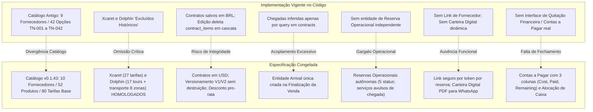
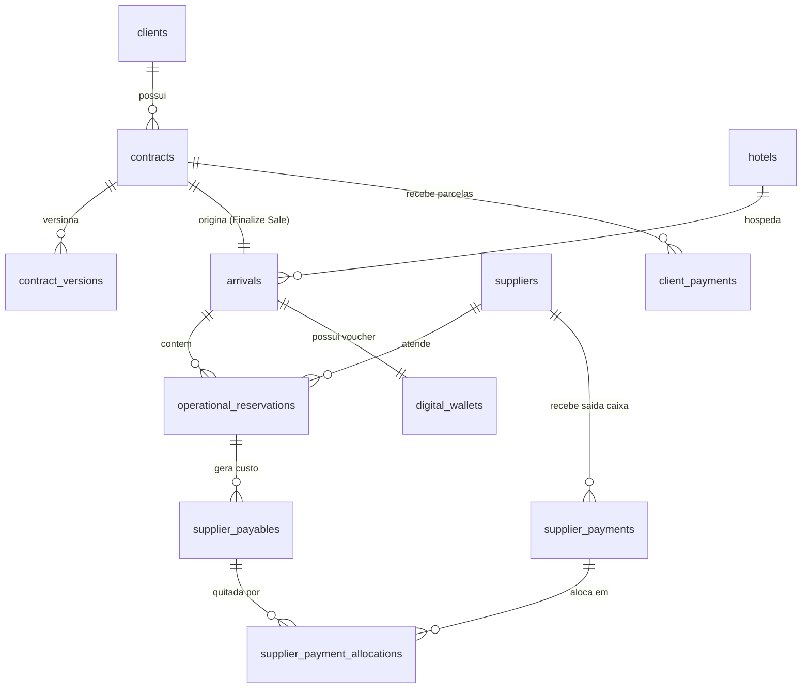
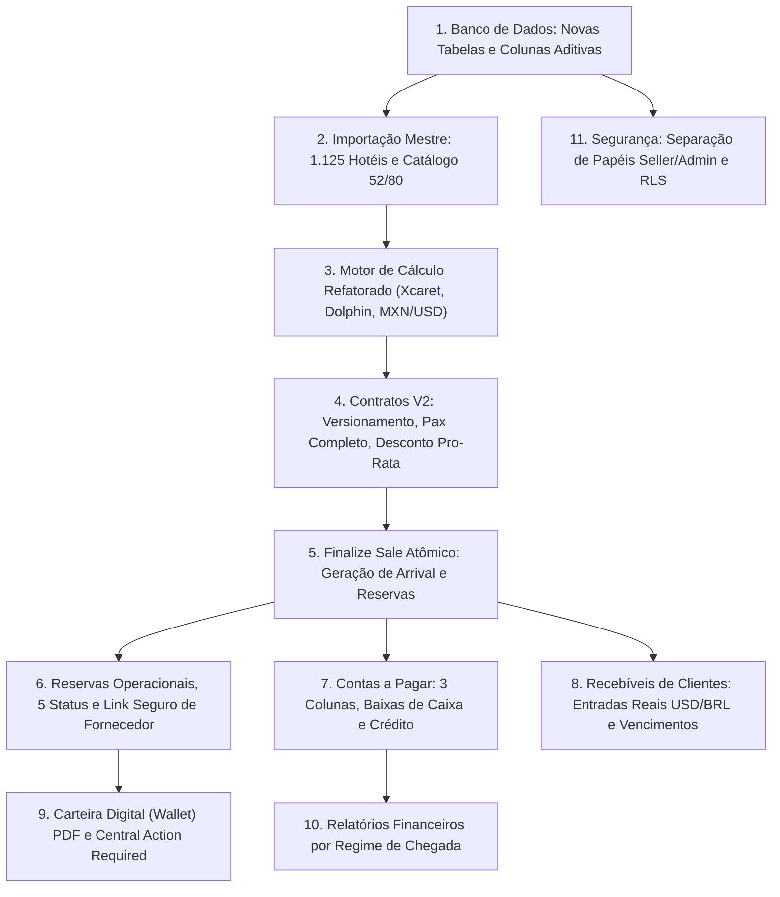

# RELATÓRIO DE ANÁLISE COMPARATIVA E GAP ANALYSIS — TÍO NENÊ

> **Documento:** Análise Comparativa do Sistema Atual vs. Requisitos Oficiais v0.1.43  
> **Data de Execução:** 21 de Outubro de 2026  
> **Status:** Relatório Técnico Exclusivo de Auditoria e Diagnóstico de Gap (Read-Only)  
> **Arquivos de Entrada:**  
> - [`AUDITORIA_SISTEMA_ATUAL_TIO_NENE.md`](file:///d:/Z_UEB/TIONENE/AUDITORIA_SISTEMA_ATUAL_TIO_NENE.md)  
> - [`ANALISE_REQUISITOS_CLIENTE_V0143.md`](file:///d:/Z_UEB/TIONENE/ANALISE_REQUISITOS_CLIENTE_V0143.md)  
> - Código-fonte da aplicação em `src/` e schemas em `supabase/` e `prisma/`  
> - Pacote de especificações em `Tio_Nene_Phase_1_v0.1.43/`

---

## 1. RESUMO EXECUTIVO

Este relatório estabelece o diagnóstico comparativo e a análise de lacunas (*Gap Analysis*) entre a aplicação web atualmente desenvolvida no repositório da **Tío Nenê** e os requisitos negociais, arquiteturais e operacionais formalizados no pacote **v0.1.43**.

A auditoria confirma que o projeto atual possui uma **fundação de interface visual e de captura comercial bem estruturada**, com módulos administrativos ricos em Next.js 15 e React 19, persistência funcional no Supabase para clientes e contratos, e um motor determinístico inicial de cálculo de custos. No entanto, existe um **abismo arquitetural e conceitual** entre o modelo de dados hoje implementado e os princípios fundamentais da v0.1.43.

### 1.1 Principais Diagnósticos Estruturais

1. **Divergência Crítica de Catálogo e Fornecedores:**
   - O sistema atual opera sobre uma especificação anterior de 9 fornecedores e 42 opções tarifárias (`TN-001` a `TN-042`), contendo o fornecedor `Puerto Maya` (que não faz parte dos 10 oficiais da v0.1.43) e marcando explicitamente `Grupo Xcaret` e `The Dolphin Company` como `'excluido_historico'` em [`supabase/migrations/20261020_supplier_catalog_v2.sql`](file:///d:/Z_UEB/TIONENE/supabase/migrations/20261020_supplier_catalog_v2.sql).
   - A v0.1.43 homologa **10 fornecedores oficiais**, **52 produtos de venda** (`seller_products`) e **80 tarifas de fornecedores** (`supplier_rates`), reintegrando Xcaret (com 27 tarifas, temporadas 2026 e regra 2027+) e Dolphin (17 experiências e transporte roundtrip em 8 zonas em USD).
2. **Incompatibilidade no Ciclo de Vida do Contrato e Risco de Perda de Dados:**
   - O sistema atual não possui versionamento de contratos (V1, V2). Ao salvar um contrato existente em [`src/app/admin/contratos/page.tsx`](file:///d:/Z_UEB/TIONENE/src/app/admin/contratos/page.tsx#L1048-L1050), executa uma operação destrutiva: `delete().eq("contract_id", id)` em `contract_items` e reinserção dos itens, o que acarreta a exclusão em cascata (`ON DELETE CASCADE`) de quaisquer registros financeiros atrelados na tabela `supplier_payment_allocations`.
   - A v0.1.43 exige imutabilidade da versão finalizada, preservação de PDFs assinados/emitidos e geração de V2 vinculada à mesma venda/chegada.
3. **Inexistência do Motor de Flexibilidade Administrativa (A "Constituição" v0.1.40):**
   - O sistema atual não possui o mecanismo de **Revisão Seletiva de Impacto (0 a todos)** (`V40-001`). Toda alteração manual é sobrescrita silenciosamente ao reabrir e salvar formulários.
   - Não há o conceito de campos persistentes (*sticky overrides*) (`V40-002`) nem a tolerância a inconsistências com alertas não bloqueantes (`V40-003`).
4. **Acoplamento entre Linha Vendida e Reserva Operacional:**
   - No sistema atual, `contract_items` acumula a função de item vendido e de reserva com fornecedor. Não existe a entidade independente de **Chegada Operacional (`arrivals`)** nem de **Reserva Operacional (`operational_reservations`)**.
   - Isso impede que a equipe adicione um serviço de transporte avulso para um passeio de iate (`ARR-003`, `SC-011`) sem alterar o contrato de venda do cliente.
5. **Módulos Ausentes na Operação Prática:**
   - **Link Seguro de Fornecedor (`RES-002`):** Inexistente. Não há rotas públicas de fornecedor nem controle de token scoped.
   - **Contas a Pagar e Baixa de Pagamentos (`PAY-008` a `PAY-013`):** [`/admin/custos-fornecedores`](file:///d:/Z_UEB/TIONENE/src/app/admin/custos-fornecedores/page.tsx) é apenas uma tela de consulta que totaliza custos de tabela. Não permite lançar saídas de caixa, abater saldos parciais, registrar adiantamentos/créditos em conta nem conciliar fornecedores.
   - **Carteira Digital do Passageiro (`WAL-001` a `WAL-008`):** As rotas [`/cliente`](file:///d:/Z_UEB/TIONENE/src/app/cliente/page.tsx) e [`/programacao-de-viagem`](file:///d:/Z_UEB/TIONENE/src/app/programacao-de-viagem/page.tsx) usam dados estáticos mockados. Não há geração dinâmica de voucher/itinerário nem controle de `Mark as Sent`.
   - **Cadastro Mestre de Hotéis (`V38-001`):** A base oficial de **1.125 hotéis** e 8 zonas canônicas não está importada no banco; estadias são salvas em JSONB sem validação cadastral.
   - **Perfis de Segurança (`SEC-001`):** Não há distinção entre **Seller** e **Admin**; a proteção atual é apenas um gate genérico de frontend via sessão do Supabase, com RLS permissivo no banco.

---

## 2. MATRIZ DE ADERÊNCIA POR REQUISITO

A matriz a seguir compara individualmente os **228 requisitos oficiais** da especificação v0.1.43 contra a implementação real do código e schemas do sistema atual.

### Critérios de Classificação:
- **JÁ IMPLEMENTADO:** Existe no código, testado e atende integralmente ao requisito.
- **PARCIALMENTE IMPLEMENTADO:** Existe no código ou schema, mas requer ajustes de regras ou integração.
- **NÃO IMPLEMENTADO:** Não existe no código nem no banco de dados; deve ser desenvolvido.
- **INCOMPATÍVEL:** A implementação atual contradiz frontalmente a regra oficial ou gera destruição de dados.
- **NÃO VERIFICADO:** Ausência de evidência verificável no código ou nas migrações locais.

### 2.1 Catálogo de Produtos e Fornecedores (`CAT`)

| ID | Descrição Oficial v0.1.43 | Status | Arquivos Envolvidos no Sistema Atual | Evidência Técnica e Justificativa |
|---|---|:---:|---|---|
| `CAT-001` | Cadastro de Fornecedor | **PARCIALMENTE IMPLEMENTADO** | [`src/app/admin/fornecedores/page.tsx`](file:///d:/Z_UEB/TIONENE/src/app/admin/fornecedores/page.tsx), [`supabase/backoffice_v1_schema.sql`](file:///d:/Z_UEB/TIONENE/supabase/backoffice_v1_schema.sql#L12) | A tabela `suppliers` e o CRUD existem, mas contêm 9 fornecedores legados (inclui Puerto Maya; omite Xcaret e Dolphin). |
| `CAT-002` | Cadastro de Passeios/Produtos | **PARCIALMENTE IMPLEMENTADO** | [`src/app/admin/passeios/page.tsx`](file:///d:/Z_UEB/TIONENE/src/app/admin/passeios/page.tsx), [`src/data/tours.ts`](file:///d:/Z_UEB/TIONENE/src/data/tours.ts) | Tabela `tours` existe no Supabase, mas a vitrine pública consome arquivo estático TypeScript; não há distinção entre produto de venda e tarifa. |
| `CAT-003` | Variações e Modalidades | **PARCIALMENTE IMPLEMENTADO** | [`src/data/supplier-catalog.ts`](file:///d:/Z_UEB/TIONENE/src/data/supplier-catalog.ts) | Existem variantes na tabela `supplier_cost_options` (TN-001 a 042), porém limitadas a 42 opções e desconectadas das 80 tarifas v0.1.43. |
| `CAT-004` | Regras de Custo Base | **PARCIALMENTE IMPLEMENTADO** | [`src/lib/cost-calculator.ts`](file:///d:/Z_UEB/TIONENE/src/lib/cost-calculator.ts) | Suporta pessoa, embarcação e van, mas não calcula tarifas por idade para bebês nem o modelo do transporte Dolphin em 8 zonas. |
| `CAT-005` | Preço de Venda Sugerido | **JÁ IMPLEMENTADO** | [`src/data/tours.ts`](file:///d:/Z_UEB/TIONENE/src/data/tours.ts), [`src/app/admin/contratos/page.tsx`](file:///d:/Z_UEB/TIONENE/src/app/admin/contratos/page.tsx#L960) | Campo `sale_price` é sugerido no formulário de contratos a partir do tour e permanece editável pelo vendedor. |
| `CAT-006` | Moeda Nativa do Fornecedor | **PARCIALMENTE IMPLEMENTADO** | [`supabase/migrations/20261020_supplier_catalog_v2.sql`](file:///d:/Z_UEB/TIONENE/supabase/migrations/20261020_supplier_catalog_v2.sql#L36) | Tabela possui campo `currency`, mas os formulários tratam custos predominantemente como USD ou BRL fixo sem projeção cambial de 16,65. |
| `CAT-007` | Inclusões e Exclusões | **PARCIALMENTE IMPLEMENTADO** | [`src/app/admin/contratos/page.tsx`](file:///d:/Z_UEB/TIONENE/src/app/admin/contratos/page.tsx#L1250) | Grava `tour_included_snapshot`, mas utiliza dados antigos e não trata aviso de pendência quando texto está vazio. |
| `CAT-008` | Dias Operacionais da Semana | **PARCIALMENTE IMPLEMENTADO** | [`src/lib/cost-calculator.ts`](file:///d:/Z_UEB/TIONENE/src/lib/cost-calculator.ts#L260-L310) | Implementa validação estrita de dias do Coco Bongo e alerta de domingo do MUSA; não implementa restrições de domingo da Xcaret 2026. |
| `CAT-009` | Base Múltipla de Custo | **PARCIALMENTE IMPLEMENTADO** | [`src/lib/cost-calculator.ts`](file:///d:/Z_UEB/TIONENE/src/lib/cost-calculator.ts#L100-L240) | Reconhece per_person, fixed_vessel, fixed_jetski e per_vehicle_leg, mas não contempla transporte per capita por zona (Dolphin). |
| `CAT-010` | Passeios Avulsos / Texto Livre | **PARCIALMENTE IMPLEMENTADO** | [`src/app/admin/contratos/page.tsx`](file:///d:/Z_UEB/TIONENE/src/app/admin/contratos/page.tsx#L850) | Permite digitar nome livre de passeio no contrato, mas força preenchimento de custo ou gera inconsistência de chave estrangeira. |
| `CAT-011` | Suporte a Temporadas Xcaret | **NÃO IMPLEMENTADO** | *Nenhum arquivo* | Xcaret está excluída do catálogo atual; inexiste motor de verificação das 6 janelas de alta temporada de 2026. |
| `CAT-012` | Operação Xcaret 2027+ | **NÃO IMPLEMENTADO** | *Nenhum arquivo* | Inexistente no sistema atual. |
| `CAT-013` | Lembrete de Atualização Xcaret | **NÃO IMPLEMENTADO** | *Nenhum arquivo* | Inexistente no sistema atual. |

### 2.2 Contratos e Vendas (`CON`)

| ID | Descrição Oficial v0.1.43 | Status | Arquivos Envolvidos no Sistema Atual | Evidência Técnica e Justificativa |
|---|---|:---:|---|---|
| `CON-001` | Dados Pessoais do Cliente | **JÁ IMPLEMENTADO** | [`src/app/admin/contratos/page.tsx`](file:///d:/Z_UEB/TIONENE/src/app/admin/contratos/page.tsx#L75-L81) | Coleta e grava nome, CPF, telefone e e-mail vinculados à tabela `clients`. |
| `CON-002` | Voo de Chegada e Partida | **JÁ IMPLEMENTADO** | [`src/app/admin/contratos/page.tsx`](file:///d:/Z_UEB/TIONENE/src/app/admin/contratos/page.tsx#L84-L87) | Campos de voo de chegada/saída (número e horário) implementados no formulário e no banco. |
| `CON-003` | Múltiplas Hospedagens com Datas | **PARCIALMENTE IMPLEMENTADO** | [`src/app/admin/contratos/page.tsx`](file:///d:/Z_UEB/TIONENE/src/app/admin/contratos/page.tsx#L44-L48) | Permite adicionar N estadias em JSONB (`hotels_schedule`), mas é texto livre não vinculado aos 1.125 hotéis mestre. |
| `CON-004` | Itens de Itinerário Vendidos | **JÁ IMPLEMENTADO** | [`src/app/admin/contratos/page.tsx`](file:///d:/Z_UEB/TIONENE/src/app/admin/contratos/page.tsx#L50-L72) | Tabela dinâmica de itens contratados com data, passeio e passageiros. |
| `CON-005` | Preço de Venda Privado por Linha | **PARCIALMENTE IMPLEMENTADO** | [`src/app/admin/contratos/page.tsx`](file:///d:/Z_UEB/TIONENE/src/app/admin/contratos/page.tsx#L1150) | O campo interno `sale_price` existe, mas no modal de impressão/PDF atual alguns modelos exibem o valor por linha para o cliente. |
| `CON-006` | Salvar e Retomar Rascunho | **PARCIALMENTE IMPLEMENTADO** | [`src/app/admin/contratos/page.tsx`](file:///d:/Z_UEB/TIONENE/src/app/admin/contratos/page.tsx#L98) | O status `rascunho` existe, mas já insere registros em `contract_items` no banco; não isola totalmente o rascunho de custos previstos. |
| `CON-007` | Finalizar Venda (*Finalize Sale*) | **INCOMPATÍVEL** | [`src/app/admin/contratos/page.tsx`](file:///d:/Z_UEB/TIONENE/src/app/admin/contratos/page.tsx#L1050) | Ação de salvar com status `emitido` não cria uma entidade `arrivals` e não separa o fechamento da venda da reserva com fornecedor. |
| `CON-008` | Versionamento de Contrato | **INCOMPATÍVEL** | [`src/app/admin/contratos/page.tsx`](file:///d:/Z_UEB/TIONENE/src/app/admin/contratos/page.tsx#L1044-L1050) | O sistema atual edita o contrato *in-place*, sobrescrevendo os dados anteriores e excluindo os itens antigos (`delete().eq()`). |
| `CON-009` | Revisão Seletiva de Impacto | **INCOMPATÍVEL** | [`src/app/admin/contratos/page.tsx`](file:///d:/Z_UEB/TIONENE/src/app/admin/contratos/page.tsx#L1049) | Não há tela ou modal de impacto seletivo (0 a todos). Os itens são compulsoriamente apagados e recriados. |
| `CON-010` | Upload de Contrato Assinado | **NÃO IMPLEMENTADO** | *Nenhum arquivo* | Apenas existe o status textual `'assinado'`. Não há componente de upload de arquivo nem storage para anexar o PDF assinado. |
| `CON-011` | Acesso Compartilhado de Vendedores | **JÁ IMPLEMENTADO** | [`src/app/admin/contratos/page.tsx`](file:///d:/Z_UEB/TIONENE/src/app/admin/contratos/page.tsx#L320) | Todos os contratos cadastrados são listados para qualquer usuário logado no painel administrativo. |
| `CON-012` | Pax Detalhado por Passeio | **PARCIALMENTE IMPLEMENTADO** | [`src/app/admin/contratos/page.tsx`](file:///d:/Z_UEB/TIONENE/src/app/admin/contratos/page.tsx#L55-L56) | Coleta adultos e crianças por linha, mas **não possui campo para bebês (*infants_count*)** por item de passeio. |
| `CON-013` | Desconto Global Pro-Rata | **NÃO IMPLEMENTADO** | [`src/app/admin/contratos/page.tsx`](file:///d:/Z_UEB/TIONENE/src/app/admin/contratos/page.tsx#L970) | O formulário apenas soma os preços das linhas no `total_amount`; não possui campo de desconto global nem rateio pro-rata. |
| `CON-014` | Geração de PDF em Português | **PARCIALMENTE IMPLEMENTADO** | [`src/app/admin/contratos/page.tsx`](file:///d:/Z_UEB/TIONENE/src/app/admin/contratos/page.tsx#L105-L144) | As 18 cláusulas em português estão no código e há impressão via navegador (`window.print()`), mas não há motor de geração de PDF DOCX server-side. |
| `CON-015` | Finalização com Custo Desconhecido | **INCOMPATÍVEL** | [`src/app/admin/contratos/page.tsx`](file:///d:/Z_UEB/TIONENE/src/app/admin/contratos/page.tsx#L980) | Quando o custo não é encontrado, o código fixa `cost_applied = 0` e `calculated_total_cost = 0`, mascarando o custo real como gratuito. |

### 2.3 Chegadas e Itinerários Operacionais (`ARR`)

| ID | Descrição Oficial v0.1.43 | Status | Arquivos Envolvidos no Sistema Atual | Evidência Técnica e Justificativa |
|---|---|:---:|---|---|
| `ARR-001` | Registro Único de Chegada | **INCOMPATÍVEL** | [`src/app/admin/chegadas/page.tsx`](file:///d:/Z_UEB/TIONENE/src/app/admin/chegadas/page.tsx#L85-L105) | Não existe tabela `arrivals`. O sistema busca diretamente contratos filtrando pela coluna `contracts.arrival_date`. |
| `ARR-002` | Vinculação Dinâmica de Hotel | **NÃO IMPLEMENTADO** | [`src/app/admin/contratos/page.tsx`](file:///d:/Z_UEB/TIONENE/src/app/admin/contratos/page.tsx) | Não cruza a data do passeio com os intervalos de check-in/out das hospedagens para atribuir o hotel do dia. |
| `ARR-003` | Inclusão de Serviços Operacionais | **INCOMPATÍVEL** | [`src/app/admin/chegadas/page.tsx`](file:///d:/Z_UEB/TIONENE/src/app/admin/chegadas/page.tsx) | A tela de chegadas é estritamente de leitura. Não permite adicionar serviços operacionais independentes do contrato. |
| `ARR-004` | Painel Hoje e Amanhã | **PARCIALMENTE IMPLEMENTADO** | [`src/app/admin/chegadas/page.tsx`](file:///d:/Z_UEB/TIONENE/src/app/admin/chegadas/page.tsx) | Visão em calendário mensal que agrupa por dia; não possui filtros dedicados para visão rápida "Hoje / Amanhã". |
| `ARR-005` | Alerta de Alteração de Venda | **NÃO IMPLEMENTADO** | *Nenhum arquivo* | Não existe a flag visual `Changed / Needs Attention` no sistema atual. |

### 2.4 Reservas com Fornecedores (`RES`)

| ID | Descrição Oficial v0.1.43 | Status | Arquivos Envolvidos no Sistema Atual | Evidência Técnica e Justificativa |
|---|---|:---:|---|---|
| `RES-001` | Reserva Operacional por Serviço | **INCOMPATÍVEL** | [`src/app/admin/contratos/page.tsx`](file:///d:/Z_UEB/TIONENE/src/app/admin/contratos/page.tsx) | A "reserva" é o próprio `contract_item`. A tela legada [`/admin/reservas`](file:///d:/Z_UEB/TIONENE/src/app/admin/reservas/page.tsx) foi abandonada e aponta para tabela inexistente. |
| `RES-002` | Link Único de Fornecedor | **NÃO IMPLEMENTADO** | *Nenhum arquivo* | Não há rota externa, geração de token nem página web para o fornecedor. |
| `RES-003` | Salvar Detalhes no Link | **NÃO IMPLEMENTADO** | *Nenhum arquivo* | Inexistente no sistema atual. |
| `RES-004` | Cinco Status de Reserva | **INCOMPATÍVEL** | [`supabase/backoffice_v1_schema.sql`](file:///d:/Z_UEB/TIONENE/supabase/backoffice_v1_schema.sql#L102) | Usa status `'agendado'`, `'confirmado_fornecedor'`, `'realizado'`, `'cancelado'`. Não contempla `Not Requested` nem `Awaiting Confirmation`. |
| `RES-005` | Confirmação Manual (WhatsApp) | **PARCIALMENTE IMPLEMENTADO** | [`src/app/admin/contratos/page.tsx`](file:///d:/Z_UEB/TIONENE/src/app/admin/contratos/page.tsx) | Pode-se mudar o status do item manualmente, mas apenas dentro do formulário geral do contrato. |
| `RES-006` | Indicador "Staff Reviewed" | **NÃO IMPLEMENTADO** | *Nenhum arquivo* | Não existe campo booleano de revisão de equipe independente do status do fornecedor. |
| `RES-007` | Ação "Mark as Requested" | **NÃO IMPLEMENTADO** | *Nenhum arquivo* | Inexistente no sistema atual. |
| `RES-008` | Alteração Manual de Reserva | **PARCIALMENTE IMPLEMENTADO** | [`src/app/admin/contratos/page.tsx`](file:///d:/Z_UEB/TIONENE/src/app/admin/contratos/page.tsx) | Pode ser editado no contrato, mas sem seleção de impacto nos outros módulos. |
| `RES-009` | Exclusão de Reserva Operacional | **INCOMPATÍVEL** | [`src/app/admin/contratos/page.tsx`](file:///d:/Z_UEB/TIONENE/src/app/admin/contratos/page.tsx#L1049) | Excluir item apaga em cascata os registros financeiros da tabela `supplier_payment_allocations`. |
| `RES-010` | Reserva de Serviço Fora do Catálogo | **PARCIALMENTE IMPLEMENTADO** | [`src/app/admin/contratos/page.tsx`](file:///d:/Z_UEB/TIONENE/src/app/admin/contratos/page.tsx) | Permite nome livre, mas não vincula fornecedor manual de forma independente. |
| `RES-011` | Confirmação via Link | **NÃO IMPLEMENTADO** | *Nenhum arquivo* | Inexistente no sistema atual. |
| `RES-012` | Revogação de Link de Fornecedor | **NÃO IMPLEMENTADO** | *Nenhum arquivo* | Inexistente no sistema atual. |
| `RES-013` | Não Bloqueio por Falta de Confirmação | **JÁ IMPLEMENTADO** | [`src/app/admin/contratos/page.tsx`](file:///d:/Z_UEB/TIONENE/src/app/admin/contratos/page.tsx) | Contratos e itens existem e são manipuláveis mesmo se não confirmados pelo fornecedor. |
| `RES-014` | Tratamento de Indisponibilidade | **NÃO IMPLEMENTADO** | *Nenhum arquivo* | Não existe o status formal `Unable to Confirm` com fila de ação rápida. |
| `RES-015` | Notificação de Cancelamento Externo | **NÃO IMPLEMENTADO** | *Nenhum arquivo* | Não emite aviso ao operador alertando sobre cancelamento externo junto ao fornecedor. |
| `RES-016` | Preservação de Histórico de Reserva | **INCOMPATÍVEL** | [`src/app/admin/contratos/page.tsx`](file:///d:/Z_UEB/TIONENE/src/app/admin/contratos/page.tsx#L1049) | Itens são deletados e reinseridos, destruindo chaves primárias e histórico. |
| `RES-017` | Alocação de Veículo/Guia | **PARCIALMENTE IMPLEMENTADO** | [`src/app/admin/contratos/page.tsx`](file:///d:/Z_UEB/TIONENE/src/app/admin/contratos/page.tsx#L63) | Possui campo genérico `voucher_ref` e `notes`, mas não campos dedicados a veículo/guia. |
| `RES-018` | Código Único Permanente de Reserva | **INCOMPATÍVEL** | [`src/app/admin/contratos/page.tsx`](file:///d:/Z_UEB/TIONENE/src/app/admin/contratos/page.tsx) | Não gera código único amigável por reserva; os UUIDs mudam a cada edição do contrato. |
| `RES-019` | Herança de Pax por Linha | **PARCIALMENTE IMPLEMENTADO** | [`src/app/admin/contratos/page.tsx`](file:///d:/Z_UEB/TIONENE/src/app/admin/contratos/page.tsx#L88-L90) | Herda contagem de adultos e crianças do cabeçalho, mas não contempla bebês na linha. |
| `RES-020` | Override de Local de Pickup | **NÃO IMPLEMENTADO** | *Nenhum arquivo* | Não existe campo de pickup específico por reserva desvinculado do hotel do contrato. |

### 2.5 Contas a Pagar e Custos de Fornecedores (`PAY`)

| ID | Descrição Oficial v0.1.43 | Status | Arquivos Envolvidos no Sistema Atual | Evidência Técnica e Justificativa |
|---|---|:---:|---|---|
| `PAY-001` | Registro de Custo Previsto (*Planned*) | **PARCIALMENTE IMPLEMENTADO** | [`src/app/admin/contratos/page.tsx`](file:///d:/Z_UEB/TIONENE/src/app/admin/contratos/page.tsx#L1070) | Grava `cost_applied` e `calculated_total_cost` em `contract_items`, mas sem status explícito `Planned`. |
| `PAY-002` | Painel Agrupado por Fornecedor | **PARCIALMENTE IMPLEMENTADO** | [`src/app/admin/custos-fornecedores/page.tsx`](file:///d:/Z_UEB/TIONENE/src/app/admin/custos-fornecedores/page.tsx#L311-L355) | Permite filtrar custos por fornecedor e mês do passeio, mas funciona apenas como extrato de consulta. |
| `PAY-003` | Override Manual de Custo na Linha | **PARCIALMENTE IMPLEMENTADO** | [`src/app/admin/contratos/page.tsx`](file:///d:/Z_UEB/TIONENE/src/app/admin/contratos/page.tsx#L985) | O operador pode digitar o custo na emissão do contrato, mas não em tela financeira dedicada de contas a pagar. |
| `PAY-004` | Três Colunas Financeiras Claras | **INCOMPATÍVEL** | [`src/app/admin/custos-fornecedores/page.tsx`](file:///d:/Z_UEB/TIONENE/src/app/admin/custos-fornecedores/page.tsx#L375-L385) | A tabela atual exibe apenas Custo Unitário e Custo Total. **Não exibe Valor Pago nem Saldo Devedor**. |
| `PAY-005` | Despesas Avulsas / Operacionais | **NÃO IMPLEMENTADO** | *Nenhum arquivo* | Não permite lançar despesas operacionais avulsas (Uber, taxas) desvinculadas de itens de contrato. |
| `PAY-006` | Custo de Transporte Manual de Iate | **NÃO IMPLEMENTADO** | *Nenhum arquivo* | Não há suporte para criar despesa independente de van atrelada a uma reserva de barco. |
| `PAY-007` | Vinculação Atômica com a Reserva | **PARCIALMENTE IMPLEMENTADO** | [`supabase/migrations/20261020_supplier_catalog_v2.sql`](file:///d:/Z_UEB/TIONENE/supabase/migrations/20261020_supplier_catalog_v2.sql#L137) | FK existe no banco, mas é apagada pela exclusão de `contract_items` ao editar contratos. |
| `PAY-008` | Pagamento Real de Fornecedor | **NÃO IMPLEMENTADO** | *Nenhum arquivo* | A tabela `supplier_payments` existe no schema SQL, mas **não há nenhuma interface ou tela** para lançar saídas reais de caixa. |
| `PAY-009` | Alocação Multi-Reserva | **NÃO IMPLEMENTADO** | *Nenhum arquivo* | A tabela `supplier_payment_allocations` existe no DDL, mas inexiste tela para alocar um pagamento em múltiplas reservas. |
| `PAY-010` | Pagamento Parcial de Reserva | **NÃO IMPLEMENTADO** | *Nenhum arquivo* | Não há implementação de abatimento parcial de reservas no código. |
| `PAY-011` | Pagamento Antecipado / Crédito | **NÃO IMPLEMENTADO** | *Nenhum arquivo* | Não há controle de saldo credor ou adiantamentos a fornecedores. |
| `PAY-012` | Alocação Posterior de Crédito | **NÃO IMPLEMENTADO** | *Nenhum arquivo* | Inexistente no sistema atual. |
| `PAY-013` | Liberação de Alocação para Crédito | **NÃO IMPLEMENTADO** | *Nenhum arquivo* | Inexistente no sistema atual. |
| `PAY-014` | Registro de Reembolso de Fornecedor | **NÃO IMPLEMENTADO** | *Nenhum arquivo* | Inexistente no sistema atual. |
| `PAY-015` | Ajuste de Taxa de Cancelamento | **NÃO IMPLEMENTADO** | *Nenhum arquivo* | Não permite definir custo de cancelamento na linha a pagar sem alterar o contrato do cliente. |
| `PAY-016` | Oferta de Liberação de Excesso | **NÃO IMPLEMENTADO** | *Nenhum arquivo* | Inexistente no sistema atual. |
| `PAY-017` | Preservação de Saídas de Caixa | **INCOMPATÍVEL** | [`supabase/migrations/20261020_supplier_catalog_v2.sql`](file:///d:/Z_UEB/TIONENE/supabase/migrations/20261020_supplier_catalog_v2.sql#L137) | O `ON DELETE CASCADE` de `contract_items` em `supplier_payment_allocations` destrói as alocações vinculadas. |
| `PAY-018` | Quitação por Saldo Devedor | **NÃO IMPLEMENTADO** | *Nenhum arquivo* | Inexistente no sistema atual. |
| `PAY-019` | Notas em Pagamentos de Fornecedor | **NÃO IMPLEMENTADO** | *Nenhum arquivo* | Não há formulário de pagamento para inserção de notas. |
| `PAY-020` | Proibição de Saldo Negativo Falso | **NÃO VERIFICADO** | *Nenhum arquivo* | Como não há cálculo de saldo devedor nem pagamento, a regra não se aplica ao código atual. |
| `PAY-021` | Motor de Tarifas Parametrizado | **PARCIALMENTE IMPLEMENTADO** | [`src/lib/cost-calculator.ts`](file:///d:/Z_UEB/TIONENE/src/lib/cost-calculator.ts) | Implementa fórmulas de adulto/criança, van (Miguel) e jet ski, mas não cobre as 80 tarifas completas da v0.1.43. |
| `PAY-022` | Moeda Nativa e Projeção USD | **NÃO IMPLEMENTADO** | *Nenhum arquivo* | Não mantém o valor em MXN nativo com projeção fixa de 16,65 para Playa Mía; trata tudo em moeda única. |
| `PAY-023` | Taxa de Câmbio de Planejamento | **NÃO IMPLEMENTADO** | *Nenhum arquivo* | Não há parâmetro configurável de taxa de câmbio de planejamento no sistema. |
| `PAY-024` | Gestão de Custo Desconhecido | **INCOMPATÍVEL** | [`src/app/admin/contratos/page.tsx`](file:///d:/Z_UEB/TIONENE/src/app/admin/contratos/page.tsx#L980) | Custos desconhecidos são gravados como 0, mascarando a pendência e distorcendo a margem financeira. |

### 2.6 Recebíveis e Pagamentos de Clientes (`REC`)

| ID | Descrição Oficial v0.1.43 | Status | Arquivos Envolvidos no Sistema Atual | Evidência Técnica e Justificativa |
|---|---|:---:|---|---|
| `REC-001` | Contas a Receber por Contrato | **PARCIALMENTE IMPLEMENTADO** | [`src/app/admin/contratos/page.tsx`](file:///d:/Z_UEB/TIONENE/src/app/admin/contratos/page.tsx#L92-L96) | O contrato possui colunas `total_amount`, `deposit_amount` e `balance_amount`, mas é estático e em BRL. |
| `REC-002` | Registro Manual de Recebimento | **NÃO IMPLEMENTADO** | *Nenhum arquivo* | Não existe tabela de lançamentos de recebíveis de clientes; não é possível registrar recebimentos reais com data e comprovante. |
| `REC-003` | Conversão Explícita de BRL | **NÃO IMPLEMENTADO** | *Nenhum arquivo* | Não permite informar valor em BRL e crédito fixo em USD no recebimento. |
| `REC-004` | Múltiplas Parcelas / Saldo em Cancún | **INCOMPATÍVEL** | [`src/app/admin/contratos/page.tsx`](file:///d:/Z_UEB/TIONENE/src/app/admin/contratos/page.tsx#L92-L96) | O schema suporta apenas duas posições fixas: `deposit_amount` (30%) e `balance_amount` (70%). Não suporta N parcelas. |
| `REC-005` | Registro de Sinal na Finalização | **PARCIALMENTE IMPLEMENTADO** | [`src/app/admin/contratos/page.tsx`](file:///d:/Z_UEB/TIONENE/src/app/admin/contratos/page.tsx#L92) | O valor de sinal é digitado no formulário, mas é tratado como termo contratual acordado, não como lançamento de entrada de caixa. |
| `REC-006` | Registro Tardio de Sinal/Pagamento | **INCOMPATÍVEL** | [`src/app/admin/contratos/page.tsx`](file:///d:/Z_UEB/TIONENE/src/app/admin/contratos/page.tsx) | Para atualizar o sinal pago depois, é obrigatório reabrir o contrato e salvá-lo, o que recria os itens e quebra o histórico. |
| `REC-007` | Vencimento Padrão do Saldo | **PARCIALMENTE IMPLEMENTADO** | [`src/app/admin/chegadas/page.tsx`](file:///d:/Z_UEB/TIONENE/src/app/admin/chegadas/page.tsx) | Exibe se o saldo está pendente na chegada, mas não calcula o vencimento oficial na véspera nem controla atraso formal. |
| `REC-008` | Ajuste Manual de Vencimento | **NÃO IMPLEMENTADO** | *Nenhum arquivo* | Não permite sobrescrever a data combinada de vencimento do saldo do cliente. |

### 2.7 Relatórios e Visões Financeiras (`FIN`)

| ID | Descrição Oficial v0.1.43 | Status | Arquivos Envolvidos no Sistema Atual | Evidência Técnica e Justificativa |
|---|---|:---:|---|---|
| `FIN-001` | Receita Bruta por Período | **PARCIALMENTE IMPLEMENTADO** | [`src/app/admin/page.tsx`](file:///d:/Z_UEB/TIONENE/src/app/admin/page.tsx) | Totaliza valores de contratos no dashboard principal, mas sem filtros analíticos avançados por período. |
| `FIN-002` | Margem por Fornecedor e Passeio | **NÃO IMPLEMENTADO** | *Nenhum arquivo* | Não calcula a margem líquida por passeio deduzindo custo de fornecedor do preço rateado com desconto. |
| `FIN-003` | Status Financeiro: Previsto vs Pago | **NÃO IMPLEMENTADO** | *Nenhum arquivo* | Não há distinção contábil entre custos previstos e saídas efetivas de caixa na interface. |
| `FIN-004` | Painel de Inadimplência de Clientes | **PARCIALMENTE IMPLEMENTADO** | [`src/app/admin/chegadas/page.tsx`](file:///d:/Z_UEB/TIONENE/src/app/admin/chegadas/page.tsx) | Exibe tag de saldo pendente no calendário de chegadas, mas sem relatório dedicado de cobrança e aging. |
| `FIN-005` | Saldo em Aberto com Fornecedores | **INCOMPATÍVEL** | [`src/app/admin/custos-fornecedores/page.tsx`](file:///d:/Z_UEB/TIONENE/src/app/admin/custos-fornecedores/page.tsx) | A tela apenas soma os custos de tabela; como não há registro de pagamentos, não sabe o saldo real em aberto. |
| `FIN-006` | Alocação de Desconto nos Relatórios | **NÃO IMPLEMENTADO** | *Nenhum arquivo* | Não há rateio de desconto pro-rata implementado. |
| `FIN-007` | Relatório de Câmbio e Custos MXN | **NÃO IMPLEMENTADO** | *Nenhum arquivo* | Inexistente no sistema atual. |
| `FIN-008` | Regime de Competência por Chegada | **INCOMPATÍVEL** | [`src/app/admin/custos-fornecedores/page.tsx`](file:///d:/Z_UEB/TIONENE/src/app/admin/custos-fornecedores/page.tsx#L80) | Filtra despesas pela **data de realização do passeio (`tour_date`)**, contrariando o regime de competência de chegada do cliente (`arrival_date`). |
| `FIN-009` | Sinalização de Margem Incompleta | **NÃO IMPLEMENTADO** | *Nenhum arquivo* | Não alerta relatórios sobre passeios com custos pendentes de cotação. |

### 2.8 Voucher / Carteira Digital do Passageiro (`WAL`)

| ID | Descrição Oficial v0.1.43 | Status | Arquivos Envolvidos no Sistema Atual | Evidência Técnica e Justificativa |
|---|---|:---:|---|---|
| `WAL-001` | Carteira Digital do Cliente | **PARCIALMENTE IMPLEMENTADO** | [`src/app/cliente/page.tsx`](file:///d:/Z_UEB/TIONENE/src/app/cliente/page.tsx), [`src/app/programacao-de-viagem/page.tsx`](file:///d:/Z_UEB/TIONENE/src/app/programacao-de-viagem/page.tsx) | O layout visual moderno e elegante existe nas telas públicas, mas consome dados estáticos mockados ([`src/data/mock-client-2.ts`](file:///d:/Z_UEB/TIONENE/src/data/mock-client-2.ts)). |
| `WAL-002` | Contagem de Passageiros por Passeio | **PARCIALMENTE IMPLEMENTADO** | [`src/app/programacao-de-viagem/page.tsx`](file:///d:/Z_UEB/TIONENE/src/app/programacao-de-viagem/page.tsx) | Exibe passageiros nos cards mockados, mas não consome o banco real nem separa bebês por passeio. |
| `WAL-003` | Edição Independente do Voucher | **NÃO IMPLEMENTADO** | *Nenhum arquivo* | Não há interface administrativa para ajustar textos ou dicas da carteira sem alterar a reserva. |
| `WAL-004` | Visão Única Atual | **NÃO IMPLEMENTADO** | *Nenhum arquivo* | Não há tela administrativa para gerenciar o voucher atual de cada chegada. |
| `WAL-005` | Exportação com Status Pendente | **NÃO IMPLEMENTADO** | *Nenhum arquivo* | Não gera PDF exportável da carteira digital para envio por WhatsApp. |
| `WAL-006` | Ação "Mark as Sent" | **NÃO IMPLEMENTADO** | *Nenhum arquivo* | Inexistente no sistema atual. |
| `WAL-007` | Alerta "Wallet Update Needed" | **NÃO IMPLEMENTADO** | *Nenhum arquivo* | Inexistente no sistema atual. |
| `WAL-008` | Preservação de Links e Vouchers | **NÃO IMPLEMENTADO** | *Nenhum arquivo* | Inexistente no sistema atual. |

### 2.9 Traslados e Transportes (`TRF`)

| ID | Descrição Oficial v0.1.43 | Status | Arquivos Envolvidos no Sistema Atual | Evidência Técnica e Justificativa |
|---|---|:---:|---|---|
| `TRF-001` | Transfer Aeroporto (Miguel Shuttle) | **PARCIALMENTE IMPLEMENTADO** | [`src/lib/cost-calculator.ts`](file:///d:/Z_UEB/TIONENE/src/lib/cost-calculator.ts#L170-L195) | Implementa precificação por van por zona baseada nas opções antigas TN-037 a TN-041. |
| `TRF-002` | Override de Zona por Reserva | **NÃO IMPLEMENTADO** | *Nenhum arquivo* | Não permite alterar a zona tarifária de um hotel para um fornecedor específico na reserva. |
| `TRF-003` | Independência da Zona Mestre | **NÃO VERIFICADO** | *Nenhum arquivo* | Como não há cadastro mestre de hotéis nem override de zona, a regra não tem efeito prático. |
| `TRF-004` | Ajuste Exclusivo de Custo de Transfer | **PARCIALMENTE IMPLEMENTADO** | [`src/app/admin/contratos/page.tsx`](file:///d:/Z_UEB/TIONENE/src/app/admin/contratos/page.tsx#L985) | O custo pode ser alterado na linha do contrato, mas sem separação de ida e volta. |
| `TRF-005` | Traslado de Ida e Volta Separados | **INCOMPATÍVEL** | [`src/lib/cost-calculator.ts`](file:///d:/Z_UEB/TIONENE/src/lib/cost-calculator.ts#L174) | Utiliza o parâmetro `legsCount = 2` que apenas multiplica o valor na mesma linha, em vez de criar 2 reservas operacionais distintas. |
| `TRF-006` | Capacidade Máxima do Veículo | **JÁ IMPLEMENTADO** | [`src/lib/cost-calculator.ts`](file:///d:/Z_UEB/TIONENE/src/lib/cost-calculator.ts#L178) | Aplica a regra de no máximo 7 passageiros por veículo: `Math.ceil(pax / 7)`. |
| `TRF-007` | Transporte Dolphin Integrado | **NÃO IMPLEMENTADO** | *Nenhum arquivo* | Inexistente no sistema atual (Dolphin estava excluída). |
| `TRF-008` | Transporte Dolphin Opcional (*Opt-out*) | **NÃO IMPLEMENTADO** | *Nenhum arquivo* | Inexistente no sistema atual. |
| `TRF-009` | Transporte Dolphin por Categoria de Idade | **NÃO IMPLEMENTADO** | *Nenhum arquivo* | Inexistente no sistema atual. |
| `TRF-010` | Alerta de Cobertura Sul Dolphin | **NÃO IMPLEMENTADO** | *Nenhum arquivo* | Inexistente no sistema atual. |
| `TRF-011` | Transporte Adicionado a Iate Privado | **NÃO IMPLEMENTADO** | *Nenhum arquivo* | Inexistente no sistema atual. |
| `TRF-012` | Regras de Embarque Playa Mía | **PARCIALMENTE IMPLEMENTADO** | [`src/data/supplier-catalog.ts`](file:///d:/Z_UEB/TIONENE/src/data/supplier-catalog.ts#L715) | Contém as opções antigas TN-033 a TN-035, mas não implementa a regra estrita de saída manual de Cozumel (`PLY-R003`). |

### 2.10 Painéis e Operações Diárias (`OPS`)

| ID | Descrição Oficial v0.1.43 | Status | Arquivos Envolvidos no Sistema Atual | Evidência Técnica e Justificativa |
|---|---|:---:|---|---|
| `OPS-001` | Painel de Controle de Chegadas | **PARCIALMENTE IMPLEMENTADO** | [`src/app/admin/chegadas/page.tsx`](file:///d:/Z_UEB/TIONENE/src/app/admin/chegadas/page.tsx) | Ledger mensal por ano/mês com listagem de clientes e voos. Falta visão executiva de próximos 7 dias. |
| `OPS-002` | Painel de Ações Pendentes (*Action Required*) | **NÃO IMPLEMENTADO** | *Nenhum arquivo* | Não existe central unificada de tarefas pendentes operacionais. |
| `OPS-003` | Filtro por Fornecedor e Data | **PARCIALMENTE IMPLEMENTADO** | [`src/app/admin/custos-fornecedores/page.tsx`](file:///d:/Z_UEB/TIONENE/src/app/admin/custos-fornecedores/page.tsx) | Filtra por fornecedor no mês; falta extração de lista de passageiros para despacho no WhatsApp. |
| `OPS-004` | Independência de Revisão da Equipe | **NÃO VERIFICADO** | *Nenhum arquivo* | Como não há indicador de Staff Review, não há como medir essa independência. |
| `OPS-005` | Alerta de Reservas Não Solicitadas | **NÃO IMPLEMENTADO** | *Nenhum arquivo* | Inexistente no sistema atual. |
| `OPS-006` | Alerta de Falha de Confirmação | **NÃO IMPLEMENTADO** | *Nenhum arquivo* | Inexistente no sistema atual. |
| `OPS-007` | Alerta de Alteração de Venda | **NÃO IMPLEMENTADO** | *Nenhum arquivo* | Inexistente no sistema atual. |
| `OPS-008` | Alerta de Saldo Devedor de Cliente | **PARCIALMENTE IMPLEMENTADO** | [`src/app/admin/chegadas/page.tsx`](file:///d:/Z_UEB/TIONENE/src/app/admin/chegadas/page.tsx#L500) | Exibe etiqueta de saldo pendente, mas sem alerta vermelho destacado para chegadas de hoje e amanhã. |
| `OPS-009` | Alerta de Voucher Não Enviado | **NÃO IMPLEMENTADO** | *Nenhum arquivo* | Inexistente no sistema atual. |
| `OPS-010` | Alerta de Voucher Desatualizado | **NÃO IMPLEMENTADO** | *Nenhum arquivo* | Inexistente no sistema atual. |
| `OPS-011` | Fila de Custos Pendentes (*Cost Required*) | **INCOMPATÍVEL** | [`src/app/admin/contratos/page.tsx`](file:///d:/Z_UEB/TIONENE/src/app/admin/contratos/page.tsx#L980) | Custos pendentes viram 0 automaticamente, em vez de alimentarem uma fila de cotação obrigatória. |
| `OPS-012` | Alerta de Temporada Xcaret 2026 | **NÃO IMPLEMENTADO** | *Nenhum arquivo* | Inexistente no sistema atual. |
| `OPS-013` | Alerta Anual Xcaret 2027+ | **NÃO IMPLEMENTADO** | *Nenhum arquivo* | Inexistente no sistema atual. |

### 2.11 Segurança, Permissões e Auditoria (`SEC`)

| ID | Descrição Oficial v0.1.43 | Status | Arquivos Envolvidos no Sistema Atual | Evidência Técnica e Justificativa |
|---|---|:---:|---|---|
| `SEC-001` | Apenas Dois Papéis: Seller e Admin | **NÃO IMPLEMENTADO** | [`src/app/admin/layout.tsx`](file:///d:/Z_UEB/TIONENE/src/app/admin/layout.tsx#L70-L85) | Apenas verifica se `session` existe no Supabase. Não há diferenciação entre Seller e Admin nem na UI nem no banco. |
| `SEC-002` | Permissões do Vendedor (*Seller*) | **NÃO IMPLEMENTADO** | *Nenhum arquivo* | Vendedores têm acesso total ou nenhum acesso; não há restrição de acesso ao contas a pagar e configurações. |
| `SEC-003` | Permissões do Administrador (*Admin*) | **PARCIALMENTE IMPLEMENTADO** | [`src/app/admin/layout.tsx`](file:///d:/Z_UEB/TIONENE/src/app/admin/layout.tsx) | O papel atual é genericamente administrativo para qualquer usuário autenticado. |
| `SEC-004` | Proteção de Dados no Link de Fornecedor | **NÃO IMPLEMENTADO** | *Nenhum arquivo* | Não há link de fornecedor implementado. |
| `SEC-005` | Armazenamento Seguro de Documentos | **INCOMPATÍVEL** | [`supabase/backoffice_v1_schema.sql`](file:///d:/Z_UEB/TIONENE/supabase/backoffice_v1_schema.sql#L151-L175) | As políticas RLS do Supabase utilizam `USING (true)`, permitindo leitura e gravação anônima irrestrita. |

### 2.12 Observações e Notas (`NOTE`)

| ID | Descrição Oficial v0.1.43 | Status | Arquivos Envolvidos no Sistema Atual | Evidência Técnica e Justificativa |
|---|---|:---:|---|---|
| `NOTE-001` | Campo de Notas Leves e Opcionais | **PARCIALMENTE IMPLEMENTADO** | [`src/app/admin/contratos/page.tsx`](file:///d:/Z_UEB/TIONENE/src/app/admin/contratos/page.tsx#L100) | O contrato possui `internal_notes`, mas não há notas leves em saídas financeiras, recebimentos e reservas. |

### 2.13 Adições Aprovadas v0.1.38 a v0.1.40 (`V38`, `V39`, `V40`)

| ID | Descrição Oficial v0.1.43 | Status | Arquivos Envolvidos no Sistema Atual | Evidência Técnica e Justificativa |
|---|---|:---:|---|---|
| `V38-001` | Importação Mestre de 1.125 Hotéis | **NÃO IMPLEMENTADO** | *Nenhum arquivo* | Os 1.125 hotéis de `Ultimate_Tio_Nene_Hotels_Two_Columns.xlsx` não estão no banco. |
| `V38-002` | Desconto Contratual Pro-Rata | **NÃO IMPLEMENTADO** | *Nenhum arquivo* | Não há campo de desconto total nem divisão proporcional entre os passeios. |
| `V38-003` | Contagem Obrigatória de Pax por Linha | **INCOMPATÍVEL** | [`src/app/admin/contratos/page.tsx`](file:///d:/Z_UEB/TIONENE/src/app/admin/contratos/page.tsx#L50-L72) | Não possui campo para bebês na linha de passeio; omite a categoria infantil de colo no cálculo. |
| `V38-004` | Template DOCX de 18 Cláusulas | **PARCIALMENTE IMPLEMENTADO** | [`src/app/admin/contratos/page.tsx`](file:///d:/Z_UEB/TIONENE/src/app/admin/contratos/page.tsx#L105-L144) | O texto das 18 cláusulas está no código em `DEFAULT_TERMS`, mas impresso via HTML simples, não DOCX. |
| `V38-005` | Capacidade e Unidade Jet Ski | **JÁ IMPLEMENTADO** | [`src/lib/cost-calculator.ts`](file:///d:/Z_UEB/TIONENE/src/lib/cost-calculator.ts#L150-L165) | Aplica a fórmula de unidades de moto aquática: `Math.ceil(passengers / 2)`. |
| `V38-006` | Catálogo Dolphin Homologado | **NÃO IMPLEMENTADO** | *Nenhum arquivo* | Dolphin está excluída no sistema atual. |
| `V38-007` | Exclusão de Recálculo Retroativo | **PARCIALMENTE IMPLEMENTADO** | [`src/app/admin/contratos/page.tsx`](file:///d:/Z_UEB/TIONENE/src/app/admin/contratos/page.tsx#L1060) | Grava snapshots de texto na emissão, mas a reedição do contrato recalcula os valores destruindo snapshots. |
| `V38-008` | Autonomia de Zonas de Fornecedor | **NÃO IMPLEMENTADO** | *Nenhum arquivo* | Inexistente no sistema atual. |
| `V39-001` | Transporte Dolphin em 8 Zonas | **NÃO IMPLEMENTADO** | *Nenhum arquivo* | Inexistente no sistema atual. |
| `V39-002` | Transporte Dolphin Ativado por Padrão | **NÃO IMPLEMENTADO** | *Nenhum arquivo* | Inexistente no sistema atual. |
| `V39-003` | Regras Xcaret 2027+ Não Bloqueantes | **NÃO IMPLEMENTADO** | *Nenhum arquivo* | Inexistente no sistema atual. |
| `V39-004` | Quitação Rápida por Saldo Devedor | **NÃO IMPLEMENTADO** | *Nenhum arquivo* | Inexistente no sistema atual. |
| `V40-001` | Revisão Seletiva de Impacto (0 a Todos) | **INCOMPATÍVEL** | [`src/app/admin/contratos/page.tsx`](file:///d:/Z_UEB/TIONENE/src/app/admin/contratos/page.tsx#L1049) | Recriação destrutiva sem interface de conciliação. |
| `V40-002` | Valores Manuais Persistentes (*Sticky*) | **INCOMPATÍVEL** | [`src/app/admin/contratos/page.tsx`](file:///d:/Z_UEB/TIONENE/src/app/admin/contratos/page.tsx) | Ao editar o contrato, os custos são recalculados pela tabela, sobrescrevendo overrides manuais prévios. |
| `V40-003` | Alertas Sem Bloqueio Sistêmico | **PARCIALMENTE IMPLEMENTADO** | [`src/app/admin/contratos/page.tsx`](file:///d:/Z_UEB/TIONENE/src/app/admin/contratos/page.tsx) | Emite avisos visuais no formulário sem travar salvamento, mas não possui as tags formais da v0.1.43. |
| `V40-004` | Isolamento do Link Externo | **NÃO IMPLEMENTADO** | *Nenhum arquivo* | Inexistente no sistema atual. |
| `V40-005` | Recuperabilidade Sem Poluição Visual | **PARCIALMENTE IMPLEMENTADO** | [`src/app/admin/clientes/page.tsx`](file:///d:/Z_UEB/TIONENE/src/app/admin/clientes/page.tsx) | Tela de clientes tem ficha limpa e sem poluição, mas não há tabelas de auditoria funcionais. |
| `V40-006` | Resiliência a Falhas de Automação | **PARCIALMENTE IMPLEMENTADO** | [`src/app/admin/contratos/page.tsx`](file:///d:/Z_UEB/TIONENE/src/app/admin/contratos/page.tsx) | Permite preenchimento manual de quase todos os campos em caso de ausência de tabela. |
| `V40-007` | Preservação de Transações Financeiras | **INCOMPATÍVEL** | [`supabase/migrations/20261020_supplier_catalog_v2.sql`](file:///d:/Z_UEB/TIONENE/supabase/migrations/20261020_supplier_catalog_v2.sql#L137) | FK em cascata destrói registros financeiros ao alterar passeios de contrato. |
| `V40-008` | Independência de Módulos | **INCOMPATÍVEL** | [`src/app/admin/contratos/page.tsx`](file:///d:/Z_UEB/TIONENE/src/app/admin/contratos/page.tsx) | Módulos de chegada, reservas e custos estão todos acoplados e dependentes diretamente de `contracts`. |

### 2.14 Invariantes de Auditoria Técnica (`QC42` v0.1.42 / v0.1.43)

| ID | Invariante Oficial | Status | Evidência Técnica no Sistema Atual |
|---|---|:---:|---|
| `QC42-001` | Unicidade Estrita dos 1.125 Hotéis | **NÃO IMPLEMENTADO** | Hotéis não estão cadastrados no banco; não há tabela nem validação. |
| `QC42-002` | Zonas Canônicas Válidas (8 Zonas) | **NÃO IMPLEMENTADO** | Não há tabela de zonas no banco atual. |
| `QC42-003` | Independência de Hotéis com Mesmo Nome | **NÃO IMPLEMENTADO** | Sem base de hotéis. |
| `QC42-004` | Preservação de Tarifas Mestre | **JÁ IMPLEMENTADO** | A edição de contratos não altera as linhas da tabela `supplier_cost_options`. |
| `QC42-005` | Imutabilidade dos 11 Arquivos XLSX | **JÁ IMPLEMENTADO** | As planilhas originais em `Data/` não foram modificadas pelo sistema. |
| `QC42-006` | Contagem Estrita: 52 Produtos / 80 Tarifas | **INCOMPATÍVEL** | O sistema atual opera com 42 opções tarifárias legadas em vez de 52/80. |
| `QC42-007` | 128 Junções Válidas Xcaret 2026 | **NÃO IMPLEMENTADO** | Xcaret está excluída do sistema atual. |
| `QC42-008` | Isolamento das Tarifas Dolphin | **NÃO IMPLEMENTADO** | Dolphin está excluída do sistema atual. |
| `QC42-009` | Projeção Cambial MXN Fixa (16,65) | **NÃO IMPLEMENTADO** | Playa Mía não é projetada com taxa de 16,65 no código atual. |
| `QC42-010` | 18 Cláusulas no Contrato | **JÁ IMPLEMENTADO** | As 18 cláusulas jurídicas estão presentes em `DEFAULT_TERMS` no código. |
| `QC42-011` | Ocultação de Valores Unitários no PDF | **PARCIALMENTE IMPLEMENTADO** | O formulário separa preços internos, mas a impressão HTML precisa de conferência. |
| `QC42-012` | Ocultação de Dados Sensíveis no Link | **NÃO IMPLEMENTADO** | Não há link de fornecedor. |
| `QC42-013` | Criação Atômica na Finalização | **INCOMPATÍVEL** | O rascunho já insere `contract_items` e não há criação de `arrivals`. |
| `QC42-014` | Idempotência de Finalização | **PARCIALMENTE IMPLEMENTADO** | Baixar PDF não duplica registros, mas re-salvar contrato apaga e recria itens. |
| `QC42-015` | Preservação de Versões Anteriores | **INCOMPATÍVEL** | Salvar contrato sobrescreve a versão anterior sem guardar histórico V1/V2. |
| `QC42-016` | Manutenção da Chegada na Revisão | **INCOMPATÍVEL** | Como não existe entidade `arrivals`, a chegada é apenas a data do contrato. |
| `QC42-017` | Proibição de Sobrescrita Silenciosa | **INCOMPATÍVEL** | Recalcula custos de itens e apaga registros dependentes silenciosamente. |
| `QC42-018` | Seleção Livre de Impactos (0 a Todos) | **INCOMPATÍVEL** | Não há modal de conciliação com checkboxes de seleção de impacto. |
| `QC42-019` | Persistência de Dados Manuais (*Sticky*) | **INCOMPATÍVEL** | Dados manuais são perdidos quando o formulário é reprocessado. |
| `QC42-020` | Não Bloqueio por Divergência | **PARCIALMENTE IMPLEMENTADO** | Avisos de Coco Bongo não impedem salvamento do formulário. |
| `QC42-021` | Resolução Manual de Inconsistências | **PARCIALMENTE IMPLEMENTADO** | Permite edição livre de quase todos os campos na tela do contrato. |
| `QC42-022` | Escopo Estrito do Token de Fornecedor | **NÃO IMPLEMENTADO** | Inexistente no sistema atual. |
| `QC42-023` | Idempotência de Submissão de Fornecedor | **NÃO IMPLEMENTADO** | Inexistente no sistema atual. |
| `QC42-024` | Diferença entre Salvar e Confirmar no Link | **NÃO IMPLEMENTADO** | Inexistente no sistema atual. |
| `QC42-025` | Acesso Compartilhado de Vendedores | **JÁ IMPLEMENTADO** | Vendedores visualizam e editam contratos de toda a equipe. |
| `QC42-026` | Revogação de Token na Troca de Fornecedor | **NÃO IMPLEMENTADO** | Inexistente no sistema atual. |
| `QC42-027` | Não Bloqueio por Falta de Confirmação | **JÁ IMPLEMENTADO** | Operações downstream não são bloqueadas pela falta de confirmação. |
| `QC42-028` | Três Colunas em Todas as Linhas a Pagar | **INCOMPATÍVEL** | Falta colunas de Valor Pago e Saldo Devedor em `/admin/custos-fornecedores`. |
| `QC42-029` | Manutenção de Pagamento na Exclusão | **INCOMPATÍVEL** | Exclusão de itens apaga as alocações de pagamentos no banco via CASCADE. |
| `QC42-030` | Conversão Explícita de Moeda do Cliente | **NÃO IMPLEMENTADO** | Não há tela para registrar recebimentos de clientes com taxa BRL/USD fixada. |
| `QC42-031` | Versão Única Visível da Carteira Digital | **NÃO IMPLEMENTADO** | A carteira não está conectada ao banco de dados. |
| `QC42-032` | Sinalização de Carteira Desatualizada | **NÃO IMPLEMENTADO** | Inexistente no sistema atual. |

---

## 3. COMPARAÇÃO POR MÓDULO

Esta seção detalha o diagnóstico funcional dos 14 módulos exigidos, orientando o que pode ser reaproveitado, o que requer adaptação e o que precisa ser desenvolvido do zero.

### 3.1 Fornecedores, Produtos e Tarifas
- **O que pode ser reaproveitado:**
  - A tabela `public.suppliers` em [`supabase/backoffice_v1_schema.sql`](file:///d:/Z_UEB/TIONENE/supabase/backoffice_v1_schema.sql) e a interface básica de listagem em [`/admin/fornecedores`](file:///d:/Z_UEB/TIONENE/src/app/admin/fornecedores/page.tsx).
  - A lógica de cálculo de capacidade do Miguel Shuttle e do Jet Ski em [`src/lib/cost-calculator.ts`](file:///d:/Z_UEB/TIONENE/src/lib/cost-calculator.ts).
- **O que precisa ser adaptado:**
  - Reintegrar os fornecedores homologados **Grupo Xcaret** e **The Dolphin Company** e remover o fornecedor não homologado **Puerto Maya**.
  - Corrigir a gravação de auditoria em [`src/app/admin/fornecedores/page.tsx`](file:///d:/Z_UEB/TIONENE/src/app/admin/fornecedores/page.tsx#L276-L295) para coincidir com as colunas reais do schema SQL.
  - Conectar a vitrine pública ([`/passeios`](file:///d:/Z_UEB/TIONENE/src/app/passeios/page.tsx)) à base de dados para que alterações de catálogo não fiquem restritas ao arquivo estático.
- **O que deverá ser desenvolvido:**
  - Desacoplamento arquitetural: criar a tabela `seller_products` (52 produtos) e a tabela `supplier_rates` (80 tarifas base).
  - Motor de regras sazonais Xcaret 2026 (27 tarifas e 6 janelas) e fallback de 2027+.
  - Motor de transporte Dolphin por pessoa para as 8 zonas canônicas (USD 9,01 / 12,01 / 15,02).

### 3.2 Cadastro de Hotéis e Zonas
- **O que pode ser reaproveitado:**
  - Os inputs visuais de hotéis na tela de emissão de contratos.
- **O que precisa ser adaptado:**
  - O campo `contracts.hotels_schedule`, que hoje aceita qualquer string livre, deve passar a oferecer autocompletar contra a base mestre de hotéis.
- **O que deverá ser desenvolvido:**
  - Tabela `hotels` no banco de dados contendo exatamente os **1.125 hotéis oficiais** de `Ultimate_Tio_Nene_Hotels_Two_Columns.xlsx` e as **8 zonas canônicas**.
  - Mecanismo de resolução automática: ao selecionar um passeio, o sistema busca qual hotel da estadia do cliente corresponde àquela data de realização (`ARR-002`).

### 3.3 Clientes e Vendedores
- **O que pode ser reaproveitado:**
  - A tabela `public.clients` e a tela completa de Ficha 360° em [`/admin/clientes`](file:///d:/Z_UEB/TIONENE/src/app/admin/clientes/page.tsx).
  - O fluxo de conversão automática de lead para cliente em [`/admin/leads`](file:///d:/Z_UEB/TIONENE/src/app/admin/leads/page.tsx).
- **O que precisa ser adaptado:**
  - Inclusão de validação/máscara para CPF brasileiro e documento de identidade estrangeiro (Passaporte).
- **O que deverá ser desenvolvido:**
  - Gestão de perfis de usuário no banco vinculada ao Supabase Auth, diferenciando papéis **Seller** e **Admin** (`SEC-001`).

### 3.4 Contratos, PDFs e Versionamento
- **O que pode ser reaproveitado:**
  - O formulário abrangente de emissão em [`/admin/contratos`](file:///d:/Z_UEB/TIONENE/src/app/admin/contratos/page.tsx).
  - O texto integral das **18 cláusulas jurídicas em português** já presente na constante `DEFAULT_TERMS`.
- **O que precisa ser adaptado:**
  - Alterar a moeda padrão do contrato de **BRL para USD** (`REC-001`).
  - Adicionar o campo obrigatório de **Bebês (*infants_count*)** em cada linha de passeio (`CON-012`).
  - Implementar o cálculo de desconto global com distribuição pro-rata entre as linhas vendidas (`CON-013`).
- **O que deverá ser desenvolvido:**
  - Mecanismo de versionamento: ao revisar uma venda, gerar V2 mantendo V1 imutável no histórico (`CON-008`).
  - Storage seguro e botão de upload para anexar o PDF assinado pelo cliente (`CON-010`).
  - Renderizador de contratos em PDF garantindo paginação correta e ocultação do valor cobrado por passeio individual (`CON-005`).

### 3.5 Finalização de Vendas (*Finalize Sale*)
- **O que pode ser reaproveitado:**
  - O botão de confirmação e a validação de campos obrigatórios no frontend de contratos.
- **O que precisa ser adaptado:**
  - Permitir a finalização mesmo quando o custo de algum passeio for desconhecido, gerando a flag `Cost Required` sem fixar custo zero (`CON-015`).
  - Adicionar o registro imediato do sinal recebido durante a finalização (`REC-005`).
- **O que deverá ser desenvolvido:**
  - Criação transacional atômica: ao clicar em "Finalizar Venda", o sistema cria simultaneamente **1 Chegada (`arrivals`)**, **N Reservas Operacionais (`operational_reservations`)** e **N Custos Previstos a Pagar (`supplier_payables`)** (`QC42-013`).

### 3.6 Chegadas e Itinerários
- **O que pode ser reaproveitado:**
  - A interface gráfica em calendário mensal com agrupamento por dia em [`/admin/chegadas`](file:///d:/Z_UEB/TIONENE/src/app/admin/chegadas/page.tsx).
- **O que precisa ser adaptado:**
  - A página deve passar a consultar a entidade própria `arrivals` em vez de fazer query direta em `contracts`.
- **O que deverá ser desenvolvido:**
  - Tabela `arrivals` no banco de dados.
  - Recurso para adicionar serviços operacionais de campo diretamente na chegada (ex.: transporte de marina para iate) sem alterar os itens do contrato de venda (`ARR-003`).
  - Indicador visual `Changed / Needs Attention` quando o contrato de origem for revisado (`ARR-005`).

### 3.7 Reservas com Fornecedores
- **O que pode ser reaproveitado:**
  - A captura de data do passeio, fornecedor e quantidade de pessoas vinda dos itens do contrato.
- **O que precisa ser adaptado:**
  - Substituir os 4 status legados pelos **5 status oficiais**: `Not Requested`, `Awaiting Confirmation`, `Confirmed`, `Unable to Confirm`, `Cancelled` (`RES-004`).
- **O que deverá ser desenvolvido:**
  - Tabela `operational_reservations` com geração de código permanente único (`RES-018`).
  - Botão de ação rápida `Mark as Requested` (`RES-007`).
  - Indicador independente `Staff Reviewed` separado do status do fornecedor (`RES-006`).
  - Alerta de cancelamento externo ao remover reserva já confirmada (`RES-015`).

### 3.8 Links Externos de Confirmação
- **O que pode ser reaproveitado:**
  - Nenhum componente existente no repositório.
- **O que precisa ser adaptado:**
  - Não aplicável.
- **O que deverá ser desenvolvido (100% Novo):**
  - Geração de token criptográfico único por reserva, com escopo estrito a um único serviço (`RES-002`, `QC42-022`).
  - Página pública responsiva mobile para o fornecedor acessar via WhatsApp sem login:
    - Botão `Save Details`: salva horário e local de pickup sem alterar status (`RES-003`).
    - Botão `Confirm Booking`: efetiva a confirmação operacional (`RES-011`, `QC42-024`).
  - Blindagem absoluta: omitir CPF, e-mail, notas internas e valores pagos pelo cliente (`SEC-004`).
  - Revogação automática do link caso a reserva seja transferida para outro fornecedor (`QC42-026`).

### 3.9 Custos e Contas a Pagar
- **O que pode ser reaproveitado:**
  - O filtro visual por fornecedor e mês em [`/admin/custos-fornecedores`](file:///d:/Z_UEB/TIONENE/src/app/admin/custos-fornecedores/page.tsx).
- **O que precisa ser adaptado:**
  - A tabela de custos precisa exibir obrigatoriamente as **três colunas**: `Reservation Cost` (devido), `Amount Paid` (pago) e `Remaining Balance` (saldo devedor) (`PAY-004`).
  - Desvincular as despesas de fornecedor da exclusão em cascata de `contract_items` (`PAY-017`).
- **O que deverá ser desenvolvido:**
  - Interface para registro manual de saídas reais de caixa e transferência bancária para fornecedores (`PAY-008`).
  - Modal de alocação de um pagamento em múltiplas reservas (`PAY-009`).
  - Controle de pagamentos antecipados e saldo credor em conta com o parceiro (`PAY-011`, `PAY-012`).
  - Ação `Release to Credit` para devolver pagamento de reserva cancelada para o crédito da agência (`PAY-013`).
  - Registro de devolução real de dinheiro pelo parceiro (*Supplier Refund*) (`PAY-014`).
  - Edição do custo efetivo da reserva para lançamento de taxa de cancelamento (`PAY-015`).

### 3.10 Recebimentos de Clientes
- **O que pode ser reaproveitado:**
  - A exibição do valor total, sinal de 30% e saldo de 70% na Ficha do Cliente e no Contrato.
- **O que precisa ser adaptado:**
  - O modelo rígido de sinal + saldo deve ser expandido para suportar **qualquer quantidade de recebimentos parciais** (`REC-004`).
- **O que deverá ser desenvolvido:**
  - Tabela `client_payments` para registrar entradas reais de dinheiro/Pix do cliente com data e notas (`REC-002`).
  - Conversão explícita de pagamentos feitos em BRL para crédito correspondente em USD no ato do lançamento (`REC-003`).
  - Controle de vencimento do saldo na véspera da chegada e alerta visual de inadimplência no dia da chegada (`REC-007`).

### 3.11 Carteira Digital e Vouchers
- **O que pode ser reaproveitado:**
  - O belo layout visual da timeline e dos cards de passeio existentes em [`/cliente`](file:///d:/Z_UEB/TIONENE/src/app/cliente/page.tsx) e [`/programacao-de-viagem`](file:///d:/Z_UEB/TIONENE/src/app/programacao-de-viagem/page.tsx).
- **O que precisa ser adaptado:**
  - Conectar esses componentes aos dados reais da chegada e reservas do banco de dados, substituindo o arquivo mock `mock-client-2.ts`.
- **O que deverá ser desenvolvido:**
  - Tela administrativa do voucher mostrando apenas a versão atualizada da carteira (`WAL-004`).
  - Campo de edição de orientações personalizadas no voucher sem afetar a reserva do fornecedor (`WAL-003`).
  - Gerador de PDF da carteira digital para envio pelo WhatsApp, permitindo exportar mesmo com passeios pendentes (`WAL-005`).
  - Ação `Mark as Sent` e indicador visual `Wallet Update Needed` quando o itinerário for alterado após o envio (`WAL-006`, `WAL-007`).

### 3.12 Painéis e Relatórios
- **O que pode ser reaproveitado:**
  - Os cards de indicadores gerais do topo de [`/admin`](file:///d:/Z_UEB/TIONENE/src/app/admin/page.tsx).
- **O que precisa ser adaptado:**
  - Corrigir a apuração contábil dos relatórios financeiros para operar pelo **regime de competência por data de chegada do cliente (`arrival_date`)**, e não pela data de cada passeio (`FIN-008`).
- **O que deverá ser desenvolvido:**
  - Central de Ações Pendentes (*Action Required*) agrupando reservas não solicitadas, recusas de fornecedores, custos pendentes e vouchers a enviar (`OPS-002`).
  - Relatório de margem operacional bruta por fornecedor e por passeio deduzindo descontos rateados pro-rata (`FIN-002`, `FIN-006`).

### 3.13 Flexibilidade Administrativa
- **O que pode ser reaproveitado:**
  - A permissividade atual do formulário de contratos que aceita valores customizados nos campos de preço e custo.
- **O que precisa ser adaptado:**
  - Substituir a exclusão automática de itens por conciliação seletiva.
- **O que deverá ser desenvolvido (O Coração da v0.1.40):**
  - **Modal de Revisão Seletiva de Impacto (0 a Todos):** Ao revisar contrato ou chegada, exibir lista com checkboxes permitindo ao operador selecionar exatamente quais registros dependentes serão recalculados (`V40-001`).
  - **Mecanismo de Valores Persistentes (*Sticky*):** Flag booleana `is_manual_override` para travar campos editados pelo usuário contra recálculos automáticos (`V40-002`).
  - **Tolerância a Inconsistências:** Sistema de alertas visuais (`Changed / Needs Attention`, `Cost Required`, `Wallet Update Needed`) sem travar a navegação nem a exportação de documentos (`V40-003`).

### 3.14 Histórico, Auditoria e Permissões
- **O que pode ser reaproveitado:**
  - A tabela `supplier_cost_audit_log` no schema do Supabase.
- **O que precisa ser adaptado:**
  - Corrigir o formulário de auditoria em [`src/app/admin/fornecedores/page.tsx`](file:///d:/Z_UEB/TIONENE/src/app/admin/fornecedores/page.tsx) para usar os nomes exatos das colunas da tabela SQL (`option_code`, `previous_data`, `new_data`, `notes`).
- **O que deverá ser desenvolvido:**
  - Separação estrita de rotas e Server Actions entre os papéis **Seller** (vendas, clientes e recebimentos) e **Admin** (fornecedores, custos, pagamentos e parâmetros) (`SEC-001`).
  - Políticas RLS seguras no Supabase bloqueando acesso anônimo aos dados sensíveis de clientes e contratos (`SEC-005`).

---

## 4. COMPATIBILIDADE DO BANCO DE DADOS

A comparação entre o schema PostgreSQL atual (documentado em [`supabase/backoffice_v1_schema.sql`](file:///d:/Z_UEB/TIONENE/supabase/backoffice_v1_schema.sql) e [`supabase/migrations/20261020_supplier_catalog_v2.sql`](file:///d:/Z_UEB/TIONENE/supabase/migrations/20261020_supplier_catalog_v2.sql)) e a arquitetura de dados exigida pelo documento `03_Data_Architecture_and_Rules.md` revela a seguinte estratégia de coexistência e migração:

### 4.1 Tabelas Existentes que Podem Ser Mantidas
1. **`public.clients`:** Estrutura sólida. Mantida como cadastro mestre de clientes.
2. **`public.suppliers`:** Mantida, necessitando apenas da reativação de Xcaret e Dolphin e desativação de Puerto Maya.
3. **`public.leads`:** Mantida integralmente para o funil comercial.
4. **`public.supplier_payments`:** A estrutura do DDL V2 é excelente (`id`, `supplier_id`, `payment_date`, `amount`, `currency`, `payment_method`, `reference_code`, `notes`). Permanece como registro oficial de saídas reais de caixa.
5. **`public.supplier_payment_allocations`:** Mantida, mas a FK deve ser redirecionada para a nova entidade de custo a pagar (`supplier_payables`), desvinculando-se do destrutivo `contract_items`.

### 4.2 Tabelas que Precisam de Novos Campos
1. **`public.contracts`:**
   - Adicionar `version` (INT, default 1).
   - Adicionar `sale_id` (UUID para agrupar as versões V1, V2, V3 de um mesmo contrato).
   - Adicionar `discount_type` (TEXT: `none`, `percentage`, `fixed`) e `discount_value` (NUMERIC).
   - Adicionar `signed_document_url` (TEXT) e `signed_at` (TIMESTAMPTZ).
   - Garantir que `currency` seja estritamente `'USD'` para vendas.
2. **`public.contract_items`:**
   - Adicionar `infants_count` (INT, default 0).
   - Adicionar `net_sale_price` (NUMERIC, para armazenar o preço com desconto rateado pro-rata).
   - Adicionar `is_cost_unknown` (BOOLEAN, para flag `Cost Required`).
3. **`public.suppliers`:**
   - Adicionar `planning_exchange_rate` (NUMERIC, default 16.65 para fornecedores em MXN).

### 4.3 Novas Entidades Necessárias no Banco de Dados
1. **`public.hotels`:** Tabela para os **1.125 hotéis mestre** e suas 8 zonas canônicas (`id`, `name`, `zone`, `active`).
2. **`public.arrivals`:** Chegada operacional desvinculada de contrato (`id`, `sale_id`, `contract_id`, `client_id`, `arrival_date`, `departure_date`, `arrival_flight_number`, `depart_flight_number`, `status`, `needs_attention`, `notes`).
3. **`public.operational_reservations`:** Reservas autônomas com fornecedores (`id`, `arrival_id`, `supplier_id`, `service_name`, `service_date`, `hotel_id`, `pickup_time`, `pickup_location`, `confirmation_code`, `status`, `staff_reviewed`, `token`, `token_revoked`, `adults_count`, `children_count`, `infants_count`, `units_count`).
4. **`public.supplier_payables`:** Obrigações financeiras a pagar (`id`, `reservation_id`, `supplier_id`, `arrival_id`, `cost_currency`, `effective_cost`, `amount_paid`, `remaining_balance`, `is_sticky`, `status`).
5. **`public.client_payments`:** Entradas de caixa de clientes (`id`, `contract_id`, `client_id`, `payment_date`, `amount_usd`, `tender_currency`, `tender_amount`, `payment_method`, `notes`, `created_by`).
6. **`public.supplier_credits`:** Controle de saldo de adiantamentos a fornecedores (`id`, `supplier_id`, `available_credit`, `updated_at`).
7. **`public.digital_wallets`:** Estado da carteira do passageiro (`id`, `arrival_id`, `content_json`, `last_pdf_url`, `status`, `sent_at`, `needs_update`).

### 4.4 Estratégia de Preservação e Risco de Migração
- **Risco Zero no Banco Remoto:** Como o sistema ainda não está operando com vendas reais, não há risco de corromper clientes de produção. Contudo, scripts de migração devem ser aditivos (`ADD COLUMN`, `CREATE TABLE IF NOT EXISTS`), sem comandos `DROP TABLE`.
- **Limitação de Acesso ao Banco Remoto:** Conforme documentado na Tarefa 01, o acesso direto de rede ao banco Supabase remoto não foi aberto para a inspeção; as análises fundamentam-se nas migrações SQL locais e no código executado em runtime.

---

## 5. CATÁLOGO ANTIGO VERSUS CATÁLOGO NOVO

O contraste entre a base atualmente embutida no código (`src/data/supplier-catalog.ts`) e as 11 planilhas oficiais homologadas da v0.1.43 é o principal fator de desalinhamento do sistema.

### 5.1 Tabela Comparativa de Fornecedores

| Fornecedor | Situação no Código Atual | Situação na v0.1.43 | Ação Técnica Obrigatória |
|---|---|---|---|
| **Baktun** | Presente (TN-001 a TN-003) | Homologado (BAK-001 a BAK-003) | Atualizar códigos e manter custos USD por pessoa. |
| **Coco Bongo** | Presente (TN-004 a TN-014) | Homologado (11 tarifas) | Preservar regras de dias e atualizar nomenclaturas. |
| **Envatours** | Presente (TN-015 a TN-020) | Homologado (6 tarifas) | Ajustar taxas de doca e códigos para ENV-001 a 006. |
| **Miguel Shuttle** | Presente (TN-037 a TN-041) | Homologado (MIG-001, 5 tarifas de zona) | Manter regra de 7 pax; suportar 2 reservas para ida e volta. |
| **MTZ Tours** | Presente (TN-021 a TN-027) | Homologado (4 produtos/tarifas) | Adequar às 4 opções consolidadas da v0.1.43. |
| **MUSA** | Presente (TN-028) | Homologado (MUS-001 / MUS-R001) | Atualizar código e notas operacionais de domingo. |
| **Parasailing & Jet Ski** | Presente (TN-029 a TN-032) | Homologado (PJS-001 a PJS-003) | Manter fórmula ceil(pax/2) para Jet Ski a $90 e $120. |
| **Playa Mía** | Presente (TN-033 a TN-035) | Homologado (PLY-001, 3 tarifas MXN) | Fixar moeda nativa em MXN com projeção USD a 16,65; Cozumel manual. |
| **The Dolphin Company** | **EXCLUÍDO NO CÓDIGO** | **HOMOLOGADO (17 tours + transporte 8 zonas)** | **Reintegrar 17 experiências e tabela de transporte em USD**. |
| **Grupo Xcaret** | **EXCLUÍDO NO CÓDIGO** | **HOMOLOGADO (10 tours / 27 tarifas)** | **Reintegrar parques, regras de alta temporada 2026 e 2027+**. |
| **Puerto Maya** | **PRESENTE NO CÓDIGO (TN-036)** | **NÃO FAZ PARTE DOS 10 OFICIAIS** | **Remover ou desativar do catálogo de venda**. |

### 5.2 O Desacoplamento entre Produtos e Tarifas
- No sistema atual, cada item é uma "opção de custo" (`TN-xxx`).
- Na v0.1.43, a regra exige a distinção:
  - **`seller_products` (52 produtos):** É o que o vendedor seleciona no contrato (ex.: *Xcaret Plus* ou *Dolphin Royal Swim*).
  - **`supplier_rates` (80 tarifas):** É a regra operacional de custo do fornecedor associada ao produto conforme a data (Alta ou Regular) ou zona do hotel.
- Essa separação deve ser respeitada para evitar que o vendedor tenha que selecionar manualmente tarifas sazonais complexas no contrato.

---

## 6. FUNCIONALIDADES REAPROVEITÁVEIS

Apesar dos gaps estruturais, um volume expressivo de código e componentes de interface do sistema atual foi construído com excelente padrão de qualidade estética e técnica, podendo ser 100% reaproveitado:

1. **Gestão de Clientes e Ficha 360°:** O componente [`/admin/clientes/page.tsx`](file:///d:/Z_UEB/TIONENE/src/app/admin/clientes/page.tsx) com busca, paginação, listagem e modal de histórico do cliente está plenamente funcional e aderente.
2. **Funil de Captura de Leads:** O modal [`LeadCaptureModal.tsx`](file:///d:/Z_UEB/TIONENE/src/components/LeadCaptureModal.tsx) e o painel [`/admin/leads/page.tsx`](file:///d:/Z_UEB/TIONENE/src/app/admin/leads/page.tsx) com conversão para cliente operam com perfeição e devem ser mantidos.
3. **Formulário de Emissão de Contratos (UI):** Os seletores dinâmicos de datas, passageiros, estadias de hotéis e tabela de itens de [`/admin/contratos/page.tsx`](file:///d:/Z_UEB/TIONENE/src/app/admin/contratos/page.tsx) servem perfeitamente como base para a V2 do módulo.
4. **Texto Jurídico das 18 Cláusulas:** A constante `DEFAULT_TERMS` em [`/admin/contratos/page.tsx`](file:///d:/Z_UEB/TIONENE/src/app/admin/contratos/page.tsx#L105-L144) é a reprodução exata das 18 cláusulas aprovadas do DOCX e deve ser mantida.
5. **Algoritmos Especiais de Cálculo:**
   - A fórmula de dimensionamento de veículos do Miguel Shuttle em [`src/lib/cost-calculator.ts`](file:///d:/Z_UEB/TIONENE/src/lib/cost-calculator.ts#L178): `Math.ceil(pax / 7)`.
   - A fórmula de equipamentos de Jet Ski em [`src/lib/cost-calculator.ts`](file:///d:/Z_UEB/TIONENE/src/lib/cost-calculator.ts#L155): `Math.ceil(pax / 2)`.
   - As regras de dias de funcionamento do Coco Bongo em [`src/lib/cost-calculator.ts`](file:///d:/Z_UEB/TIONENE/src/lib/cost-calculator.ts#L260-L310).
6. **Design System Administrativo:** Todas as classes CSS de [`src/app/admin/admin.css`](file:///d:/Z_UEB/TIONENE/src/app/admin/admin.css) (paleta terracota/vinho, tabelas responsivas, cards, badges) formam a identidade visual perfeita para os novos módulos.
7. **Design da Área do Cliente:** Os componentes de linha do tempo e cards de passeio de [`/cliente`](file:///d:/Z_UEB/TIONENE/src/app/cliente/page.tsx) serão a base visual da Carteira Digital (*Wallet*).

---

## 7. FUNCIONALIDADES QUE PRECISAM DE ADAPTAÇÃO

Módulos existentes que necessitam de refatoração para se alinharem às regras oficiais:

1. **Persistência de Contratos em [`src/app/admin/contratos/page.tsx`](file:///d:/Z_UEB/TIONENE/src/app/admin/contratos/page.tsx):**
   - Eliminar a exclusão destrutiva `delete().eq("contract_id", id)`.
   - Adicionar controle de versão (V1, V2) e campo de desconto global pro-rata.
   - Forçar moeda padrão da venda para USD.
   - Adicionar campo de bebês na linha de passeio.
2. **Motor de Cálculo em [`src/lib/cost-calculator.ts`](file:///d:/Z_UEB/TIONENE/src/lib/cost-calculator.ts):**
   - Expandir de 42 para as 80 tarifas base oficiais.
   - Adicionar cálculo de transporte Dolphin em 8 zonas por pessoa.
   - Adicionar temporadas da Xcaret 2026.
   - Tratar custos em MXN nativo com projeção fixa de 16,65 para USD.
3. **Tela de Custos de Fornecedores em [`src/app/admin/custos-fornecedores/page.tsx`](file:///d:/Z_UEB/TIONENE/src/app/admin/custos-fornecedores/page.tsx):**
   - Transformar a tabela de extrato em um painel interativo de contas a pagar contendo Custo Devido, Valor Pago e Saldo Devedor.
   - Conectar com as tabelas de pagamentos reais (`supplier_payments`).
4. **Tela de Chegadas em [`src/app/admin/chegadas/page.tsx`](file:///d:/Z_UEB/TIONENE/src/app/admin/chegadas/page.tsx):**
   - Desacoplar da tabela `contracts` e passar a consumir a tabela dedicada `arrivals`.
   - Permitir inserção de serviços operacionais manuais diretamente na chegada.
5. **Autenticação em [`src/app/admin/layout.tsx`](file:///d:/Z_UEB/TIONENE/src/app/admin/layout.tsx):**
   - Implementar verificação de papéis (**Seller** vs **Admin**), restringindo o acesso dos vendedores às telas financeiras e de fornecedores.

---

## 8. FUNCIONALIDADES NOVAS (A SEREM DESENVOLVIDAS)

Módulos que não possuem qualquer linha de código no repositório atual e devem ser criados:

1. **Motor de Revisão Seletiva de Impacto (0 a Todos) (`V40-001`):** Modal de conciliação ativado ao revisar contratos/chegadas para escolha livre de propagação de mudanças.
2. **Link Público Seguro do Fornecedor (`RES-002`, `SEC-004`):** Página web mobile (`/supplier/[token]`) com ações de `Save Details` e `Confirm Booking` e blindagem total de dados sensíveis.
3. **Módulo de Saídas de Caixa e Quitação a Fornecedores (`PAY-008` a `PAY-014`):** Modais de registro de pagamentos reais, alocação multi-reserva e controle de adiantamentos/crédito em conta.
4. **Módulo de Recebíveis de Clientes (`REC-001` a `REC-008`):** Registro de entradas de caixa/Pix, conversão de BRL para crédito USD e gestão de vencimento do saldo na véspera da chegada.
5. **Gerador e Painel da Carteira Digital (*Wallet*) (`WAL-001` a `WAL-008`):** Montagem do itinerário dinâmico em PDF para envio pelo WhatsApp, ação `Mark as Sent` e alerta `Wallet Update Needed`.
6. **Central de Ações Pendentes (*Action Required*) (`OPS-002`):** Painel operacional centralizando pendências urgentes da agência.
7. **Carga dos 1.125 Hotéis Oficiais (`V38-001`):** Importação da planilha mestre para tabela de hotéis com indexação rápida de busca.

---

## 9. RISCOS TÉCNICOS E DEPENDÊNCIAS

A implementação das alterações deve respeitar a ordem lógica de dependência de dados para evitar retrabalho ou bloqueios funcionais.

### 9.1 Matriz de Priorização de Riscos

| Risco Técnico | Categoria | Severidade | Impacto e Mitigação Recomendada |
|---|---|:---:|---|
| **Exclusão de itens de contrato em cascata** | Integridade de Dados | **CRÍTICO** | Mitigar substituindo `delete().eq()` por conciliação de itens e removendo `ON DELETE CASCADE` de tabelas financeiras. |
| **Políticas RLS com `USING (true)`** | Segurança | **CRÍTICO** | Mitigar antes de colocar em produção com dados reais, restringindo leitura e escrita para `authenticated` e separando Seller/Admin. |
| **Ausência de Xcaret e Dolphin no sistema** | Bloqueador Estrutural | **CRÍTICO** | São os maiores fornecedores de Cancún; a agência não opera sem eles. Mitigar importando as tabelas v0.1.43. |
| **Moeda em BRL nos contratos** | Incompatibilidade Funcional | **ALTO** | Vendas em Cancún são fechadas em USD; mitigar migrando o campo de moeda para USD e tratando BRL apenas na conversão do pagamento. |
| **Custos desconhecidos gravados como zero** | Integridade Financeira | **ALTO** | Mitigar gravando status `Cost Required` e omitindo valor em vez de assumir $0 de custo. |
| **Dessincronização Vitrine vs Admin** | Usabilidade / Comercial | **MÉDIO** | Pode aguardar etapa posterior ao lançamento do backoffice operacional. |

---

## 10. PLANO SUGERIDO DE IMPLEMENTAÇÃO EM ETAPAS

Para garantir que a aplicação continue utilizável e evitar mudanças traumáticas em um sistema já publicado, propõe-se um cronograma de desenvolvimento dividido em **6 etapas pequenas, isoladas e incrementais**.

### Etapa 1: Estrutura de Dados e Carga dos Mestres (Base Segura)
- **Objetivo:** Preparar o banco de dados com as novas tabelas e carregar as bases de dados congeladas sem tocar nos contratos atuais.
- **Funcionalidades Envolvidas:**
  - Criação das tabelas `hotels`, `arrivals`, `operational_reservations`, `supplier_payables`, `client_payments`, `supplier_credits`, `digital_wallets`.
  - Importação dos 1.125 hotéis de `Ultimate_Tio_Nene_Hotels_Two_Columns.xlsx` para `public.hotels`.
  - Carga do catálogo de 52 produtos e 80 tarifas v0.1.43 (reintegrando Xcaret e Dolphin).
- **Arquivos Afetados:** [`supabase/migrations/`](file:///d:/Z_UEB/TIONENE/supabase/migrations), scripts de seed.
- **Riscos:** Baixo (operações estritamente aditivas).
- **Testes Necessários:** Consulta SQL garantindo exatamente 1.125 hotéis e 80 tarifas no banco.
- **Critério de Conclusão:** Todas as tabelas criadas no Supabase com integridade referencial validada.

### Etapa 2: Motor de Custos e Refatoração de Vendas (Contratos V2)
- **Objetivo:** Adequar a emissão de contratos às regras financeiras da v0.1.43 sem quebrar dados existentes.
- **Funcionalidades Envolvidas:**
  - Atualização de [`src/lib/cost-calculator.ts`](file:///d:/Z_UEB/TIONENE/src/lib/cost-calculator.ts) com fórmulas de Dolphin (transporte 8 zonas), Xcaret 2026/2027 e MXN a 16,65.
  - Refatoração de [`src/app/admin/contratos/page.tsx`](file:///d:/Z_UEB/TIONENE/src/app/admin/contratos/page.tsx): moeda padrão USD, bebês na linha de passeio, desconto pro-rata e autocompletar de hotéis mestre.
  - Eliminação da exclusão em cascata de itens ao salvar.
- **Arquivos Afetados:** [`src/lib/cost-calculator.ts`](file:///d:/Z_UEB/TIONENE/src/lib/cost-calculator.ts), [`src/data/supplier-catalog.ts`](file:///d:/Z_UEB/TIONENE/src/data/supplier-catalog.ts), [`src/app/admin/contratos/page.tsx`](file:///d:/Z_UEB/TIONENE/src/app/admin/contratos/page.tsx).
- **Riscos:** Quebra de contratos rascunho antigos.
- **Testes Necessários:** Emissão de contrato de teste com passeios Baktun, Xcaret e Dolphin validando totais e custos.
- **Critério de Conclusão:** Contrato emitido e recalculado em USD sem apagar itens ao salvar.

### Etapa 3: Finalização Atômica e Operação de Chegadas (Arrivals e Reservas)
- **Objetivo:** Desacoplar a venda da operação de campo, permitindo gerenciar chegadas e reservas de fornecedor de forma autônoma.
- **Funcionalidades Envolvidas:**
  - Criação da transação do botão **Finalize Sale**: cria 1 chegada em `arrivals`, as reservas em `operational_reservations` com os 5 status e gera os custos em `supplier_payables`.
  - Refatoração de [`src/app/admin/chegadas/page.tsx`](file:///d:/Z_UEB/TIONENE/src/app/admin/chegadas/page.tsx) para ler de `arrivals` e permitir adicionar serviços avulsos (transporte de iate).
- **Arquivos Afetados:** [`src/app/admin/contratos/page.tsx`](file:///d:/Z_UEB/TIONENE/src/app/admin/contratos/page.tsx), [`src/app/admin/chegadas/page.tsx`](file:///d:/Z_UEB/TIONENE/src/app/admin/chegadas/page.tsx).
- **Riscos:** Médio (criação atômica em múltiplas tabelas).
- **Testes Necessários:** Finalizar venda e verificar criação síncrona de 1 chegada, N reservas e N custos.
- **Critério de Conclusão:** Chegadas operacionais navegáveis com serviços adicionais independentes do contrato.

### Etapa 4: Flexibilidade Administrativa e Conciliação Seletiva (v0.1.40)
- **Objetivo:** Entregar a prioridade máxima do cliente: proteção de dados manuais e escolha de impacto de 0 a todos.
- **Funcionalidades Envolvidas:**
  - Desenvolvimento do modal de Revisão Seletiva de Impacto ao alterar contratos finalizados (`V40-001`).
  - Implementação da flag `is_sticky` para campos com override manual do operador (`V40-002`).
  - Tags de alerta não bloqueantes: `Changed / Needs Attention`, `Cost Required`.
- **Arquivos Afetados:** [`src/app/admin/contratos/page.tsx`](file:///d:/Z_UEB/TIONENE/src/app/admin/contratos/page.tsx), componentes de conciliação.
- **Riscos:** Médio (complexidade de sincronização condicional).
- **Testes Necessários:** Cenário `SC-018`: alterar custo manualmente para $135, editar contrato e garantir que o valor de $135 não seja sobrescrito.
- **Critério de Conclusão:** Operador consegue revisar venda escolhendo 0, alguns ou todos os impactos a jusante.

### Etapa 5: Fechamento Financeiro e Contas a Pagar Real
- **Objetivo:** Permitir à agência registrar e controlar todo o dinheiro de entrada e saída.
- **Funcionalidades Envolvidas:**
  - Refatoração de [`src/app/admin/custos-fornecedores/page.tsx`](file:///d:/Z_UEB/TIONENE/src/app/admin/custos-fornecedores/page.tsx): inclusão das colunas de Custo Devido, Valor Pago e Saldo Devedor.
  - Modais para registrar pagamentos a fornecedores com alocação multi-reserva e controle de adiantamentos/crédito.
  - Interface na Ficha do Cliente para registrar recebimentos parciais de clientes em USD e conversão de BRL.
- **Arquivos Afetados:** [`src/app/admin/custos-fornecedores/page.tsx`](file:///d:/Z_UEB/TIONENE/src/app/admin/custos-fornecedores/page.tsx), [`src/app/admin/clientes/page.tsx`](file:///d:/Z_UEB/TIONENE/src/app/admin/clientes/page.tsx).
- **Riscos:** Médio (cálculos de saldos remanescentes).
- **Testes Necessários:** Cenário `SC-045`: um pagamento de $300 quitando três reservas de $100.
- **Critério de Conclusão:** Saldos devedores de clientes e fornecedores atualizados dinamicamente a partir de lançamentos de caixa.

### Etapa 6: Link Seguro do Fornecedor e Carteira Digital do Passageiro
- **Objetivo:** Fechar o ciclo externo: comunicação com o fornecedor e entrega do voucher ao turista.
- **Funcionalidades Envolvidas:**
  - Criação da rota pública segura mobile `/supplier/[token]` para confirmação de reservas sem vazamento de dados de clientes.
  - Conexão de [`/programacao-de-viagem`](file:///d:/Z_UEB/TIONENE/src/app/programacao-de-viagem/page.tsx) com o banco de dados e gerador de PDF para envio por WhatsApp.
  - Botão `Mark as Sent` e alerta `Wallet Update Needed`.
  - Aplicação de RLS restritivo no Supabase e divisão de perfis Seller e Admin.
- **Arquivos Afetados:** Rotas de fornecedor, [`src/app/programacao-de-viagem/page.tsx`](file:///d:/Z_UEB/TIONENE/src/app/programacao-de-viagem/page.tsx), políticas RLS.
- **Riscos:** Baixo/Médio (testes de responsividade e segurança).
- **Testes Necessários:** Acessar link de fornecedor em aba anônima e verificar que CPF, e-mail e preço do cliente estão estritamente inacessíveis.
- **Critério de Conclusão:** Sistema operacional de ponta a ponta pronto para Go-Live.

---

## 11. CRITÉRIOS DE VALIDAÇÃO TÉCNICA

Para considerar a adaptação concluída antes da entrada em produção, o sistema deverá ser validado contra os seguintes critérios objetivos:

1. **Aderência aos Cenários de Aceitação Críticos:**
   - Aprovação nos cenários `SC-001` a `SC-004` (Ciclo de Venda e Versionamento).
   - Aprovação nos cenários `SC-008` a `SC-012` (Atendimento de Fornecedor via Link e WhatsApp).
   - Aprovação no cenário `SC-018` (Persistência estrita de overrides manuais *sticky*).
   - Aprovação nos cenários `SC-045` a `SC-050` (Alocação de Pagamento e Crédito com Fornecedor).
   - Aprovação no cenário `SC-184` (Preservação exata dos 1.125 hotéis mestre).
   - Aprovação no cenário `SC-208` (Blindagem absoluta de PII no link do fornecedor).
2. **Integridade de Banco de Dados:**
   - Nenhuma operação de edição em contratos ou chegadas pode disparar exclusão em cascata de registros em tabelas de pagamentos.
3. **Validação Contábil:**
   - Toda linha de contas a pagar deve satisfazer a equação: $\text{Remaining Balance} = \text{Reservation Cost} - \text{Amount Paid}$.
   - O rateio de desconto pro-rata deve garantir que a soma das receitas líquidas das linhas seja exatamente igual ao total do contrato pago pelo cliente.

---

## 12. QUESTÕES QUE EXIGEM DECISÃO DO DESENVOLVEDOR OU CLIENTE

Antes de iniciar as migrações e o desenvolvimento da Etapa 1, os seguintes pontos devem ser formalmente alinhados:

1. **Destino do Fornecedor Puerto Maya (`TN-036`):**
   - No código atual, Puerto Maya é um fornecedor ativo de Jungle Tour. Nas 11 planilhas oficiais da v0.1.43, ele não consta. O cliente deseja desativar o fornecedor ou mantê-lo como cadastro secundário para passeios avulsos?
2. **Estratégia de Renderização de PDFs:**
   - O cliente prefere manter a impressão nativa via navegador (`window.print()` com CSS `@media print`), como hoje é feito no contrato, ou deseja a geração de PDFs binários no servidor (usando bibliotecas como `@react-pdf/renderer` ou `docx`) para anexação e download direto?
3. **Sincronização da Vitrine Pública com o Catálogo do Admin:**
   - A vitrine pública de passeios (`/passeios`) deve ser mantida como catálogo estático em TypeScript (mais rápido e seguro contra falhas de banco) ou deve passar a ler dinamicamente da tabela `tours` do Supabase?
4. **Ambiente de Banco de Dados para Testes:**
   - Recomenda-se criar um projeto de *Staging* no Supabase para rodar as migrações aditivas da Etapa 1 e validar a carga dos 1.125 hotéis e 80 tarifas antes de aplicar no banco de produção onde a vitrine está publicada.

---
*Fim do Relatório de Análise Comparativa e Gap Analysis — Tío Nenê*
