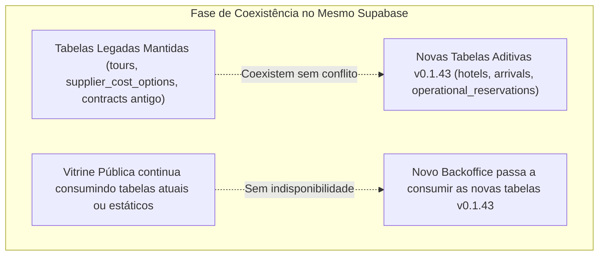

# DIAGNÓSTICO DO SUPABASE E PREPARAÇÃO DA IMPLEMENTAÇÃO — TÍO NENÊ v0.1.43

> **Documento:** Relatório Técnico de Diagnóstico do Banco Remoto, Análise de Dados e Plano de Preparação  
> **Data de Execução:** 21 de Outubro de 2026  
> **Status:** Diagnóstico Empírico de Leitura — Zero Modificações / Zero Escritas / Zero Deploys  
> **Ambiente Avaliado:** Projeto Único Supabase (`pfsgpsvbsfowrtcyckcm`)  
> **Conexão Verificada:** `https://pfsgpsvbsfowrtcyckcm.supabase.co`  
> **Repositório Inspecionado:** `d:\Z_UEB\TIONENE`

---

## 1. RESUMO EXECUTIVO DO DIAGNÓSTICO

Em estrito cumprimento às regras da Tarefa 04, foi realizado um diagnóstico técnico detalhado do banco de dados PostgreSQL remoto hospedado no **Supabase** (`pfsgpsvbsfowrtcyckcm`), utilizando exclusivamente consultas seguras de leitura agregada via cliente oficial da aplicação.

### 1.1 Principais Achados Empíricos:
1. **Ambiente Supabase Único e Ativo:** O projeto remoto está online e acessível, contendo **18 tabelas ativas** no schema `public`.
2. **Dados Existentes no Ambiente de Testes:**
   - O banco contém dados gerados durante fases de teste prévias: **2 clientes cadastrados**, **3 contratos emitidos** e **11 itens de passeios contratados**.
   - Todos os 3 contratos existentes operam em **Reais (BRL)**, totalizando R$ 8.044,00 contratados, com adiantamentos de 30% acordados (R$ 2.413,00) e saldos de 70% (R$ 5.631,00).
   - Os 11 itens de contrato possuem `tariff_code_snapshot = null`, confirmando que foram emitidos antes da migração V2 do catálogo de custos.
3. **Catálogo Antigo no Banco Remoto:**
   - A tabela `suppliers` possui **16 registros** (8 ativos e 8 inativos/excluídos históricos, entre eles *Grupo Xcaret* e *The Dolphin Company*).
   - A tabela `supplier_cost_options` contém exatamente as **42 opções antigas** (`TN-001` a `TN-042`).
   - As tabelas financeiras de quitação (`supplier_payments` e `supplier_payment_allocations`) e a auditoria (`supplier_cost_audit_log`) **existem no schema remoto, mas possuem 0 registros (estão vazias)**.
4. **Tabelas Ausentes (Exigidas pela v0.1.43):**
   - As novas entidades fundamentais da especificação v0.1.43 — **`hotels`** (1.125 hotéis mestre), **`arrivals`** (chegadas), **`operational_reservations`** (reservas), **`supplier_payables`** (contas a pagar), **`client_payments`** (recebíveis reais), **`supplier_credits`** (adiantamentos a fornecedores) e **`digital_wallets`** (voucher digital) — **NÃO EXISTEM** no banco remoto.
5. **Storage de Arquivos:**
   - A consulta de storage confirmou que **não há buckets de arquivos criados** (`listBuckets = []`). Não há repositório para PDFs de contratos assinados ou vouchers.
6. **Segurança (RLS):**
   - Todas as tabelas possuem políticas RLS ativas, porém configuradas com `USING (true)`, permitindo leitura e gravação anônima irrestrita via chave pública (`anon key`).

---

## 2. DIAGNÓSTICO DO SUPABASE REMOTO

A inspeção empírica de leitura via PostgREST/Supabase API permitiu mapear com exatidão a estrutura do schema remoto, confrontando-a com os arquivos SQL locais e os modelos declarados.

### 2.1 Inventário de Tabelas Confirmadas no Banco Remoto

| Tabela Remota (`public`) | Status Remoto | Qtd. Registros | Colunas Confirmadas no Banco Remoto | Origem / Correspondência Local |
|---|:---:|:---:|---|---|
| **`clients`** | **Existe** | **2** | `id`, `name`, `cpf`, `document_id`, `email`, `phone`, `whatsapp`, `default_hotel`, `notes`, `created_at`, `updated_at` | [`supabase/backoffice_v1_schema.sql`](file:///d:/Z_UEB/TIONENE/supabase/backoffice_v1_schema.sql#L41) |
| **`contracts`** | **Existe** | **3** | `id`, `contract_number`, `client_id`, `client_name`, `client_cpf`, `client_phone`, `client_email`, `arrival_date`, `departure_date`, `arrival_flight_number`, `arrival_flight_time`, `depart_flight_number`, `depart_flight_time`, `adults_count`, `children_count`, `infants_count`, `hotels_schedule`, `deposit_amount`, `deposit_observation`, `balance_amount`, `balance_observation`, `total_amount`, `currency`, `status`, `terms_clauses`, `internal_notes`, `created_at`, `updated_at` | [`supabase/backoffice_v1_schema.sql`](file:///d:/Z_UEB/TIONENE/supabase/backoffice_v1_schema.sql#L56) |
| **`contract_items`** | **Existe** | **11** | `id`, `contract_id`, `tour_id`, `supplier_id`, `tour_date`, `tour_name_snapshot`, `tour_included_snapshot`, `tour_not_included_snapshot`, `supplier_name_snapshot`, `adults_count`, `children_count`, `infants_count`, `sale_price`, `cost_applied`, `cost_type`, `cost_currency`, `calculated_total_cost`, `cost_status`, `voucher_ref`, `status`, `notes`, `created_at`, `updated_at`, `supplier_cost_option_id`, `tariff_code_snapshot`, `pricing_model_snapshot`, `units_count`, `external_fees_snapshot`, `currency_exchange_rate`, `calculation_breakdown` | [`supabase/backoffice_v1_schema.sql`](file:///d:/Z_UEB/TIONENE/supabase/backoffice_v1_schema.sql#L90) + Migration V2 |
| **`suppliers`** | **Existe** | **16** | `id`, `name`, `trade_name`, `contact_name`, `phone`, `whatsapp`, `email`, `category`, `currency_default`, `payment_terms`, `notes`, `active`, `created_at`, `updated_at`, `status` | [`supabase/backoffice_v1_schema.sql`](file:///d:/Z_UEB/TIONENE/supabase/backoffice_v1_schema.sql#L12) + Migration V2 |
| **`supplier_cost_options`** | **Existe** | **42** | `id`, `code`, `supplier_id`, `supplier_name`, `service_name`, `variant`, `pricing_model`, `cost_adult`, `cost_child`, `cost_infant`, `cost_fixed`, `currency`, `pricing_rule`, `external_fees_note`, `operation_days`, `operation_hours`, `duration`, `description`, `included`, `not_included`, `operational_notes`, `commercial_notes`, `pending_issues`, `source_reference`, `validation_status`, `public_tour_slug`, `active`, `created_at`, `updated_at` | [`supabase/migrations/20261020_supplier_catalog_v2.sql`](file:///d:/Z_UEB/TIONENE/supabase/migrations/20261020_supplier_catalog_v2.sql#L36) |
| **`supplier_cost_audit_log`** | **Existe** | **0** | `id`, `supplier_cost_option_id`, `option_code`, `changed_by`, `change_type`, `previous_data`, `new_data`, `notes`, `created_at` | [`supabase/migrations/20261020_supplier_catalog_v2.sql`](file:///d:/Z_UEB/TIONENE/supabase/migrations/20261020_supplier_catalog_v2.sql#L94) |
| **`supplier_payments`** | **Existe** | **0** | `id`, `supplier_id`, `payment_date`, `amount`, `currency`, `payment_method`, `reference_code`, `notes`, `created_by`, `created_at` | [`supabase/migrations/20261020_supplier_catalog_v2.sql`](file:///d:/Z_UEB/TIONENE/supabase/migrations/20261020_supplier_catalog_v2.sql#L112) |
| **`supplier_payment_allocations`** | **Existe** | **0** | `id`, `payment_id`, `contract_item_id`, `allocated_amount`, `created_at` | [`supabase/migrations/20261020_supplier_catalog_v2.sql`](file:///d:/Z_UEB/TIONENE/supabase/migrations/20261020_supplier_catalog_v2.sql#L131) |
| **`leads`** | **Existe** | **1** | `id`, `name`, `phone`, `email`, `source`, `interest_type`, `interest_name`, `interest_slug`, `selected_items`, `notes`, `status`, `converted_client_id`, `created_at`, `updated_at` | [`supabase/lead_funnel_schema.sql`](file:///d:/Z_UEB/TIONENE/supabase/lead_funnel_schema.sql#L10) |
| **`tours`** | **Existe** | **28** | `id`, `created_at`, `destination_id`, `name`, `slug`, `description`, `price`, `duration`, `included`, `not_included`, `image_url`, `active`, `featured`, `category`, `updated_at`, `price_label`, `contact_only`, `short_description`, `start_time`, `end_time`, `location`, `minimum_age`, `infant_policy`, `what_to_bring`, `important_info`, `highlights`, `cancellation_policy`, `accessibility`, `gallery`, `categories`, `faqs`, `itinerary` | [`supabase/import_tours_catalog.sql`](file:///d:/Z_UEB/TIONENE/supabase/import_tours_catalog.sql#L10) |
| **`travel_packages`** | **Existe** | **4** | `id`, `created_at`, `updated_at`, `destination_id`, `name`, `slug`, `slogan`, `description`, `duration_days`, `duration_info`, `price_value`, `price_label`, `price_suffix`, `inclusions`, `itinerary`, `suggested_hotels`, `image_url`, `is_featured`, `is_active`, `sort_order` | Existente no banco remoto (ausente no SQL local) |
| **`destinations`** | **Existe** | **7** | `id`, `created_at`, `name`, `slug`, `subtitle`, `description`, `cover_image`, `featured`, `active`, `sort_order`, `updated_at`, `short_description`, `seo_title`, `seo_description`, `og_image` | Existente no banco remoto (ausente no SQL local) |
| **`curadoria_leads`** | **Existe** | **0** | Schema criado no banco remoto | Existente no banco remoto (ausente no SQL local) |
| **`partner_leads`** | **Existe** | **0** | Schema criado no banco remoto | Existente no banco remoto (ausente no SQL local) |
| **`reservations`** | **Existe** | **0** | Schema legado de reservas | Existente no banco remoto (ausente no SQL local) |
| **`testimonials`** | **Existe** | **0** | Depoimentos de clientes | Existente no banco remoto (ausente no SQL local) |
| **`profiles`** | **Existe** | **0** | Perfis de usuários vinculados ao Supabase Auth | Existente no banco remoto (ausente no SQL local) |
| **`site_settings`** | **Existe** | **0** | Configurações de contato e parâmetros globais | Presente em `prisma/schema.prisma` |

### 2.2 Tabelas Inexistentes no Banco Remoto (Exigidas pela v0.1.43)
As seguintes entidades não foram criadas no banco remoto (`PGRST205 - Could not find the table in schema cache`):
1. **`hotels`:** Base mestre dos 1.125 hotéis oficiais da v0.1.43 (**Inexistente**).
2. **`arrivals`:** Chegada operacional independente de contratos (**Inexistente**).
3. **`operational_reservations`:** Reservas de fornecedores autônomas com 5 status (**Inexistente**).
4. **`supplier_payables`:** Tabela financeira de obrigações com 3 colunas (*Cost, Paid, Remaining*) (**Inexistente**).
5. **`client_payments`:** Entradas reais de caixa de clientes com conversão BRL/USD (**Inexistente**).
6. **`supplier_credits`:** Controle de saldo de adiantamentos/crédito em conta de fornecedores (**Inexistente**).
7. **`digital_wallets`:** Itinerário consolidado e status de envio de voucher (**Inexistente**).

### 2.3 Storage de Arquivos (Supabase Storage)
- A consulta direta confirmou: **Nenhum bucket de storage existe no projeto** (`[]`).
- O sistema atual não possui infraestrutura para upload de comprovantes bancários, PDFs de contratos assinados (`CON-010`) ou arquivos exportados de carteira digital (`WAL-005`).

---

## 3. INVENTÁRIO DOS DADOS EXISTENTES (AGREGADOS)

A inspeção de dados confirmou a existência de registros de teste no projeto que devem ser compreendidos e preservados durante a evolução do sistema.

### 3.1 Clientes (`public.clients`)
- **Total:** 2 clientes cadastrados.
- **Campos preenchidos:** Nome, CPF, e-mail, telefone/WhatsApp. Ambos associados aos contratos existentes.

### 3.2 Contratos (`public.contracts`)
- **Total:** 3 contratos emitidos (todos criados em 13/10/2026).
- **Dados agregados:**
  - `TN-2026-8446`: Status `emitido`, Moeda `BRL`, Total R$ 2.930,00, Sinal R$ 879,00 (30%), Saldo R$ 2.051,00 (70%).
  - `TN-2026-9392`: Status `emitido`, Moeda `BRL`, Total R$ 2.930,00, Sinal R$ 879,00 (30%), Saldo R$ 2.051,00 (70%).
  - `TN-2026-7405`: Status `emitido`, Moeda `BRL`, Total R$ 2.184,00, Sinal R$ 655,00 (30%), Saldo R$ 1.529,00 (70%).
- **Total Contratado no Banco:** R$ 8.044,00 (Sinais: R$ 2.413,00; Saldos: R$ 5.631,00).

### 3.3 Itens de Contrato (`public.contract_items`)
- **Total:** 11 itens distribuídos entre os 3 contratos.
- **Status:** Todos os 11 itens possuem status `'agendado'`.
- **Fornecedores nos itens:**
  - 10 itens atribuídos a `'Operadora Local'` (nome genérico atribuído antes da importação V2).
  - 1 item atribuído a `'Baktun Tours'` (passeio *Chichén Itzá Deluxe & 2 Cenotes*).
- **Tarifas vinculadas:** Todos os 11 itens possuem `supplier_cost_option_id = null` e `tariff_code_snapshot = null`.

### 3.4 Fornecedores (`public.suppliers`)
- **Total:** 16 registros no banco.
- **Fornecedores Ativos (8):**
  1. `Baktun` (ativo, USD)
  2. `Coco Bongo` (ativo, USD)
  3. `Envatours` (ativo, USD)
  4. `Miguel Shuttle` (ativo, USD)
  5. `MTZ Tours` (ativo, USD)
  6. `MUSA` (ativo, USD)
  7. `Parasailing & Jet Ski` (ativo, USD)
  8. `Playamia` (ativo, MXN)
  9. `Puerto Maya` (ativo, USD) — *Presente no banco atual, ausente na v0.1.43.*
- **Fornecedores Inativos / Excluídos Históricos (7):**
  - `Grupo Xcaret` (inativo, status `'excluido_historico'`) — *Exige reativação na v0.1.43.*
  - `The Dolphin Company` (inativo, status `'excluido_historico'`) — *Exige reativação na v0.1.43.*
  - `Baktun Tours` (inativo, duplicata legada de Baktun).
  - `Aquatours`, `Francisco Murrieta`, `Neftali Transportes`, `Tamyfer Locadora` (inativos).

### 3.5 Opções Tarifárias (`public.supplier_cost_options`)
- **Total:** 42 registros (`TN-001` a `TN-042`).
- **Status de Validação:** 42 opções com status variando entre `'revisado'` e `'sob_cotacao'`. Nenhuma das 80 tarifas oficiais da v0.1.43 está carregada.

### 3.6 Pagamentos e Alocações (`supplier_payments` e `supplier_payment_allocations`)
- **Total:** **0 registros**.
- As tabelas foram criadas no schema, mas nunca foram utilizadas para registrar transações de caixa ou baixas financeiras.

### 3.7 Outros Dados Existentes
- **`leads`:** 1 registro (lead de teste de captura).
- **`tours`:** 28 passeios cadastrados com slugs, fotos e descrições ricas.
- **`travel_packages`:** 4 pacotes (*Cancún Essencial*, *Oficial*, *Completo*, *Assinatura*).
- **`destinations`:** 7 destinos (*Cancún*, *Riviera Maya*, *Isla Mujeres*, *Tulum*, *Holbox*, *Oaxaca*, *Los Cabos*).

---

## 4. INTEGRIDADE E RISCOS TÉCNICOS

A coexistência entre os dados atuais de teste e a arquitetura v0.1.43 impõe atenção imediata a pontos críticos de integridade:

### 4.1 Risco Crítico de Exclusão em Cascata (`ON DELETE CASCADE`)
- No schema atual, a tabela `supplier_payment_allocations` possui a seguinte foreign key:
```sql
CONSTRAINT supplier_payment_allocations_contract_item_id_fkey 
FOREIGN KEY (contract_item_id) REFERENCES contract_items(id) ON DELETE CASCADE;
```
- Como a tela de contratos ([`src/app/admin/contratos/page.tsx`](file:///d:/Z_UEB/TIONENE/src/app/admin/contratos/page.tsx#L1049)) executa `delete().eq("contract_id", id)` ao salvar qualquer alteração, **qualquer quitação financeira que viesse a ser registrada no futuro seria sumariamente destruída pelo banco**.
- *Diagnóstico Positivo:* Como a tabela de alocações possui atualmente **0 registros**, **nenhum dado histórico foi perdido até hoje**. Esse problema deve ser corrigido antes do lançamento do módulo de pagamentos.

### 4.2 Inconsistência nos Contratos em BRL vs. Vendas em USD
- Os 3 contratos de teste existentes foram gravados com moeda `'BRL'`.
- A especificação v0.1.43 (`REC-001`, `OQ-22`) exige que todos os contratos de venda da agência operem em **Dólares Americanos (USD)**, sendo o Real (BRL) apenas uma moeda de meio de pagamento (conversão explícita no ato do recebimento).
- *Mitigação:* Os 3 contratos de teste não devem ser deletados, mas devem ser marcados com uma flag de legado ou convertidos para USD caso o cliente queira preservá-los para histórico.

### 4.3 Inconsistência de Colunas no Log de Auditoria
- O schema da tabela `supplier_cost_audit_log` espera:
  `supplier_cost_option_id, option_code, changed_by, change_type, previous_data, new_data, notes`.
- O código em [`src/app/admin/fornecedores/page.tsx`](file:///d:/Z_UEB/TIONENE/src/app/admin/fornecedores/page.tsx#L276-L295) tenta inserir:
  `tariff_code, field_changed, old_value, new_value, change_reason`.
- Essa divergência explica por que a tabela `supplier_cost_audit_log` está com **0 registros**: qualquer tentativa de salvar log de auditoria no frontend falhou silenciosamente ou foi rejeitada pelo PostgREST.

### 4.4 Duplicidade e Conflito de Fornecedores
- Existem no banco `Baktun` (ativo) e `Baktun Tours` (inativo).
- O contrato de teste `TN-2026-7405` está associado ao fornecedor `Baktun Tours`.
- A futura ativação do catálogo v0.1.43 deve manter a chave primária de `Baktun` e garantir que referências a `Baktun Tours` sejam migradas com segurança.

---

## 5. PREPARAÇÃO DE BACKUP E RECUPERAÇÃO

Como existe apenas **um projeto Supabase**, a realização e verificação de backups antes de qualquer intervenção de banco de dados é mandatória.

### 5.1 Mecanismos de Backup no Ambiente Atual

1. **Backups Nativos do Supabase (Cloud):**
   - No tier gratuito ou Pro básico, o Supabase executa snapshots diários automáticos com retenção de 7 dias. Porém, sem acesso administrativo ao console de infraestrutura, a agência não deve depender exclusivamente de snapshots automáticos de plataforma para reversão cirúrgica de tabelas.
2. **Exportação Integral via API / Script Autenticado (Recomendado):**
   - Como todas as 18 tabelas atuais podem ser lidas via API autenticada, é possível gerar um **backup lógico em JSON e CSV de 100% dos registros existentes** (clientes, contratos, itens, fornecedores, opções, passeios, pacotes, destinos).
   - Esse dump lógico pode ser salvo localmente em uma pasta versionada (ex.: `backups/pre_v0143_snapshot_YYYYMMDD.json`), garantindo recuperabilidade imediata.
3. **Backup de DDL e Schemas:**
   - Todos os scripts de criação atuais estão versionados na pasta `supabase/` do Git.
   - Antes de aplicar qualquer nova migração, deve ser gerado o script inverso (*rollback DDL*) correspondente.

### 5.2 Procedimento Padrão de Backup Pré-Migração
Antes de executar qualquer migração futura:
1. Executar script de dump de dados: extrair todos os registros das 18 tabelas para arquivo JSON consolidado.
2. Verificar hashes SHA-256 do arquivo de backup.
3. Armazenar o snapshot em local seguro fora da árvore rastreada do Git (ou em `.gitignore`).
4. Somente após a confirmação do dump, autorizar a execução de migrações aditivas.

---

## 6. ESTRATÉGIA DE IMPLEMENTAÇÃO NO MESMO SUPABASE

A implementação dos requisitos v0.1.43 no mesmo projeto Supabase em que o site está publicado deve seguir a **estratégia de coexistência não destrutiva**:



### 6.1 Diretrizes de Coexistência Segura:
1. **Migrações Exclusivamente Aditivas:**
   - Proibido o uso de `DROP TABLE`, `DROP COLUMN` ou `TRUNCATE`.
   - Todas as novas entidades da v0.1.43 (`hotels`, `arrivals`, `operational_reservations`, `supplier_payables`, `client_payments`, `supplier_credits`, `digital_wallets`) devem ser criadas com `CREATE TABLE IF NOT EXISTS`.
2. **Isolamento de Catálogos:**
   - A tabela antiga `supplier_cost_options` (42 opções) será mantida intocada durante a transição para garantir que os contratos de teste existentes continuem legíveis.
   - A nova estrutura de catálogo da v0.1.43 será criada em tabelas dedicadas: `seller_products` (52 produtos) e `supplier_rates` (80 tarifas base).
3. **Reativação Segura de Fornecedores:**
   - Atualizar `Grupo Xcaret` e `The Dolphin Company` de `active = false` para `active = true` e status `'ativo'`, sem recriar os registros (preservando os UUIDs já existentes).
4. **Desacoplamento Gradual:**
   - Os novos módulos administrativos (Arrivals, Reservas, Contas a Pagar) serão conectados às novas tabelas.
   - O site publicado e as páginas institucionais não sofrerão impacto, pois continuarão lendo suas rotas habituais.

---

## 7. PRIMEIRA IMPLEMENTAÇÃO RECOMENDADA

Com base em todo o diagnóstico técnico, a **primeira tarefa de implementação** deve ser estritamente cirúrgica, verificável, de altíssimo valor para o negócio e com **risco zero de regressão no site publicado**.

### 7.1 Identificação da Tarefa
> **PRIMEIRA TAREFA: Criação da Tabela Mestre `hotels` e Carga dos 1.125 Hotéis Oficiais em 8 Zonas Canônicas**

### 7.2 Justificativa Técnica:
1. **Risco Zero para o Sistema Atual:** A tabela `hotels` não existe no banco remoto. Sua criação não afeta nenhuma tela, rota ou contrato existente.
2. **Independência de Dependências:** Não depende de contratos, reservas ou fornecedores; depende apenas da planilha congelada `Ultimate_Tio_Nene_Hotels_Two_Columns.xlsx` já auditada.
3. **Desbloqueio Imediato da Fase de Vendas:** Atende diretamente aos requisitos `V38-001`, `QC42-001`, `QC42-002` e `SC-184`, permitindo que o formulário de contratos substitua inputs de texto solto por autocompletar oficial das hospedagens.
4. **Verificabilidade Exata:** Critério de sucesso 100% determinístico: a tabela deve conter exatamente **1.125 registros**, zero nulos, e todas as localizações devem pertencer rigorosamente a uma das 8 zonas canônicas homologadas.

### 7.3 Detalhamento da Execução da Primeira Tarefa:
- **Objetivo:** Estabelecer a base canônica de hospedagens de Cancún e Riviera Maya no Supabase.
- **Entidades e Arquivos Envolvidos:**
  - Planilha oficial: `Data/Hotel_Master/Ultimate_Tio_Nene_Hotels_Two_Columns.xlsx`.
  - Novo script SQL: `supabase/migrations/20261022_create_hotels_master.sql`.
  - Script idempotente de carga em Node.js / TypeScript.
- **Estrutura da Tabela:**
```sql
CREATE TABLE IF NOT EXISTS public.hotels (
    id UUID PRIMARY KEY DEFAULT gen_random_uuid(),
    name TEXT NOT NULL,
    zone TEXT NOT NULL,
    active BOOLEAN DEFAULT true,
    created_at TIMESTAMPTZ DEFAULT now(),
    updated_at TIMESTAMPTZ DEFAULT now(),
    CONSTRAINT hotels_name_unique UNIQUE (name),
    CONSTRAINT hotels_zone_check CHECK (zone IN (
        'Puerto Juarez',
        'Isla Blanca',
        'Cancun Center',
        'Cancun Hotel Zone',
        'Maya Riviera',
        'Playa del Carmen',
        'Tulum Center',
        'Tulum Hotel Zone'
    ))
);
```
- **Testes de Aceitação (`SC-184`):**
  - Contagem exata: `SELECT count(*) FROM public.hotels` = 1125.
  - Validação de zonas: `SELECT count(DISTINCT zone) FROM public.hotels` = 8.
  - Unicidade: `SELECT name, count(*) FROM public.hotels GROUP BY name HAVING count(*) > 1` = 0 linhas.
- **Procedimento de Reversão (*Rollback*):**
  - `DROP TABLE IF EXISTS public.hotels CASCADE;`

---

## 8. CONCLUSÕES E PRÓXIMOS PASSOS

1. O ambiente Supabase do cliente está diagnosticado e pronto para receber as migrações aditivas da v0.1.43 com total segurança.
2. Os dados de teste existentes (2 clientes, 3 contratos em BRL) foram catalogados e não serão perdidos nem corrompidos.
3. A ausência de buckets de storage e as políticas RLS permissivas foram documentadas e deverão ser ajustadas em etapas planejadas antes da entrada em produção com dados reais de turistas.
4. A primeira etapa técnica recomendada está delimitada e pronta para aprovação do cliente.

---
*Fim do Relatório de Diagnóstico do Supabase e Preparação — Tío Nenê v0.1.43*
