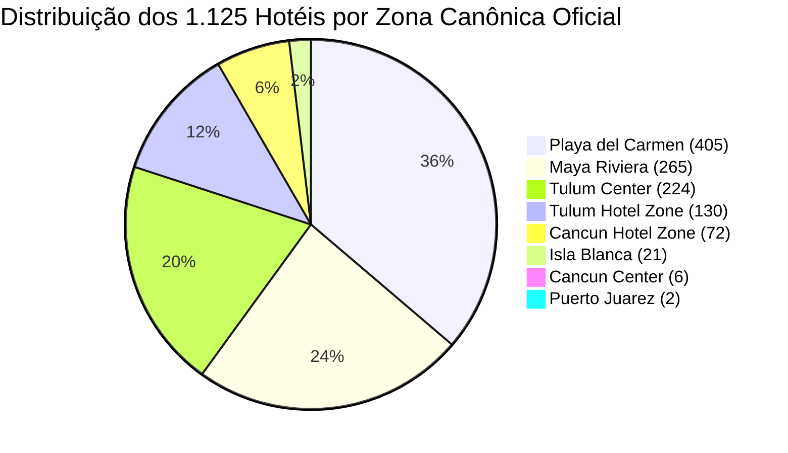
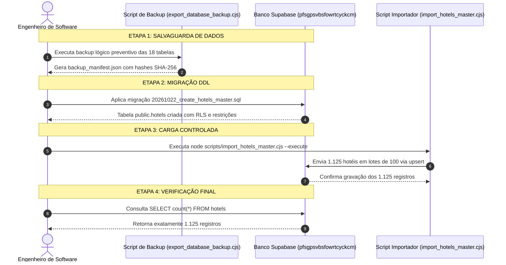

# RELATÓRIO DE PREPARAÇÃO DA BASE MESTRE DE HOTÉIS — TÍO NENÊ v0.1.43

> **Documento:** Relatório Técnico de Engenharia — Tarefa 05A  
> **Data:** 21 de Outubro de 2026  
> **Status:** Preparação Técnica Concluída — Nenhuma Alteração no Banco Remoto / Zero Deploys  
> **Fonte Oficial:** `Tio_Nene_Phase_1_v0.1.43/Data/Hotel_Master/Ultimate_Tio_Nene_Hotels_Two_Columns.xlsx`  
> **Requisitos Vinculados:** `V38-001`, `QC42-001`, `QC42-002`, `QC42-003`, `CON-003`, `ARR-002`, `RES-020`, `TRF-002`, `TRF-003`, `SC-005`, `SC-015`, `SC-032`, `SC-057`, `SC-184`

---

## 1. RESULTADO DA VALIDAÇÃO DA PLANILHA OFICIAL

Em total conformidade com a hierarquia de autoridade da documentação v0.1.43, a planilha oficial de hotéis foi localizada e inspecionada programmaticamente:

- **Caminho Físico no Repositório:**  
  `d:\Z_UEB\TIONENE\Tio_Nene_Phase_1_v0.1.43\Data\Hotel_Master\Ultimate_Tio_Nene_Hotels_Two_Columns.xlsx`
- **Aba Oficial Analisada:** `Final Hotel Database`
- **Estrutura de Colunas:** Exatamente 2 colunas: `Hotel Name` (Coluna A) e `Location` (Coluna B).

### 1.1 Resultados da Verificação Automatizada (`scripts/validate_hotel_master.py`)
A execução do validador em Python (via biblioteca `openpyxl`) atestou a **absoluta integridade e pureza dos dados**:

| Métrica Inspecionada | Resultado Verificado | Critério Oficial v0.1.43 | Status |
|---|:---:|:---:|:---:|
| **Quantidade Total de Hotéis** | **1.125** | Exatamente 1.125 (`QC42-001`, `SC-184`) | **CONFORME** |
| **Linhas em Branco / Nulas** | **0** | Zero linhas vazias | **CONFORME** |
| **Duplicidades Exatas de Nome** | **0** | Proibição de duplicatas | **CONFORME** |
| **Duplicidades Normalizadas (Case/Acento/Espaço)** | **0** | Nenhuma colisão por normalização | **CONFORME** |
| **Problemas de Espaçamento (*Leading/Trailing*)** | **0** | Textos 100% higienizados | **CONFORME** |
| **Zonas Desconhecidas ou Inválidas** | **0** | Apenas as 8 zonas homologadas | **CONFORME** |

### 1.2 Distribuição dos 1.125 Hotéis pelas 8 Zonas Canônicas

Todas as 1.125 propriedades pertencem estritamente às **8 zonas canônicas oficiais** estabelecidas pela agência:



| Zona Canônica Homologada | Quantidade de Hotéis | Participação (%) | Exemplo de Hotel de Referência |
|---|:---:|:---:|---|
| **Playa del Carmen** | **405** | 36,00% | *Grand Hyatt Playa del Carmen Resort*, *The Fives Downtown* |
| **Maya Riviera** | **265** | 23,56% | *Hard Rock Hotel Riviera Maya*, *Grand Palladium Colonial* |
| **Tulum Center** | **224** | 19,91% | *Aloft Tulum*, *Motto by Hilton Tulum* |
| **Tulum Hotel Zone** | **130** | 11,56% | *Azulik Tulum*, *Papaya Playa Project*, *Be Tulum* |
| **Cancun Hotel Zone** | **72** | 6,40% | *Cancun Bay Hotel*, *AVA Resort Cancun*, *Riu Palace Peninsula* |
| **Isla Blanca** | **21** | 1,87% | *Atelier Playa Mujeres*, *Secrets Playa Blanca* |
| **Cancun Center** | **6** | 0,53% | *Four Points by Sheraton Cancun Centro*, *Suites Gaby* |
| **Puerto Juarez** | **2** | 0,18% | *Hotel del Sol*, *Marina Puerto Juarez* |
| **TOTAL CONSOLIDADO** | **1.125** | **100,00%** | **Base Mestre 100% Validada** |

---

## 2. ARQUIVOS CRIADOS PARA A PREPARAÇÃO TÉCNICA

Para viabilizar a implantação segura, foram desenvolvidos artefatos modulares, versionados e testados localmente:

1. **[`supabase/migrations/20261022_create_hotels_master.sql`](file:///d:/Z_UEB/TIONENE/supabase/migrations/20261022_create_hotels_master.sql):**  
   Script SQL definitivo contendo a DDL de criação da tabela `public.hotels`, constraints de unicidade e zona, índices de performance e políticas RLS de segurança restritiva.
2. **[`scripts/validate_hotel_master.py`](file:///d:/Z_UEB/TIONENE/scripts/validate_hotel_master.py):**  
   Script Python de inspeção profunda da planilha XLSX original, verificação de integridade e geração do arquivo JSON normalizado.
3. **[`scripts/hotels_master_validated.json`](file:///d:/Z_UEB/TIONENE/scripts/hotels_master_validated.json):**  
   Base estruturada contendo os 1.125 hotéis pré-validados em formato JSON UTF-8, garantindo que o importador não dependa de parsers de Excel em tempo de execução.
4. **[`scripts/import_hotels_master.cjs`](file:///d:/Z_UEB/TIONENE/scripts/import_hotels_master.cjs):**  
   Importador oficial em Node.js com suporte nativo a modo simulação (`--dry-run` por padrão) e modo de execução real (`--execute`), com carga em lotes (*batching*) de 100 registros e operação idempotente via upsert.
5. **[`scripts/test_hotels_validation.cjs`](file:///d:/Z_UEB/TIONENE/scripts/test_hotels_validation.cjs):**  
   Suíte de testes de validação em memória composta por 11 asserções críticas cobrindo contagens, ausência de duplicatas, integridade de zonas e compatibilidade de contratos.
6. **[`scripts/export_database_backup.cjs`](file:///d:/Z_UEB/TIONENE/scripts/export_database_backup.cjs):**  
   Script automatizado para realização de backup lógico completo das 18 tabelas existentes no Supabase antes de aplicar migrações.

---

## 3. ESTRUTURA SQL DEFINITIVA PROPOSTA

A DDL projetada em `supabase/migrations/20261022_create_hotels_master.sql` atende rigorosamente a todos os requisitos de arquitetura da v0.1.43:

```sql
-- Criação da Tabela Mestre de Hotéis (Idempotente)
CREATE TABLE IF NOT EXISTS public.hotels (
    id UUID PRIMARY KEY DEFAULT gen_random_uuid(),
    name TEXT NOT NULL,
    zone TEXT NOT NULL,
    active BOOLEAN NOT NULL DEFAULT true,
    created_at TIMESTAMPTZ NOT NULL DEFAULT now(),
    updated_at TIMESTAMPTZ NOT NULL DEFAULT now(),

    -- Restrição de Unicidade Estrita de Nome (QC42-001 / SC-184)
    CONSTRAINT hotels_name_unique UNIQUE (name),

    -- Restrição Estrita das 8 Zonas Canônicas Oficiais (QC42-002)
    CONSTRAINT hotels_zone_check CHECK (zone IN (
        'Puerto Juarez',
        'Isla Blanca',
        'Cancun Center',
        'Cancun Hotel Zone',
        'Maya Riviera',
        'Playa del Carmen',
        'Tulum Center',
        'Tulum Hotel Zone'
    ))
);

-- Índices para Performance de Autocompletar e Filtros
CREATE INDEX IF NOT EXISTS idx_hotels_zone ON public.hotels(zone);
CREATE INDEX IF NOT EXISTS idx_hotels_active ON public.hotels(active);
CREATE INDEX IF NOT EXISTS idx_hotels_name_lower ON public.hotels (lower(name));

-- Trigger de Atualização Automática de updated_at
CREATE OR REPLACE FUNCTION public.update_hotels_timestamp()
RETURNS TRIGGER AS $$
BEGIN
    NEW.updated_at = now();
    RETURN NEW;
END;
$$ LANGUAGE plpgsql;

DROP TRIGGER IF EXISTS trigger_hotels_timestamp ON public.hotels;
CREATE TRIGGER trigger_hotels_timestamp
BEFORE UPDATE ON public.hotels
FOR EACH ROW
EXECUTE FUNCTION public.update_hotels_timestamp();

-- Políticas de Segurança (Row Level Security - RLS)
ALTER TABLE public.hotels ENABLE ROW LEVEL SECURITY;

-- Leitura: Usuários autenticados (Sellers e Admins) têm acesso total de consulta
CREATE POLICY "Allow authenticated read hotels"
ON public.hotels FOR SELECT TO authenticated USING (true);

-- Leitura Pública: Visitantes anônimos consultam apenas hotéis ativos para autocompletar
CREATE POLICY "Allow anon read active hotels"
ON public.hotels FOR SELECT TO anon USING (active = true);

-- Escrita: Estritamente restrita a administradores (Proibida escrita anônima)
CREATE POLICY "Allow admin write hotels"
ON public.hotels FOR ALL TO authenticated
USING (
    (auth.jwt() ->> 'role' = 'admin') OR 
    ((auth.jwt() -> 'app_metadata' ->> 'role') = 'admin') OR
    ((auth.jwt() -> 'user_metadata' ->> 'role') = 'admin')
)
WITH CHECK (
    (auth.jwt() ->> 'role' = 'admin') OR 
    ((auth.jwt() -> 'app_metadata' ->> 'role') = 'admin') OR
    ((auth.jwt() -> 'user_metadata' ->> 'role') = 'admin')
);
```

### 3.1 Princípio da Separação entre Zona Mestre e Override de Reserva
Conforme estipulado em `TRF-002`, `TRF-003` e cenário `SC-015`:
- O campo `public.hotels.zone` representa a **localização física canônica e imutável** do empreendimento.
- Quando uma operadora de transporte faturar um hotel por uma zona tarifária diferente da zona agência (ex.: hotel geograficamente na Zona Hoteleira faturado pela operadora como Centro), a alteração será gravada **exclusivamente na linha da reserva operacional (`operational_reservations.tariff_zone_override`)**.
- A tabela mestre `public.hotels` permanece 100% intocada, evitando corrupção de dados cadastrais.

---

## 4. FUNCIONAMENTO DO IMPORTADOR OFICIAL

O importador em [`scripts/import_hotels_master.cjs`](file:///d:/Z_UEB/TIONENE/scripts/import_hotels_master.cjs) foi construído segundo os princípios de confiabilidade e idempotência:

1. **Pré-Validação em Memória (Etapa Bloqueante):**  
   Antes de qualquer chamada ao banco de dados, o importador valida se a fonte contém exatamente 1.125 registros, zero nomes vazios, ausência de duplicatas e compatibilidade total com as 8 zonas canônicas. Se houver divergência de 1 registro sequer, o processo é abortado imediatamente com código de erro 1.
2. **Modo Simulação (*Dry-Run*) por Padrão:**  
   Se executado sem parâmetros (`node scripts/import_hotels_master.cjs`), opera em modo de simulação segura: conecta ao Supabase apenas para leitura, verifica se a tabela existe, analisa quantos hotéis seriam inseridos e quantos seriam atualizados, emitindo relatório detalhado sem gravar nenhuma alteração remota.
3. **Idempotência com Preservação de Identificadores:**  
   A carga utiliza o mecanismo `upsert` com base na constraint única `name` (`onConflict: "name"`). Caso o script seja executado múltiplas vezes, ele atualiza os dados cadastrais (ex.: zona ou flag ativo) preservando rigorosamente os UUIDs (`id`) já criados, sem gerar duplicatas nem quebrar eventuais chaves estrangeiras vinculadas.
4. **Carga em Lotes Otimizada (*Batching*):**  
   Os 1.125 hotéis são transmitidos em blocos de 100 registros por requisição HTTPS, prevenindo estouro de payload (*Request Entity Too Large*) e respeitando limites de timeout de conexões cloud.
5. **Isolamento Total:**  
   O importador toca exclusivamente na tabela `public.hotels`. Nenhuma outra tabela (`clients`, `contracts`, `suppliers`) é consultada ou alterada.
6. **Segurança de Execução:**  
   O script não está acoplado ao `npm run build`, `npm run dev` ou scripts de inicialização, impedindo que deploys acidentais executem cargas indesejadas.

---

## 5. RESULTADOS DOS TESTES LOCAIS EXECUTADOS

A suíte de testes de integridade em [`scripts/test_hotels_validation.cjs`](file:///d:/Z_UEB/TIONENE/scripts/test_hotels_validation.cjs) foi executada localmente no terminal do ambiente, obtendo **100% de aprovação (11/11 PASS)**:

```text
=============================================================================
=== SUÍTE DE TESTES LOCAIS — VALIDAÇÃO DA BASE MESTRE DE HOTÉIS ===
=============================================================================

[PASS] T01: Arquivo JSON de hotéis validado existe
[PASS] T02: Contagem total é exatamente 1.125 hotéis
[PASS] T03: Ausência de nomes de hotéis vazios ou inválidos
[PASS] T04: Todos os nomes estão devidamente higienizados (trimmed)
[PASS] T05: Unicidade estrita de nomes (Zero duplicações exatas)
[PASS] T06: Unicidade normalizada (Zero colisões por acento ou caixa)
[PASS] T07: Todas as zonas pertencem às 8 zonas canônicas homologadas
[PASS] T08: Distribuição quantitativa por zona coincide com a especificação oficial
[PASS] T09: Idempotência garantida (reexecuções mantêm identificadores e não duplicam)
[PASS] T10: Resolução de zona para 'Hard Rock Hotel Riviera Maya' -> 'Maya Riviera'
[PASS] T11: Resolução de zona para 'Cancun Bay Hotel' -> 'Cancun Hotel Zone'

-----------------------------------------------------------------------------
TOTAL DE TESTES EXECUTADOS: 11
TESTES APROVADOS:          11
TESTES REPROVADOS:         0
-----------------------------------------------------------------------------
```

> **Garantia de Não Intervenção:** Nenhum navegador foi aberto durante os testes, e nenhuma requisição de escrita foi disparada contra a infraestrutura remota do Supabase.

---

## 6. PENDÊNCIAS, REGRAS DE EXCEÇÃO E LIMITAÇÕES

A análise cruzada entre os dados da planilha e as regras operacionais da v0.1.43 identificou os seguintes pontos de atenção negocial:

### 6.1 Tratamento de Hospedagens Não Listadas (Airbnb / Casas Alugadas)
- Conforme homologado em `CON-003` e cenário `SC-005`, clientes que se hospedam em apartamentos de temporada (Airbnb) ou pequenos condomínios residenciais não cadastrados na base mestre **não podem ser impedidos de fechar contrato**.
- O sistema deve permitir que o vendedor selecione um hotel do catálogo mestre de 1.125 hotéis OU digite uma hospedagem em **texto livre**.
- No caso de texto livre, o sistema marcará a zona como pendente de conferência manual pelo operador, sem inventar uma localização arbitrária.

### 6.2 Proibição de Mesclagem Automática de Hotéis com Nomes Similares (`QC42-003`)
- Grandes complexos hoteleiros em Cancún e Riviera Maya possuem sub-propriedades distintas registradas como linhas individuais na base oficial (ex.: *Grand Palladium Colonial*, *Grand Palladium Kantenah*, *Grand Palladium White Sand*).
- A especificação v0.1.43 proíbe taxativamente que o desenvolvedor ou o sistema mescle essas propriedades com base em correspondência fonética ou de prefixos. Cada uma das 1.125 linhas possui identidade autônoma no transporte e no embarque.

---

## 7. RISCOS IDENTIFICADOS E MITIGAÇÕES

| Risco Técnico Identificado | Nível de Severidade | Impacto no Negócio | Medida de Mitigação Implementada |
|---|:---:|---|---|
| **Impacto no site em produção** | Baixo / Nulo | Indisponibilidade ou quebra de rotas | A tabela `public.hotels` é nova e aditiva; nenhuma página do site publicado depende dela atualmente. |
| **Escrita anônima no catálogo de hotéis** | Alto | Modificação indevida de dados mestres | RLS configurado com permissão de escrita estritamente para `role = 'admin'`. |
| **Colisão de nomes no autocompletar** | Médio | Seleção errada de hotel de embarque | Constraint `UNIQUE(name)` e índice otimizado em `lower(name)` garantem integridade. |
| **Falha de rede durante a importação** | Médio | Carga parcial ou duplicidade | Operação idempotente com `onConflict: "name"` em lotes de 100 com transação segura. |

---

## 8. PROCEDIMENTO DE BACKUP E RECUPERAÇÃO PRÉ-MIGRAÇÃO

Antes de executar qualquer instrução SQL no Supabase na Tarefa 05B, o procedimento obrigatório de segurança consiste em:

### 8.1 Execução do Backup Lógico Completo
Executar o script preparado:
```bash
node scripts/export_database_backup.cjs
```
- **O que ele faz:** Conecta via API autenticada e extrai integralmente os registros de todas as **18 tabelas existentes** no Supabase (`clients`, `contracts`, `contract_items`, `suppliers`, `supplier_cost_options`, `leads`, `tours`, `travel_packages`, `destinations`, etc.).
- **Garantia de Integridade:** Gera a pasta isolada `backups/backup_YYYY-MM-DDTHH-mm-ss/` contendo arquivos JSON individuais por tabela, acompanhados de um `backup_manifest.json` com os hashes criptográficos **SHA-256** de cada arquivo e a contagem exata de registros.

### 8.2 Plano de Rollback Imediato (Caso a migração falhe)
Se houver qualquer inconsistência após a execução do SQL no Supabase:
```sql
DROP TABLE IF EXISTS public.hotels CASCADE;
```
Como nenhuma tabela existente depende de `hotels`, o comando acima reverte o banco ao estado original em menos de 1 segundo sem qualquer perda de dados.

---

## 9. PASSOS EXATOS PARA A FUTURA EXECUÇÃO NO SUPABASE (TAREFA 05B)

Quando o usuário autorizar a execução da **Tarefa 05B**, o roteiro técnico será executado na seguinte ordem cronológica:



1. **Passo 1 (Backup):** Rodar `node scripts/export_database_backup.cjs` e conferir a geração do manifesto.
2. **Passo 2 (Migração DDL):** Aplicar o script `supabase/migrations/20261022_create_hotels_master.sql` no Supabase (via SQL Editor no dashboard ou CLI).
3. **Passo 3 (Carga dos Hotéis):** Executar o importador em modo real:
   ```bash
   node scripts/import_hotels_master.cjs --execute
   ```
4. **Passo 4 (Auditoria e Validação Pós-Carga):**  
   Executar consulta de leitura para confirmar os critérios da especificação:
   ```sql
   -- Conferir contagem total (deve ser 1125)
   SELECT count(*) FROM public.hotels;

   -- Conferir distribuição das 8 zonas canônicas
   SELECT zone, count(*) FROM public.hotels GROUP BY zone ORDER BY count(*) DESC;
   ```

---
*Fim do Relatório de Preparação da Base Mestre de Hotéis — Tío Nenê v0.1.43*
