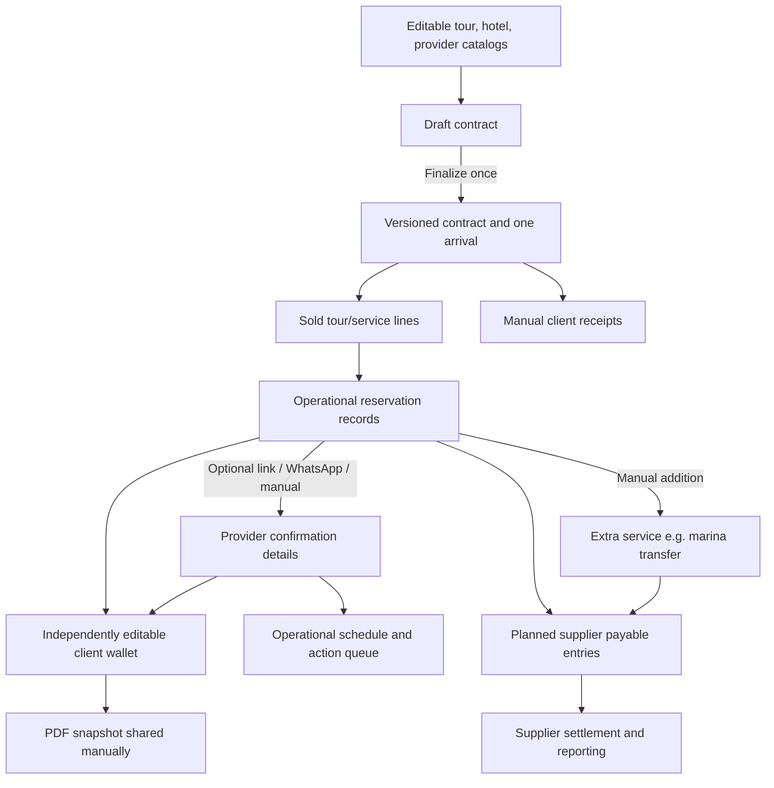

> **CURRENT v0.1.43:** Existing app partially built; initial 52/80 supplier records are only an initial seed. Admin must be able to add providers/tours/rates; critical steps have manual fallback and none/subset/all selective impacts. Older dated historical paragraphs below are archival context, not open gates. See `00_READ_FIRST_CURRENT_AUTHORITIES.md`.

# 01 — Project overview and Phase 1 scope

**Baseline:** 2026-10-19 · **Status:** WIP, refer to `04_Decisions_and_Open_Questions.md` for decision authority.

## 1. Business problem

Tío Nenê is a tour agency selling tours, transfers and occasionally bespoke experiences in Cancún / Riviera Maya. **A sale and its signed contract are not the actual provider reservations.** Phase 1 must make the journey from a completed sale to correctly arranged supplier services, provider payments and a usable guest itinerary operationally reliable, while supporting frequent ad-hoc changes.

The owner's design priority is **practical flexibility for a small, volatile operation**, not a rigid process that blocks real transactions. Automate the ordinary case; keep escape routes for unusual tours, supplier arrangements, transport, changed dates/prices, manual confirmations and emergency expenses.

**Latest confirmed operational refinements:** Two **independent operational airport-transfer reservations**, inbound and outbound, are generated when both transfers are purchased, while the client-facing contract displays one chronological itinerary (arrival with/without transfer, dated tours, departure with/without transfer). One WhatsApp conversation can arrange both (`CON-014`, `TRF-009`–`010`). Normal auto-readiness is achieved when every required booking is present and Confirmed (including separately arranged included services) and the wallet is prepared; Admin can override only the displayed badge. Airport transfer flight numbers/times belong on contracts for the legs sold, and supplier coordination can happen via a single informal message for both inbound/return or separately (`OPS-005`, `TRF-007`–`008`).

**Missing provider quote clarification:** Sellers can finalize legitimate sales even when an unusual tour or yacht supplier cost cannot yet be specified. The system still creates operational records and a planned payable placeholder, but preserves cost as **Unknown**, raises **Cost Required** for staff, and marks incomplete financial margin estimates honestly. No artificial $0 supplier cost or compulsory advance quote (`CON-015`, `PAY-024`, `OPS-011`, `FIN-009`).

**Reporting date-basis clarification:** For operational profitability by month/week/year/custom dates, group sales and associated provider costs by **the customer's arrival date** (October 31 arrival counts in October, regardless of later tour dates). This is *arrival-cohort operational profit*, not necessarily statutory revenue recognition; actual cash receipts/payments remain date-filtered cash-flow reporting measures (`FIN-008`, `OQ-24`).

**Standard FX change clarification:** The editable agency MXN→USD estimate rate is a *future-only default*. Each new estimated provider cost snapshots its applied rate and USD equivalent; later changes to the central rate never rewrite old bookings, original MXN amounts or actual paid USD amounts (`PAY-023`, `SC-087`).

**Supplier FX clarification:** When a provider such as Playa Mía prices in MXN, retain the MXN charge, estimate USD cost using a **snapshot of Tío Nenê's configurable standard rate**, and, when staff manually record the actual payment, capture the **real USD expenditure known on that date**. Estimated and actually paid USD costs must be distinct; unfinished/partly settled FX accounting still needs later rules (`PAY-022`, `FIN-007`, `OQ-23`).

**Client finance clarification:** Client contract prices and balances are in USD. When a rare deposit arrives in Brazilian reais, the staff records the USD equivalent credited against the contract, with an optional BRL note (`REC-008`); do not infer a multi-currency client selling-price model.

## 2. Phase 1 boundary

**Begins:** seller enters a sale / prepares a draft contract, and then finalizes it.  
**Primary business goal:** every sold service appears in an arrival, can be reserved/confirmed, is visibly actioned before service, and can be conveyed in a client-facing itinerary.  
**Also in Phase 1:** supplier payables, manual client receipts, day/next-day activity views, task priority, financial reporting and admin maintenance of reference catalogs.

**Not the focus:** acquisition marketing, leads pipeline, customer loyalty, repeat-customer campaigns and broader CRM automation. Don't let these delay post-sale execution. Basic stable customer/contract identity can support future extensions.

**Separate disruption-management module:** deferred for now; cancellations, rescheduling and manual operational corrections still must work within the relevant reservations/ledgers.

**Guest-facing website login/portal:** explicitly **undecided**. It might be added in this same phase or later. Build a wallet whose data is not hardwired to PDF generation, but do not build or categorically postpone the portal on this version's authority.

## 3. Main functional pillars

| Pillar | Summary | Relevant requirements |
|---|---|---|
| Editable master catalogs | Tours, providers, hotel list and default zones, tariffs/standard costs; initial incomplete spreadsheet seed. | `CAT-*` |
| Contract creation / revision | Static template + editable fields; draft/finalize; versions; internal per-service sale prices not visible as tour line prices in PDF. | `CON-*` |
| Arrival workspace | One client party/trip record per finalized sale, linked contract, hotels, dates, operational services and financial history. | `ARR-*` |
| Supplier booking | One or more separately manageable operational reservations, each with an automatically generated unique number; copyable provider link OR manual WhatsApp/other confirmation; optional human review. | `RES-*` |
| Operations | Upcoming arrivals, today/tomorrow services, clear **Ready / Not Ready** marker on each arrival **and** separately listed automatically generated, prioritized **Action Required** tasks. Both must coexist; calendar layout is undecided. | `OPS-*` |
| Payables and costs | Planned provider costs at sale; independent adjustments, provider grouped/monthly views and ad-hoc payees; **manually recorded actual cash/bank supplier payments**, allocated across one or more payable rows (including partial payment). | `PAY-*` |
| Receivables | Sellers can log actual deposits received within Finalize Sale or later without revising the sale. Track cash/bank receipts and instalments separately from agreed deposits; default outstanding balance payable **before arrival**, mark unpaid balances **overdue on arrival day**, and permit a manual per-client deadline override. | `REC-*` |
| Financial reporting | Views of sales, attributable tour/provider margin, planned/confirmed/paid costs, flexible provider and period filters. | `FIN-*` |
| Client digital wallet | Internal editable per-arrival itinerary; provider reservation facts and status; export PDF for manual sharing. | `WAL-*` |
| Transfer pricing | Airport↔hotel transfer is a **fixed booking fee for up to seven passengers**, varying by leg/zone; default from hotel master and allow booking-local tariff zone/cost overrides. | `TRF-*`, `PAY-021` |
| Lightweight notes | Optional short notes on relevant payments, supplier costs and reservations, with no separate notes module. | `NOTE-*` |
| Access/security | Two Phase 1 roles: Seller and Admin. Sellers can access/revise contracts by other sellers but have restricted operational and company-financial access; details remain to specify. | `SEC-*` |

## 4. End-to-end workflow (confirmed baseline)

**Arrow caveat:** These are initial data creation/association flows, **not continuous forced synchronization**. Edits to existing records default to independence with prompted selective synchronization (Decision 1). The graphic simplifies one sold line into one or more operational services, including manually added linked services.

### Typical sale

1. Seller looks up hotels and tours in the admin-maintained catalogs; has manual free-text fallbacks. Enters party/arrival/hotel information, **separate adult and child counts for each sold tour (shown on contract)**, contract totals/deposit/balance, and internal per-tour negotiated selling prices. Seller may also apply one **overall percentage or fixed-money discount**, automatically allocated pro rata to internal lines for accurate revenue attribution; the client sees only final agreed contract financial terms, not individual tour prices (`CON-013`, `FIN-006`). When hotel stays cover different dates, the service reservation should later default to the hotel matching that service date, with local pickup override possible (`RES-020`).
2. Seller may save a draft with **no active arrival or supplier obligations**. The seller explicitly clicks **Finalize Sale** when they consider the sale agreed. This action, not PDF generation or receipt of a signature, issues the active contract version, creates one arrival, operational reservations and planned supplier costs. The finalized sale may still be revised later via preserved contract versions and safe downstream reconciliation. Sellers can independently upload returned signed contract files, associated with the appropriate preserved version; e-signing and signature validation are not yet specified.
3. Operations opens the arrival, sees scheduled services, supplier booking links and gaps. A provider may submit a link, or staff may record confirmation received by WhatsApp / another method.
4. Staff can manually create an extra service (e.g. hotel-to-marina transport that is included in a yacht sale) without appending a visible contract line. That service receives its own uniquely numbered reservation and payable.
5. The booking has one of five statuses: **Not Requested**, **Awaiting Confirmation**, **Confirmed**, **Unable to Confirm** or **Cancelled** (`DEC-013`). Supplier selecting an explicit **Confirm** action through its link marks only its booking **Confirmed**; a details-only update does not confirm (staff review remains unchecked). Admin may also confirm following WhatsApp/direct contact. Operations may change reservation details and selectively apply related updates. **Neither confirmation nor staff review gates** reporting, supplier payables or the wallet (`DEC-012`). After actually reaching out (e.g. WhatsApp), staff may use **Mark as Requested** to move only that booking from **Not Requested** to **Awaiting Confirmation**; copying a link alone has no status effect (`DEC-014`). When a supplier cannot accept, staff can mark **Unable to Confirm**, retaining it in Action Required; staff may edit or remove the individual reservation and decide whether an unpaid planned expense stays or is removed. Paid charges survive booking deletion. Other transitions and fee/refund details remain open (`DEC-015`).
6. Supplier financial ledger entries are independently editable; supplier costs can be overridden with no master/contract corruption. One-off Uber/other expenses can be entered independently of reservations. **Actual supplier payments** are recorded manually as distinct dated cash/bank transactions, allocated to one or more payable rows (including partial payments), rather than treating the payable amount itself as a bank transfer. In each provider's spreadsheet-style ledger, keep **Reservation cost / Amount paid / Remaining balance** as three distinct visible financial values; partial payments never rewrite the original cost (`DEC-017`, `PAY-013`). Supplier payments may also remain **unallocated credit on the provider account**, then be assigned later to one or more payables, including future-date tours; allocating is not another cash expense (`DEC-018`). If a service changes/cancels, staff can release allocated funds back to supplier credit OR separately record money actually refunded by provider; these are different actions (`DEC-019`).
7. **Usually the deposit is already received when seller finalizes** (approximately 95% of sales): the seller can log the **actual receipt** right there, while still being allowed to finalize with no deposit received. A deposit *promised on the contract* is not automatically treated as cash received. If the seller forgets to log an already-received deposit, permitted staff can add it later on the same contract/arrival or quick payment action using the real received date, without revising the contract. Further installments use the same independent client receipt ledger (`REC-005`, `REC-006`). **Client balance deadline:** Normally due by the day preceding the party's arrival, becoming overdue on the arrival date if still unpaid; staff may override that individual payment deadline without changing the contract or operational bookings (`REC-007`).
8. Admin independently edits guest itinerary/wallet as needed, generates a PDF snapshot and sends it through the trip's WhatsApp group, email or another channel. An unconfirmed service may appear as *pending*. The everyday admin view presents **only the current wallet**, not a PDF revision list. Editing after the last marked-sent PDF shows a small **Wallet Update Needed** indicator; staff manually exports/sends the newer PDF and marks it sent (`DEC-016`).

### Non-standard sale example (illustrative only)

Contract shows **Private Yacht (transport included)**. Yacht booking can be confirmed by a simple message from captain without code or pickup location. For **this individual yacht booking only**, Admin may configure that separate marina transportation **is required**; when it is required, the app flags **Book transportation** in Action Required even before a transport reservation exists. For an otherwise identical yacht booking marked **not required**, no ancillary transport task or payable is created. Operations later **manually adds** the separate marina transfer reservation, associated with this requirement/arrival; yacht confirmation alone must not hide the outstanding transfer. It has its own transport provider confirmation, pickup fields and supplier cost/payable. Contract does not acquire a second charged item automatically; guest wallet may show relevant transport pickup alongside the yacht itinerary.

### Supplier cost-model defaults (confirmed / unresolved boundary)

Configured pricing belongs to **each service variant**, not to the supplier globally. For routine known tariffs the system suggests a planned cost: per-adult/child, fixed per booking (e.g. transfers up to seven people), with or without zone-based tariffs. Yacht bookings are **manual boat-specific quotes** until standardization exists. Baktun's three Chichén Itzá offerings are **per attending adult and per attending child, independent of hotel zone**, using actual imported variant-specific adult/child tariffs; the illustrative $80/$60 amounts are **not verified catalog prices**. Incomplete price input must be visibly unknown and manually correctable, never silently $0 (`CAT-009`, `PAY-021`, `OQ-10`).

### Specific Xcaret tour pricing and calendar decisions now confirmed

The owner approved a special Xcaret rule set documented with the original 2026 calendar screenshots in `Data/Xcaret_2026_Rules_And_Zone_Mapping.md`: seller enters **simple Xcaret tour, date, adults/children**; backend resolves tour-date hotel, mapped agency zone, appropriate **existing transportation-inclusive supplier variant** and configured season, and creates suggested cost at sale finalization. Owner-approved default maps cover eight agency zones (including Riviera Maya-labelled Tulum and de Noche fallbacks); **NO routine provisional badge**. All selected package/price details are per-booking editable, with individual snapshot/payment safeguards. Pickup arrangements are determined later when booking the supplier, NOT for pricing. 2026 normal weekdays and Sunday exceptions are enforced for seller date entry with View operating days; the admin dashboard prompts next-year calendar updates around December 15. The final approved 2026 provider/source pricing spreadsheets are **included** under `Data/Supplier_Source_Workbooks/`; application-side import and actual supplier availability remain to be verified.

### Confirmed supplier catalog and rate-map expansion (v0.1.36)

The agency's ten **included** standardized provider files each have **Tours** (seller-visible product identity, exact Display Name separate from supplier name) and **Supplier Rates** (many original-currency/rule-dependent costs per stable Tour ID). Admin can edit names, availability and rates directly after import. Contracts retain the display-name text as issued. **All ten final provider XLSXs and the shared reference XLSX are included in this package; app import remains unverified.**

Approved names now cover Baktun (3), Coco Bongo (6), Envatours (6), Miguel Shuttle (one seller-facing transfer), and Playa Mía (one `Cozumel el Cielo`). Miguel maps all eight agency zones onto five per-vehicle USD one-way rates; Playa Mía maps all eight zones onto two automatically selectable native-MXN departure rate variants, while its third Cozumel price is manual-only. Shared hotel stay dates/zone references select **provider-specific** tariff rates and never override supplier labels or historical amounts. Historical note (v0.1.36): Envatours unit was not yet known at that checkpoint; in v0.1.37 final owner-approved source confirms fixed unit **per boat** for 1–10 passengers, with `ENV-R002/004/006`. Other unsupplied yacht costs still require manual quotes. Full mapping tables and unresolved data boundaries: `Data/Supplier_Catalog_and_Pricing_Decisions.md`. Preserve Xcaret's separate already-approved 2026 rate/calendar rules and its explicit no-provisional-badge policy.

## 5. User experience priorities

- **Low cognitive load for seller:** select hotel, look up tours, enter negotiated line prices and contractual fields, optionally choose a global **% or fixed-amount discount** without manual per-tour allocation; system supplies suggested zone/tariff/cost where data exists.
- **Fast owner/operations actions:** find an arrival, amend one booking, confirm manually, copy provider link, add extra service, add one-off supplier expense.
- **Quick receipt:** from a prominent dashboard or similarly accessible action, search client/contract, enter cash/transfer payment amount/date/note.
- **Actionable operations:** automatically flag work not yet done, including near-term service bookings; don't confuse 'record exists' with 'provider confirmed'.
- **Clean UI:** minimize noisy on-screen audit history; retain enough technical history to support corrections and investigations, with detailed audit UI design still open.

## 6. Typical terms / distinctions

- **Contract / sale:** what client originally agreed to purchase, including total commercial terms and historical versions. A contract is **not** a supplier booking.
- **Arrival:** internal workspace for one contracted trip/party, keyed to arrival date; not a duplicate contract or necessarily a persistent CRM profile.
- **Sold line:** the service listed in the agreed sale, with a private negotiated sale amount.
- **Operational service/reservation:** task and booking record for a specific tour/transfer/provider; may be generated from a sold line **or added manually**.
- **Provider confirmation:** what the supplier has agreed to, potentially recorded via staff WhatsApp update; code/pickup data may legitimately be absent.
- **Staff review:** separate optional acknowledgment that an internal user reviewed a service/arrival.
- **Provider payable:** expected/confirmed/settled spend owed or potentially owed to a supplier, with independent effective amounts. A cancelled service may have a $0, partial-fee or full-fee effective supplier charge; recording actual payments or refunds is separate (`DEC-020`).
- **Client wallet:** editable guest-facing presentation data, not the original contract or the sole supplier booking source.

**Operational overview clarification (CONFIRMED):** The arrivals list displays **Ready / Not Ready** for each trip, while the operational **Action Required** queue separately identifies unfinished supplier requests, replies and other known items; staff can open an arrival to inspect the issues behind its label. This is one connected operational system, not a choice between indicator and task list. **Client money owed/overdue must be displayed separately and must never by itself make an operationally arranged arrival Not Ready** (`OPS-007`, `REC-007`). **The wallet must be ready to send for operational readiness, but does not need to have actually been sent; the send status is displayed separately** (`OPS-008`, `WAL-008`). **Admin can explicitly override the arrival-level Ready/Not Ready indicator in either direction; the outstanding booking and required-service tasks remain plainly visible and no separate workflows are blocked by the badge** (`OPS-010`). Admin may independently set a booking status to Confirmed (`RES-021`) without inventing a supplier confirmation event. Other exceptional readiness refinements are deferred/UAT under `OQ-26`; a calendar view is a possible addition but not specified now (`OPS-005`, `OPS-006`).

## 7. Planning assumptions to avoid

- Do **not** assume every contract tour creates only one provider reservation.
- Do **not** assume every provider uses links or returns a confirmation code.
- Do **not** assume the agency's geographic hotel zone matches each provider's billing zone.
- Do **not** assume all services or providers are already in the seed spreadsheets.
- Do **not** assume client-facing wallet data must always exactly equal operations data; permitted divergence is deliberate.
- Do **not** assume changing a contract deletes already-confirmed/paid records.
- Do **not** assume a planned cost is a legally owed/paid invoice or that all costs are USD.

## 8. Current boundary of confidence

The core **pillars** and Decisions 1–21 are established; low-level schema fields, payment edge cases, financial accounting semantics, alert timing, electronic signatures, signing validation and UX details remain under review. See `04_Decisions_and_Open_Questions.md` **current §C** for the remaining genuine boundaries; archived OQ tables are historical. This package supports implementation of the approved working model but does not authorize invented unprovided commercial data or unsafe security decisions.

## v0.1.37 — Finalized initial supplier catalog sources included

The implementation now has an authoritative, verified initial data seed: **10 supplier XLSX sources + 1 central Shared Reference workbook** with **52 visible source products / 80 Rate IDs**. All workbooks are in `Data/Supplier_Source_Workbooks/` byte-for-byte unchanged, and reference data is connected to explicit Tour IDs and Rate IDs. Previous descriptions that raw spreadsheets are forthcoming refer to the historical v0.1.36 planning stage, not to v0.1.37. Numeric source truth remains XLSX, not copied illustrative examples. The developer must support `Product Subtype`, `Equipment` basis, per-boat and per-vehicle supplier units, adults-only weekday tickets, native MXN source liabilities, Xcaret zone/season eligibility, and separately handled Dolphin extras. All existing contracts/booking/financial design principles remain in force. This is still a **work-in-progress project**, not the final delivery of all business data or legal/technical signoff.
