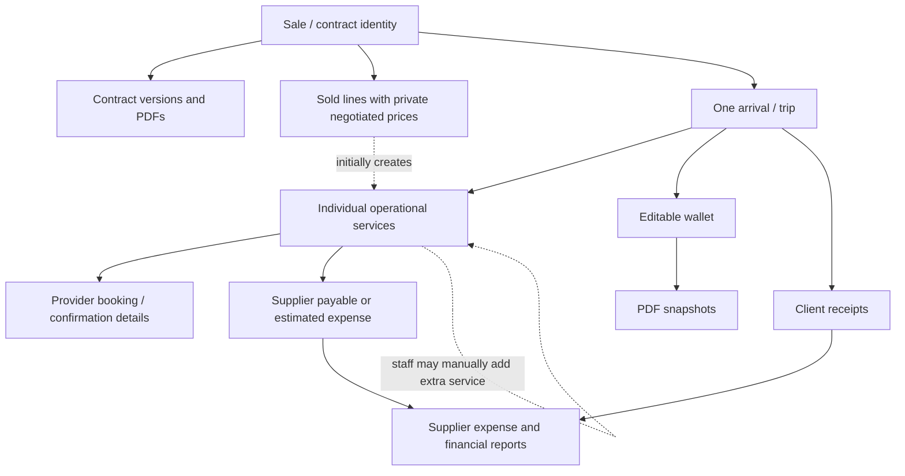

> **ARCHIVED VERBATIM v0.1.40 COPY — NOT AN ACTIVE IMPLEMENTATION INSTRUCTION.** The current files at the main ZIP root have precedence. This archive is provided only to preserve the decision/audit trail.

> **CURRENT v0.1.40 ACTIVE RULE:** Read `00_START_HERE_DEVELOPER_HANDOFF.md` and `11_v0.1.40_Usable_App_Manual_Override_and_Impact_Rules.md` before this historical/evolving architecture. Any statement implying a silent automatic propagation, forced Admin approval of a seller-finalized revision, or inability to operate without automation is **SUPERSEDED**. Keep the independent payable vs actual money ledger boundary.

# 03 — Data architecture, sources of truth and synchronization

**Baseline:** 2026-10-19 · **Status:** WIP conceptual architecture. This file distinguishes **CONFIRMED business invariants** from **PROPOSED implementation mechanisms**. Do not assume these names are literal database tables or dictate a particular framework.

## 1. Core design principle — Decision 1 (CONFIRMED)

**Linked records are independently editable; initial creation is automated, subsequent updates are selective, and unrelated/upstream records never change silently.** Staff may choose to propagate a relevant change to selected linked records. Specific agreed business workflow events—such as a provider submitting its link or a contract being finalized—may update the designated record automatically.

It is *not* a rigid mirror of one table. Tío Nenê may deliberately have a sold itinerary, an operational itinerary, a supplier-confirmed booking, a payable and a customer wallet that differ at a particular moment. The system must support intentional divergence while reducing dangerous unnoticed discrepancies.

**Master catalogs must not be overwritten by a transaction-level edit.** Similarly, a contract must not be implicitly rewritten because operations changed a reservation or a payable was adjusted.

## 2. Conceptual record boundaries

| Record / object | Owns this business fact | Created by | Mutable? | Links and cautions |
|---|---|---|---|---|
| **Hotel master** | Standard name / aliases, agency geographic zone and available reference data | Admin import or editor | Admin-editable | Default classification, not provider-specific pricing truth; multiple hotel stays possible. |
| **Provider master** | Reusable supplier identities and catalog relationship | Admin import or editor | Admin-editable | One-off payees must be allowed *without* this record. |
| **Supplier rate variant identity** | Stable globally unique Rate ID per original supplier rate row, parent stable Tour ID, original rate name, native currency/basis and geographic/season/weekday/route selectors | Admin import/editor (all 10 verified standardized provider XLSX sources packaged from v0.1.37) | Editable prospective rate and eligibility | Referenced by booking snapshot; future master price changes must not reprice prior booking or rewrite paid money. Envatours private-boat unit confirmed as fixed total USD per boat for 1–10 passengers. |
| **Provider-specific hotel-zone → tariff mapping** | Rule linking canonical agency zone + product/provider to a source Rate variant or supplier region, including manually restricted variants | Admin rules config | Editable prospective; per-booking override | Xcaret/Miguel/Playa Mía have different approved maps. Playa Mía Cozumel departure is never automatically eligible. |
| **Tour/service catalog** | Standard internal/provider name, display name, supplier relationship, typical costs, future inclusions/exclusions, and where applicable a **structured ancillary booking requirement** (e.g. included yacht transport) | Admin import or editor | Admin-editable | Incomplete at launch; not a historical invoice/contract. Ancillary requirement signals missing work; it does NOT automatically choose or book a transport provider (`CAT-010`, `OPS-009`). Do not overwrite past transactions. |
| **Provider tariff / cost reference** | Reusable default prices/zone price tables, **pricing basis for each service variant**, optional capacity limits and manual-quote designation where known | Admin/import | Admin-editable | Per-person, flat-booking and zone-dependent are composable; provider may offer several methods across tours. No complete provider × hotel matrix needed. Supplier tariff zone can differ from hotel geographic zone. |
| **Sale / contract identity** | One commercial agreement and historical versions | Seller | Revisable through versioning | Ties to one trip's arrival, receipts and sold lines; not a reservation. |
| **Contract version + PDF** | What was represented to/signed by the customer at that revision | Contract issue/revision | Prior versions preserved | Contains visible contract details and overall commercial price; **never print internal negotiated tour-line sale prices as individual tour prices**. |
| **Returned signed contract attachment** | Uploaded customer-signed file associated with a particular contract version; presence of a document, not a legal validity determination | Seller manual upload (independent from finalization) | Upload new files without destructively overwriting earlier files | Signed file storage is confirmed (`DEC-010`); accepted types, verification, replacement-signature policy and e-sign integration are open (`OQ-03`). |
| **Sold service line** | Per-sale tour/service, **its own structured adult count and child count**, original negotiated internal selling price, proportionally allocated contract-level discount and net attributed internal selling price; snapshot of displayed offer | Seller contract editor; system computes discount allocation | Through approved contract revision | Source for initial operational booking and provider-revenue attribution; historically versioned. Private tour line prices/discount allocations never appear on client PDF. A sold yacht may encompass further hidden operational services. |
| **Arrival / party trip** | Operational home for a contracted visit: traveler, arrival date, multiple dated accommodations, linked records | One-time on finalized contract | Independently operationally amendable | Remains the *same* arrival across contract revisions; not necessarily a full CRM profile. |
| **Operational service / reservation** | Specific tour/transport service to arrange and track; effective date/**its own adult and child counts**/**its own effective pickup accommodation or location**/provider and status **plus own generated unique reservation number** | Finalization or manual admin addition | **Yes, independently; identifier immutable** | Initialize pickup using that service date and the arrival's dated hotel stays; staff may override just this booking, with optional downstream sync. Never rewrite canonical hotel location or contract (`RES-020`). Number stays constant across amendments, is never reused after deletion and is distinct from supplier's confirmation code (`RES-018`). |
| **Provider-booking confirmation data** | What the supplier has agreed to: confirmation status/details; optionally code, pickup, channel | Provider link or staff manual entry | **Yes** | Five booking statuses: **Not Requested**, **Awaiting Confirmation**, **Confirmed**, **Unable to Confirm**, **Cancelled** (`DEC-013`). Link submission marks only its booking **Confirmed** automatically; Staff Reviewed stays unchecked. Staff may confirm via WhatsApp; pickup/time/code are optional. Neither status gates downstream (`DEC-012`). Other status transitions remain open; `DEC-014` defines the explicit Not Requested → Awaiting Confirmation staff action. |
| **Provider reservation link** | Scoped supplier access to see relevant request and submit relevant booking details | Operational reservation | Managed/revocable as security rules determine | Each operational reservation can provide link even if unused. Exact expiry/access security unresolved. |
| **Provider payable / expense** | Planned/confirmed cost obligation, effective cost override, remaining balance | Finalized sale, added reservation, or manual expense | **Yes, independently** | Provider ledger's effective cost is its own truth; one-off payees supported. Paid/outstanding is derived from allocations of actual supplier payment transactions; not the same object as the money movement (`DEC-017`). |
| **Supplier payment transaction** | Actual reported payment out to a provider/payee, by cash or bank transfer, dated and valued; any unallocated remainder is provider credit | Manual entry by authorized staff | Allocation now or later; correction/reversal approach OPEN | One payment may cover several payable entries and a payable may have several payments, including future-service payables. Keep the transaction independent from an operational reservation so booking deletion does not erase real cash paid (`DEC-017`, `DEC-018`). |
| **Supplier payment allocation** | Portion of one actual supplier payment applied to a particular provider payable entry | Staff selection during manual payment entry | Allocation correction procedure OPEN | Links one payment to one payable and derives its remaining balance; no duplicate booking costs or multiple copies of a single bank transfer. |
| **Client receipt** | Actual manually reported cash or bank transfer installment/deposit received against agreement (separate from the **agreed deposit** on contract) | Seller in Finalize Sale or authorized staff via existing contract/arrival / quick action | Corrections policy open | Record actual amount, date and method. An omitted original deposit can be logged later without editing signed contract terms or duplicating receipt; never infer bank reconciliation. |
| **Client wallet / itinerary** | Guest-facing itinerary and reservation information the agency chooses to present | Associated with arrival | **Yes, independently** | Not an operational booking or authoritative confirmation; can intentionally diverge. Pending status visible. |
| **Wallet PDF snapshot** | Most recently generated shareable guest PDF, distinct from editable wallet data | Manual PDF generation | New export supersedes current PDF for day-to-day app view; optional unobtrusive back-end recoverability | **Show one latest wallet**, not a visible list of past PDFs. Previously shared PDF remains unchanged outside app; content edits after a marked-sent PDF trigger **Wallet Update Needed**. Staff exports/shares manually, then **Mark as Sent** without implying delivery verification (`DEC-016`). |
| **Staff review indicator** | Whether operations staff checked the individual service/arrival | Staff action | Yes | Different from actual provider confirmation; review optional, clearly surfaced; provider submission does **not** mark staff-reviewed. Neither status gates payables/reports/wallet. (`DEC-012`) |

The above is a **conceptual separation of concerns**, not a finalized entity-relationship schema; persistence choices, field-level versioning and cardinalities beyond confirmed behavior remain to be designed.

### Xcaret source-of-truth extensions (CONFIRMED; conceptual only)

- **Xcaret display tour** is distinct from **source supplier tariff variants** for the same tour. Source rows carry package region, optional temporada, separate adult/child supplier costs in USD and transport INCLUDED (no computed transport cost breakup). The final 27-row **source catalog spreadsheet is now attached** in `Data/Supplier_Source_Workbooks/Tio_Nene_Xcaret_Standardized.xlsx`; import its exact `XCA-R001`–`XCA-R027` IDs/amounts and do not hardcode a synthetic tariff list.
- **Xcaret pricing-zone rules** are configured as owner-approved defaults matching each of the agency's eight **hotel** zones to an *existing* supplier region variant for a particular tour. Tulum uses region-labelled existing package fallbacks; Xcaret de Noche uses existing RM where mapped. No ordinary UI **provisional** marker or requirement to inspect actual pickup eligibility. Store selected rule identity/package for traceability only.
- **Xcaret 2026 temporada schedule** is an editable set of high/regular effective date ranges, using TOUR date; does not apply to future years until configured. **Weekly availability** is an independent editable weekday set associated to a supplier tour/schedule group. **Year-specific exception dates** override the weekday schedule; closed dates prevent seller add/reschedule while showing valid days. See attached data annex and original owner images.
- **Per-booking Xcaret cost snapshot** is created with the planned supplier payable at FINALIZE SALE and records the exact existing package/tariff reference, applicable hotel zone, source season/year/date, quantities and suggested cost. Confirmation and per-booking manual package/price overrides may diverge from the historical estimate. Neither price list changes nor overrides propagate to master zone, other bookings, original issued contract or real supplier payments; reconciliation of independently adjusted payable remains staff-controlled.
- **Calendar rollover reminder:** around December 15, Admin dashboard prompts annual confirmation of next year's temporada, exceptions and regular weekdays. No background scheduler/external notification is required for a dashboard rule. Historical 2026 schedules cannot be silently assumed for 2027.
- **CURRENT v0.1.40 source-data staging:** All 11 original provider/shared reference XLSXs and original 2026 Xcaret calendars ARE packaged and verified. Numeric source rates are available for importing and source-level testing; no claim they are imported into the live app. Future catalog/2027 calendars can be edited later by Admin. Earlier wording that the XLSXs were absent is historical.

### General source-of-truth extension — provider two-sheet imports and multiple rates (v0.1.36)

- **Source Tours sheet → persistent Tour/Product record:** stable globally distinct Tour ID, provider relationship, supplier source product name, independently editable `Display Name`, product type, `Seller Visible`, `Status`. One product can have multiple original supplier Rate records; archive/rename neither changes Tour ID nor existing sold-line/PDF display-name snapshots.
- **Supplier Rates sheet → rate variant records:** independent stable Rate ID and parent Tour ID, original supplier tariff name, original currency and **explicit calculation basis** (person/vehicle/boat/package), adult/child/fixed costs when applicable, region/route/season/date/weekday/passenger-capacity selectors and conditional inclusions/fees. A blank is absent/unknown, not zero. Unit labels in source are not necessarily verified; Envatours private boat costs in particular require unit confirmation before automatic calculation. Rate weekdays constrain price selection, unlike separately defined operating calendars.
- **Canonical references:** agency hotel zones, applicable dated stays, provider/product-specific region-map rules, shared seasonal/operating calendars and prospective FX defaults are stored centrally. Do not copy reference data into each XLSX or infer the **same** tariff zone mapping for Xcaret, Miguel and Playa Mía.
- **Single booking price determination:** Tour ID + booking date and date-matched hotel/agency zone + provider-specific region-map + correct eligible Rate ID + verified charging unit/passenger quantities → source-currency payable and standard-rate USD estimate. Record selected Rate ID/source name, agency zone, applicable hotel, all economic inputs and future-only FX on the BOOKING AND PLANNED PAYABLE at Finalize Sale. A missing rate/unit/hotel is **unknown cost** and an Action Required review, not a fake zero, not a barrier to Finalize Sale.
- **Manual intervention:** Admin/authorized staff may change the effective rate/package/departure/quantity or supplier cost **on one reservation** (Cozumel departure requires reason/audit). This never changes the master tour/rate/hotel zone, another reservation, the PDF text snapshot or actual money movement; existing payable edit/reallocation policies still apply.
- **Transfer exception:** Miguel one seller Tour ID → separately dated inbound/outbound reservation IDs and TWO payables on round trip. The client PDF still shows with/without-transfer dated itinerary rather than duplicating `Transfer Privado Aeroporto ↔ Hotel` as a tour line. Per-vehicle 1–7 people; unknown >7-vehicle allocation or hotel-to-hotel cost requires review.
- **Playa Mía:** one `Cozumel el Cielo` Tour ID with Cancún, Playa del Carmen and manual-only Cozumel **MXN** supplier Rate IDs. Cozumel tariff has **zero automatic zone links**; do not invent a ninth agency zone. Snapshot preserves original MXN creditor liability and standard estimated USD, distinct from actual USD paid cash.
- **Data staging:** These are owner-approved rules. The ten final standardized provider XLSX books are still under separate preparation; never import older, unapproved source spreadsheets as current. The Xcaret 2026 annex and screenshots stay included and authoritative for those previously approved rules.

**Client deposit rule (CONFIRMED):** A contract may state an agreed deposit, but *cash received* is evidenced only by its distinct receipt record. Most sales (owner estimates ~95%) have already received deposit when finalized, so offer a lightweight seller deposit-receipt field/action inside **Finalize Sale**. It is optional, since finalization can precede collection. If seller forgot the receipt, later log it on the existing contract/arrival using the true receipt date; do **not** amend contract terms, activate operations twice or create an assumed receipt. Keep seller access limited to the approved contract/finalization workflow and resolve broader receipt permissions under `OQ-28`. (`REC-005`, `REC-006`)

**Client balance due rule (CONFIRMED):** The outstanding balance is normally due **before** arrival. Store a client/sale-specific editable *payment deadline*, defaulting to the day **before** the arrival date. For a Dec 12 arrival, a still-unpaid balance is **overdue on Dec 12**. For an explicitly approved postponement to pay *on* Dec 14, staff can change only the payment deadline to Dec 14; it becomes overdue Dec 15 if still unpaid. The overdue state is derived from the effective deadline and actual received payments, not a permanent immutable flag or a change to the contract PDF. Arrival-date changes and fine-grained edit permissions remain open (`REC-007`, `OQ-27`, `OQ-28`).

**Booking status boundary (`DEC-013`, `DEC-014`):** The five approved labels describe the supplier booking lifecycle, **not** provider-payable settlement states and **not** the separately tracked Staff Reviewed indicator. Generating/copying a link is not evidence of dispatch. Following real manual outreach, authorized staff use **Mark as Requested** to move only that booking from **Not Requested** to **Awaiting Confirmation**. Provider acceptance follows `DEC-012`. Other transition/retry and completion/no-show rules remain open (`OQ-13`, `OQ-36`).

## 3. Identity and cardinality (CONFIRMED vs open)

- **CONFIRMED:** One finalized contract/sale creates one arrival, not one arrival per PDF version. One sold tour produces at least an operational reservation. An arrival can include further independently created services that are not new contract lines.
- **CONFIRMED:** A yacht sale may require yacht + **manually created** hotel-to-marina transport, each with a different provider/payment record. No automatic creation of transport solely from “included” contract text.
- **CONFIRMED:** Assign every operational service/reservation its own generated permanent human-usable number, including a manually added transport or unusual free-text tour; show/search this number internally. Amendments retain it; a separately created replacement gets a NEW number. Do not reuse deleted numbers or equate them to the supplier confirmation code. Exact formatting is undecided (`RES-018`).
- **CONFIRMED:** Tour, provider, hotel and price master records can be edited without retroactively modifying issued transactions. Free-text tours, manual accommodation, ad-hoc payees and missing standard costs are permitted exceptions.
- **OPEN:** Whether one sold line automatically creates multiple bookings in any other standardized cases, multi-contract customer identity, split party identity, and exact foreign keys/provenance representation (see `04_...`).

## 4. Creation and update matrix

| Event | Automatic effects (CONFIRMED) | Must **not** happen automatically | Pending design |
|---|---|---|---|
| Save/edit contract **draft** or preview/export draft PDF | Save draft or preview only | Create arrival/reservations/payables/provider links/wallet; treat PDF rendering as seller finalization | Draft validation, draft deletion and access. |
| Seller clicks **Finalize Sale** | Seller determines sale is agreed; issue contract version/PDF; create one arrival, operational reservation per sold line and **planned** supplier costs where mapped; populate operations queue | Wait for returned signed contract; treat PDF preview/download as finalization; mark provider confirmed; generate duplicates on retry; treat planned spend as cash paid | Exact draft validation; simple signed-file upload is separate (`DEC-010`); advanced signing stays open (`OQ-03`), and protected post-finalization revisions follow existing rules. |
| Seller uploads a **signed contract** | Save the uploaded signed file against the selected contract version; expose it separately from sale finalization | Activate a draft, re-finalize an issued sale, create bookings/payables, silently replace earlier files, or automatically certify legal validity | File validation, verification and e-signature flows remain open (`OQ-03`). |
| **Revise finalized** contract | Seller may issue V2 independently; retain V1/signed files, flag arrival **Changed / Needs Attention** and offer Admin an old→proposed selective impact review (**none/any subset/all**) | Silent rewrite of ANY downstream item, erasure of cash/signed history, forced reconciliation or forced Admin approval before seller finalizes | Reusable review UI, Admin manual destination choice and audited dismissal follow `11_v0.1.40_*`. |
| Staff marks booking **Unable to Confirm** | Set that booking's status from genuine supplier refusal and surface it in arrival/Action Required until staff resolve it | Pretend the app detected WhatsApp, change the client contract, invent a replacement or delete supplier expense | Other refusal/retry states and closure specifics remain open (`DEC-015`, `OQ-13`, `OQ-36`). |
| Staff **deletes** active reservation | Remove it from active arrival/itinerary, offer optional downstream wallet/ledger disposition; paid expenses remain valid and reportable | Delete paid provider transactions, rewrite original sale/catalog, imply external provider cancellation, auto-delete independently edited wallet | Options for mixed settlement, provider penalties/refunds and conflicts remain open (`DEC-015`, `OQ-15`–`OQ-20`). |
| Provider submits booking **link** | Save details to the intended operational booking; **automatically mark that booking Provider Confirmed**, leaving Staff Reviewed unchecked (`DEC-012`). | Change master tour/contract, blanket-confirm other services, require nonexistent code/pickup | Validation, duplicate submits and security (`OQ-29`). |
| Staff gets confirmation by **WhatsApp/phone** | Staff may set supplier booking status/details manually | Require supplier to reopen link or force time/place/code | Evidence display/optional source metadata. |
| Edit individual operational service | Save it locally, offer **selected downstream sync** relevant to edited fields | Silently rewrite contract, master data, manually adjusted payable, other unrelated booking or previously sent PDF | Specific propagation choices/conflict rules. |
| Edit provider's **tariff zone** on a booking | Apply booking-local effective zone; propose cost from known provider tariff if available | Rewrite physical hotel zone or tariff catalog; invent unavailable price | Whether applying computed price is one click or confirmed explicitly. |
| Override booking supplier **cost** | Save reservation-local cost; offer corresponding payable update | Update other customers, master costs, or independent payable without user choice | Recalculation precedence when source later changes. |
| Edit provider **payable ledger** (including cancellation charge) | Save local effective cost of $0/partial/full supplier charge and update applicable expense/payable reporting; recalculate balance against existing allocations only where valid | Alter original contract, operational booking, reference price/customer charge, or erase/alter existing actual money paid | If cost drops below already-allocated payments, flag excess allocation for explicit reconciliation; do **not** automatically create credit/refund or misstate negative outstanding (`DEC-020`, `OQ-19`, `OQ-20`). |
| Record **actual supplier payment** | Manually capture provider/payee, cash/bank method, date and total; optionally leave all or part **unallocated as provider credit**, or allocate immediately/at a later date across payable(s), including future tour dates. Update credit, allocated paid and remaining balances without duplicate cash payment or expense | Treat an invoice/expected cost as proof cash was paid, book a second supplier expense on allocation, assume bank statement was imported, or overwrite the customer contract | Refund, reversal, over-allocation, evidence/reference and cross-currency credit treatment remain open (`DEC-018`, `OQ-19`, `OQ-20`, `OQ-23`). |
| Manually add extra booking within arrival | Create new operational service, provider link, and relevant provider payable | Add separately charged line to contract or assume seller charged a second price | Attach cost to correct original sold line for margins. |
| Manually create **ad-hoc supplier expense** | Record one-off payee/amount/period and show in financial reports | Require new tour booking or permanent master provider, change contract | Paid vs unpaid entry semantics, optional client linkage. |
| Record a **client receipt** | Store entered payment and show against searched/selected contract; update displayed customer balance | Infer bank posting or associate by name alone without staff selecting matched record | Currencies, refunds and allocation. |
| Edit wallet/export PDF | Save wallet independently, show only latest/current wallet; if content changed after last acknowledged client send, flag **Wallet Update Needed**; generate updated PDF and let staff **Mark as Sent** after manually sharing | Modify actual supplier booking, imply unconfirmed tour is confirmed, edit previously shared PDF, display routine PDF version lists or assume WhatsApp send | Exact discrepancy notice and mistaken sent-status correction remain open; current-wallet/manual-replacement flow is **confirmed** (`DEC-016`). |

### Confirmed readiness and airport transfer clarifications (v0.1.28)

- **Normal calculated Ready:** once every REQUIRED sold/ancillary operational booking is present and **Confirmed**, and the client's current digital wallet is prepared and ready to send, automatically display the arrival as Ready. Do not equate “every existing booking is confirmed” with “every required service exists”—a missing included yacht transfer still generates Action Required and stops automatic Ready. An Admin override only changes the displayed badge and never clears incomplete work or changes any individual booking status. Financial balance, staff review and wallet send status remain separate (`OPS-005`, `OPS-008`–`010`, `OQ-26`).
- **Airport transfer source data and lifecycle (CONFIRMED):** The seller records arrival date and **Arriving with/without transfer**, then dated tours, and departure date and **Departing with/without transfer** in the contract's chronological itinerary. When a direction has a purchased transfer, that direction carries structured flight number and scheduled time on the client contract. **Each purchased direction creates its own independent dated operational booking with a stable reservation ID and its own supplier payable**, but the transport supplier may accept both legs through **one informal WhatsApp exchange**; no codes or two mandatory supplier contacts. If a direction says **without transfer**, still display it in the contract and **do not create a booking/payable**. Different arrival/departure dates, hotel/zone overrides, confirmation statuses, and later edits are isolated by leg. Per-leg actual supplier rate and total bundled client selling-value allocation remain open where missing (`CON-014`, `TRF-007`–`010`, `OQ-09`).

## 5. Snapshot, override and synchronization rules

### Mandatory business behavior (CONFIRMED)

1. On first creation, draw known information from source catalog/contract/reservation so workers don't retype it.
2. Manual per-record changes remain local unless there is a separately approved workflow action or staff selects related destinations to update.
3. Contract and reference catalogs are **protected upstream** against implicit changes in operational bookings, wallet or provider ledgers.
4. When a party has multiple dated accommodation stays, initialize each booked tour's **effective pickup hotel** using the stay covering that particular tour date, not by blindly choosing the first hotel. Staff can change the effective pickup location on that service independently; update only selected downstream records. If stay-date attribution is not unambiguous (for example, changeover day), flag it for staff selection rather than guessing (`RES-020`, `OQ-07`).
6. A provider's genuine approval may be recorded by staff directly (e.g., new date agreed via WhatsApp), with remaining details unchanged; an *unapproved* proposed date must not falsely become supplier-confirmed.
6. Supplier-payment entries may be edited even when a price cannot be modeled from a reliable formula; their effective values govern what the ledger shows as due/paid.
7. Deleting/archiving a master catalog tour does not erase recorded history. Later standard price changes do not rewrite negotiated sell prices or original estimated costs on existing records.
8. Supplier confirmations and staff review are separate flags/concerns. An absent pickup code does not itself prevent confirmation; it may be inapplicable.
9. Planned supplier costs exist *before* booking and are distinguishable from confirmed and paid costs.
10. **Supplier-link submissions automatically confirm only the targeted booking, leaving staff review unchecked.** Confirmation can alternatively be recorded manually. Neither confirmation nor staff review is a prerequisite for planned supplier payables, reporting, editable wallet or wallet PDF, or other normal downstream operations (`DEC-012`).

11. Staff may remove an individual reservation from the **active** arrival while preserving retained paid supplier transactions or other legitimate independent expenses. For an unpaid planned amount the owner may choose to remove it or retain it as an expense. A retained financial record must not depend on the reservation staying active (`DEC-015`).
12. A supplier's actual refusal is entered **manually** as **Unable to Confirm**; this creates an Action Required issue until handled. An internal delete must never be mistaken for cancelling the reservation with the external provider (`DEC-015`).
13. **Wallet day-to-day view is current-only**. Changes after the last marked-sent PDF surface **Wallet Update Needed**; staff creates one latest PDF, sends it externally, and explicitly **Mark as Sent**. This is not automatic messaging or verified delivery. Historical files/technical metadata must not be presented in the normal wallet view (`DEC-016`).
14. **Supplier payments out are manually entered transactions separate from costs owed**: allocate one cash/bank payment across several payable rows or partially to one. The same expense must not be booked twice, and real recorded payments persist when a booking is removed (`DEC-017`).
15. **Unallocated supplier payments are provider-specific credit**: one dated outgoing payment may initially remain wholly or partly unapplied, then later be allocated to individual reservation payables, including future tours. Provider account presentation distinguishes payable debt from unused advance credit; allocating moves value from unallocated to allocated rather than generating another cash-out. An unallocated $500 credit does not itself mark any particular $500 booking as paid (`DEC-018`).

16. **When an edited supplier payable cost falls below previously allocated payment, staff should be offered the option to release only the excess allocation to that provider’s unapplied credit**. Do not auto-release, invent a refund, overwrite the original cash/bank payment or show a negative amount due (`DEC-021`).

### Engineering safeguards (REQUIRED business behavior; developer selects implementation)

- Store immutable issuance/version IDs plus **stable operational IDs** and references; preserve generated price/cost snapshots, effective override values and source/provenance for comparison. These are recommended means of fulfilling the confirmed non-destructive/history requirements.
- Show one compact **change impact preview** after meaningful edits, including all declared computable upstream/downstream destinations, old→proposed values and conflict flags. Admin may select **none, any arbitrary subset, or all** proposed eligible updates. Unselected and manually overridden values remain unchanged. Non-computable effects are flagged for review, never silently guessed. Ensure explicit confirmation, concurrency checks, audit, and idempotent execution. The current cross-app contract is `11_v0.1.40_Usable_App_Manual_Override_and_Impact_Rules.md`.
- For records already manually overridden, don't silently overwrite with later catalog recalculation. Show proposed value and allow staff to keep the override or explicitly adopt the new value.
- Preserve an unobtrusive audit/version trail for corrections/disputes; never force detailed audit tables into the standard arrival screen. Who can view it, retention and event schema still open.
- Model exceptions (unknown provider, unknown costs, non-hotel pickup, one-off payee) as valid records with visible incomplete statuses rather than fake data.

**NOT DECIDED:** exact prompts/default checkbox selections, whether changes can be pushed upstream deliberately as a separate approval workflow, the editability of identifying keys, concurrency/rollback, propagation triggers for every field, and cross-record warning thresholds. See `OQ-15`–`OQ-18`.

**Payment release and refund (`DEC-019`) — CONFIRMED:** Releasing $500 previously allocated to John's Baktun tour makes it **unallocated Baktun credit** again, without a fresh outgoing/incoming money transaction. If the supplier **actually pays Tío Nenê back**, separately record a **supplier refund received** with its real payment date and amount, reducing the advance/credit position; it is not tour-sales revenue. Neither action alone decides the provider's cancellation charge or automatically removes an existing payable. Exact refund-allocation mechanics and FX remain open (`OQ-19`, `OQ-20`, `OQ-23`).

### Required ancillary booking — confirmed missing-work safeguard

For a sold product configured with a **required extra service** (e.g. private yacht includes hotel-to-marina transportation), create a **derived or explicitly linked outstanding-arrangement requirement** when that sale is finalized. That requirement is visible in the arrival and automatically generated **Action Required** list **even before a subordinate reservation exists**. Otherwise a yacht-only reservation could look complete while the included transfer is forgotten.

Operations **manually creates** a separate transport reservation from the arrival and associates it with the included requirement/parent sold service. Its own supplier booking/link and payable follow normal rules; the original customer contract stays a single sold item and gains no extra customer charge. Once transport is arranged/associated, the *missing ancillary booking* action clears, while any still-unconfirmed transport booking follows the usual booking queue. A known unarranged required service prevents **Ready**. Other global readiness criteria remain open (`OQ-26`). Do not try to extract operational requirements from all free-form inclusion/exclusion text, auto-create ancillary bookings, or demand a complete tour-by-tour mapping before the owner supplies it (`CAT-010`, `RES-011`, `OPS-009`, `OQ-14`).

## 6. Financial measurements: do not conflate

The following different quantities coexist:

- **Client contract total** — price agreed for the entire transaction.
- **Private sold-line prices (CONFIRMED)** — seller-negotiated original price for each tour/service, plus (if there is an overall percentage or fixed-amount contract discount) that line's **proportional share of the overall discount** and resulting **net attributed revenue**. None of these line figures appears individually on the client PDF (`CON-005`, `CON-013`).
- **Estimated planned supplier cost** — recorded on finalization from then-available reference data; not automatically owed/paid.
- **Confirmed supplier cost / obligation** — booking recognized by provider with effective payable; exact obligation timing and cancellation policy open.
- **Paid supplier amount** — supplier cash settlement entered by staff as an actual supplier payment transaction, apportioned to payable items; **never add payment to supplier cost as another expense**. Partial allocations leave a calculable unpaid remainder (`DEC-017`).
- **Released supplier allocation** — reverses application of previously recorded outgoing money to a payable and restores that amount to the same supplier's unapplied credit; **not** fresh cash movement (`DEC-019`).
- **Supplier refund received** — actual money returned by provider, separate from release-to-credit and never counted as customer sales revenue; exact partial/FX handling remains open (`DEC-019`).
- **Per-payable ledger columns (CONFIRMED)** — **Reservation cost** = current effective total provider charge; **Amount paid** = sum of real supplier payment allocations to that specific payable; **Remaining balance** = reservation cost minus amount paid. A $20 installment on a $100 cost displays $100 / $20 / $80, not a mutated $80 cost. Calculated balance is not an independently editable duplicate of the payment ledger; adjustments to cost and corrections to payments follow different flows (`PAY-013`).
- **Standard FX configuration / effective-from behavior (CONFIRMED):** The agency maintains one editable standard planning conversion rate for MXN→USD estimates. Saving a changed rate affects **subsequent booking cost-estimate snapshots only**; do not mutate historic rates, original USD estimate values, MXN payables, or actual USD payment transaction amounts. The same rate persists for new entries until intentionally edited again (`PAY-023`, `PAY-022`, `SC-087`).
- **Arrival-cohort profit attribution (CONFIRMED):** When reporting profit for any week, month, year or custom date range, filter **arrivals whose arrival date falls in the period** and aggregate associated contract net sold-line revenue, linked supplier costs and attributable extra expenses under the separately selected cost/profit basis. Tour dates outside the arrival period do not move the underlying sold tour into a different profit cohort (example: October 31 arrival / all tours in November remains October cohort). This is a *business operational profitability grouping*, **not** a claim about statutory revenue recognition, accrual accounting or cash flow. Real cash received/paid can be separately reported by actual transaction date and must not be substituted for cohort sales/profit (`FIN-008`, `OQ-24`, `SC-088`–`089`).
- **Unknown cost vs real zero (CONFIRMED):** Finalize Sale is permitted with a null/unknown provider quote. Still create the arrival, unconfirmed service record, any provider association/link available and a **planned payable placeholder with missing/unknown cost, not $0**. Surface **Cost Required** in staff Action Required and clearly label associated margins as financially incomplete. Later local cost entry fills the amount without retroactively changing master tariffs or the sales contract. An explicitly entered genuine $0 charge is valid and distinct from unknown (`CON-015`, `PAY-024`, `OPS-011`, `FIN-009`, `SC-090`–`092`).
- **MXN supplier cost conversion (CONFIRMED):** Supplier *native-currency price/payable* and its *USD reporting representation* are separate fields/facts. For a MXN-priced Playa Mía reservation, preserve e.g. **MXN 2,000** plus the snapshot of the agency's configured **standard MXN per USD rate**, producing a **provisional USD expense estimate**. Editing the global rate for new calculations never silently alters a pre-existing cost estimate, provider price, or already logged cash payment. On real supplier payment, manually capture payment date and **actual USD cost incurred**, as known by the operator (plus applicable original MXN amount), independently of the original estimated USD figure. Actual USD equivalent can be entered directly; do not force a fictional market rate. A cash payment must not be counted as another supplier expense. For complete, fully settled items, margin may reference actual USD cost; for unpaid/partially paid items, explicitly distinguish realized cash conversion on paid portions from remaining forecast, and do not claim precise full realized profit. Multi-installment FX allocation, refund/credit FX basis, statutory accounting recognition and tax details remain open under `OQ-23`–`OQ-24`; arrival-cohort profit period basis is confirmed (`FIN-008`) (`PAY-022`, `FIN-007`).
- **Client-side currency (CONFIRMED):** Contract and per-tour sold values are **USD** and the client's receivable is maintained in **USD**. Client receipts normally arrive in USD. On occasional BRL deposit, staff specifies the **USD amount actually credited** toward the contract; optional note/original tender amount may document BRL and its conversion. Do not create a second credit by counting the original BRL as another receipt, and do not apply an invented live FX rate. Detailed audit rules for historic tender currency/rates and mixed-currency exceptional reporting remain open under `OQ-23` (`REC-008`).

- **Provider advance credit (CONFIRMED)** — For each actual supplier payment, retain total paid and allocations already made; its *unallocated remainder* is available for future assignment to that same provider's reservation/payable entries (including service dates later than the payment date). Provider account net position conceptually equals aggregate current payable balance **less** unapplied credit, without rewriting individual payable rows. If a $500 future tour payable exists and $500 payment remains unapplied, the provider can have a **zero net position** yet that particular row remains unpaid; only when staff allocate $500 does it display $500 / $500 / $0 and unallocated credit $0 (`DEC-018`). Refund/over-allocation/cross-currency exceptions are not decided.
- **Client receipts** — cash/bank transfer installment entered by staff, not the same as sales revenue and not bank-verified.
- **Margin/profit** — line/provider revenue should use **net revenue after allocated contract-wide discount**, not the original negotiated line price. For discount-only deals, net line revenues reconcile to the agreed contract total; line/provider margin then deducts appropriately attributable costs. Full profit across package extras, refunds, taxes and mixed-currency provider expenses remains subject to explicit separate rules (`FIN-005`, `OQ-22`–`OQ-24`).

**CONFIRMED:** Owners can choose planned/confirmed/paid measures and time periods in reports, without double counting. **Overall contract discount rule:** seller selects percentage or fixed amount; discount is distributed proportional to original internal sold-line prices, preserving original/discount/net values. Illustrative: lines $150, $200, $150 = $500; 10% or $50 discount results in net $135, $180, $135 and contract $450. Handle currency rounding deterministically so net allocated lines reconcile exactly to contract total. This allocation is a **reporting convention**, not evidence a tour's standalone negotiated price changed (`CON-013`, `FIN-006`). **OPEN:** other fees/bundles, provider-attributable margin allocation for extra transport, whether date filters mean sale/service/confirmation/payment date, the remaining mixed-currency conversion exceptions and precise accounting basis. Do not quietly label "profit" from a guess as definitive.

## 6A. Supplier cost model selection and data completeness

**CONFIRMED:** Provider cost is not one generic adult × cost formula and must not be assigned at provider level alone. Pricing is a property of the particular **tour/service variant** with independent dimensions: per-adult/child rate versus per-booking/vehicle fee; provider zone/direction tariff dependence; maximum passenger capacity; and manually quoted exceptional services (`CAT-009`, `PAY-021`). Per-booking flat price can also be zone-dependent.

- **Airport↔hotel transfer:** a fixed vehicle/service charge for **1–7 passengers**, chosen by the service's direction and the applicable zone where known. Passenger count within this bracket does **not** multiply price. No quote is guessed for more than seven travelers or missing provider tariff information (`TRF-006`).
- **Private yacht:** boat selected for that sale determines cost; standard price cannot currently be derived from the yacht label alone. Staff must be able to enter the actual quote manually and retain it on that sale/booking. Do not populate a fictitious catalog default.
- **Baktun:** Three separate Chichén Itzá variants (Deluxe, Classic, Two Cenotes). Each uses **per-adult and per-child provider tariffs** multiplied by its actual adult/child attendance and summed for that booking; its pricing is **independent of the hotel zone**. $80/adult and $60/child were **illustrative**, not approved real-world rates. Import the correct adult/child prices by variant before relying on automated cost estimates (`OQ-10`).
- **No available estimate:** the sale/booking/payable workflow must remain operable, with supplier cost explicitly missing/needs pricing; never silently equate unknown cost to $0, and don't treat forecast profit as reliable until required cost data is entered. Staff retains reservation/payable-level independent cost overrides with optional downstream synchronization. Precise cost entry responsibility and unresolved-price queue UX remain implementation details to confirm if material.

## 7. Geographic zone vs supplier tariff zone

**Master hotel's zone** is Tío Nenê's single standard geographical classification (one master list). **Effective provider billing/tariff zone** is a value on the reservation; it can differ for the *same hotel*, across providers, without either provider being 'wrong'.

Example (illustrative, *not* verified supplier tariff facts): master hotel zone = Cancún Hotel Zone; provider A uses that tariff; provider B charges Cancún Center tariff. Staff may:

- Set just provider B's **reservation tariff zone** to Cancún Center, recomputing only from B's known tariff data if supplied; or
- Retain tariff zone and directly override the effective cost if B's charge is bespoke or its tariff isn't recorded.

Neither action rewrites the canonical hotel row or demands a costly provider-by-hotel mapping project. Future mapping can be layered in incrementally; do not require it at launch.

**Cancelled-booking payable correction (`DEC-020`) — CONFIRMED:** The effective supplier charge is editable per independent provider-payable entry even after cancellation: zero, a partial cancellation fee, or the original full cost, according to what the supplier actually charges. This is a **cost adjustment**, distinct from booking status, outgoing cash, allocation releases into supplier credit, or actual refunds received. Keep historical paid transactions intact. If cost is reduced below already allocated payment, **identify excess and offer an explicit staff-controlled release to supplier credit** (`DEC-021`); do not silently convert it into credit/refund or display negative money due. Other corrections remain open (`OQ-19`, `OQ-20`). Financial reports must distinguish the revised expense amount from money paid.

## 8. Contract revisions and manual extra services

**CURRENT v0.1.40 RULE (supersedes older auto-reconcile language):** Seller may finalize revision without Admin preapproval; every potentially affected downstream item is a CHOICE, not a mandatory cascade. Admin reviews current→proposed old/new impacts and selects exactly none/some/all. Keep previously manual/confirmed/paid/independent records unchanged unless explicitly chosen. Review flag stays until Admin dismisses, even if perfect reconciliation is not achieved. Historical signed PDFs and actual-cash transaction rows are immutable; corrections use audited adjustments. Details and failure rules in `11_v0.1.40_*`.

**Confirmed safe contract-revision rule:** Detect changes between the old and new commercial versions. Automatically make straightforward changes to untouched, unconfirmed/unpaid records. Retain links/history. If a change would touch a confirmed supplier booking, a paid entry, or a manually amended record, **send to operations review before destructive/replacing actions**. Most real contract revisions occur before such changes, but the rare case must be handled.

**Confirmed manual extra rule:** A sold yacht tour may already include transport commercially. Staff adds a *separate* transport service within its arrival. It creates a supplier booking and payment row with its own provider, but no extra client line item. This must not be modeled as a second charge to the client. An attribution link from the included transport to the parent yacht line is **design guidance**, needed for accurate tour/provider profitability, not yet a finalized data field.

### Operations readiness and action queue (CONFIRMED UI concept; criteria OPEN)

The operational arrivals list must expose a **Ready / Not Ready** indicator on every arrival **at the same time as** the automatically derived, date-prioritized **Action Required** list. The arrival detail should let staff see which underlying issues drive the displayed not-ready state. Readiness is **normally calculated from recorded operational completeness**, not a sixth provider reservation status or another manually maintained task log. **Admin may override only the displayed arrival-level Ready/Not Ready label in either direction, without changing the underlying calculated readiness, booking statuses, Action Required tasks or wallet/finance data (`OPS-010`).** The label is informational, not a gate for unrelated workflows. Unconfirmed bookings and missing known information remain visible in the detailed work queue. The exact rule for which issues prevent a Ready state, plus whether agreed exceptions can be acknowledged, is not settled (`OPS-005`, `OPS-006`, `OQ-26`). **CONFIRMED:** Client payment settlement is **not** an operational readiness gate: an arrival may display **Ready** even if money is outstanding or overdue, while payment warnings appear separately. Staff review remains optional, and an uploaded signed contract is not a prerequisite for operational scheduling. **CONFIRMED:** The digital wallet being **prepared/current and ready to send** contributes to operational Ready. Sending the wallet, clicking **Mark as Sent**, or proving message delivery are **NOT** operational readiness gates; they remain a separate lightweight communication/delivery workflow with its own reminder (`OPS-008`, `WAL-008`). Exact other operational readiness criteria (supplier confirmations and exceptional arrangements), and the precise wallet-completeness definition, remain open (`OQ-26`). Calendar presentation is not a prerequisite.

## 9. Access, privacy and operational resilience

- **CONFIRMED (`DEC-011`):** Phase 1 has two roles: **Seller** and **Admin**. Any Seller may create, view, finalize and revise any seller's contracts, and may upload returned signed contract files to the correct version. Admin supports broader back-office management. Cross-seller contract access does **not** imply unrestricted supplier-cost, payable, operations or company finance access.
- **OPEN (`OQ-28`):** Exact route/field-level authorization outside confirmed seller contract actions, including incoming payments and sensitive client records, requires later owner approval; do not add a third role or grant broad seller privileges by assumption.
- **CONFIRMED — manual provider status:** Admin may mark a booking **Confirmed** directly even without a supplier-link submission. This is an operator-entered internal status, not evidence that the supplier has actually agreed. It does not auto-check Staff Reviewed, auto-complete dependent bookings, or imply any other synchronized effect (`RES-021`).

**CONFIRMED:** Each reservation can expose a supplier-accessible link; distribution is optional. **PROPOSED:** use unguessable scoped access, minimum personal details and revocation; choose exact access controls after `OQ-29`.
- **CONFIRMED:** WhatsApp group sharing of wallet is currently manual and optional email/other sending is allowed. No automatic WhatsApp account integration is approved.
- **OPEN:** CPF and travel data handling, retention, authorized sharing in multi-member client groups, audit trail and backups; treat these as mandatory security design review before public launch.
- **OPEN:** Initial migration of existing bookings and provider balances, plus fallback if a link or PDF generation fails.

## 9A. Lightweight optional notes — confirmed usability clarification

Where short staff context is genuinely useful (client money received, supplier money paid, expense overrides, service reservations), store an optional note with that record. Editing or adding a note does not alter booking states, financial amounts, payment allocations, or independent record synchronization. Do not elevate this to a new subsystem or demand detailed history in routine screens (`NOTE-001`).

## 10. Agent instructions before writing code

1. Read `README.md` and `04_Decisions_and_Open_Questions.md` before treating any module as fully specified.
2. Map requirements to a concrete technical architecture, but **label every new assumption**; don't replace confirmed record-independence or historical preservation with live mirroring.
3. Isolate foundational identities, catalogs, contract versions and stable reservation IDs from uncertain report formulas, electronic signing and portal features.
4. Do not create providers, tariffs, hotel zones or default prices from examples or guesses.
5. Where a pending decision controls correctness, implement safe structural hooks or stop **only that affected behavior**, and request explicit approval before silently settling it.
6. Add acceptance tests from `05_Acceptance_Scenarios.md` for every completed requirement; test no-duplication, protected overrides, manual confirmations and unknown catalog cases.

## V0.1.37 — Finalized standardized supplier import and rate-selection architecture

**Authoritative numeric source:** Ten immutable supplied XLSX provider files in `Data/Supplier_Source_Workbooks/`; source Rate IDs are canonical for initial seed. The separate shared-reference workbook is reference data, **not** an eleventh provider. Full field-level contract, mapping/rate joins and import tests: `Data/Supplier_Import_Data_Dictionary.md`. Original source filename/checksum provenance is retained in `Data/FINAL_MANIFEST.json`.

**Canonical objects (existing concepts, clarified, not invented business roles):** `Provider` → `Tour` (permanent Tour ID, original supplier product name, editable seller/contract Display Name, Product Type/Subtype, visibility/status) → multiple supplier `Rate` rows (permanent Rate ID, original supplier rate label, unit basis, native adult/child/fixed cost, region/season/weekday/route/capacity/availability fields). `Hotel` has one canonical zone; independent `ProviderZoneRule` rows select a **supplier-specific** applicable rate/region using the hotel on the SERVICE DATE. Year-qualified `XcaretSeasonWindow` and operating-day rules are centrally maintained. A persisted `BookingRateSnapshot` protects the selected Rate ID, name, hotel/date/zone, rule, applicable season, native rate/cost, quantities/unit count, USD estimate and override audit. `SupplierPayable` retains original native currency and its manually edited effective cost; payment allocations and real USD cash payment values remain separate.

**Resolution order:** (1) pick stable Tour ID by Display Name; (2) determine service-date hotel and zone, if the product uses geography; (3) apply product/provider-specific zone rule; (4) select season by SERVICE DATE only where that actual Tour ID carries both regular/high supplier rates; (5) filter actual Rate ID rows by weekday/route, effective dates (only if supplied), status and other supplied eligibility restrictions; (6) require exactly one eligible normal rate, or send to manual review with supplier cost **Unknown**, unless a separately authorized booking override is entered; (7) calculate correct per-person/per-vehicle/per-boat/per-equipment cost and snapshot results at Finalize Sale; (8) allow later independent booking-level package/season/native cost overrides with audit; NEVER mutate master zone/rate, contract history or previously paid cash. Xcaret package prices already include transport. Actual pickup location is set when booking and is not a price selector.

**Availability is distinct from weekday price variation:** The Xcaret weekly and special Sunday restrictions must reject expressly closed tour dates. Coco Bongo supplied weekday rate rows are only applicable on listed weekdays, and some explicitly disallow certain days. For unspecified tour schedules, do not claim the tour is open every day merely because the rate's `Days of Week` is blank. For an unavailable priced day, do not invent another supplier price or silently use a rate from another weekday.

**Source-specific rules now resolved:** Envatours private boat `ENV-R002/R004/R006` is fixed price per ONE boat for 1–10 passengers; Jet Ski 30/60min is fixed price per EQUIPMENT UNIT for up to two passengers, with seller-entered passenger count and computed `ceil(passengers / 2)` skis; Miguel 1–7 riders/vehicle and two one-way legs for roundtrip; Playa Mía original cost/payable in MXN with separate USD estimate and actual-paid value; Coco Bongo adults-only and weekday rate eligibility; Dolphin 17 BASE-COST rows, excluding Columbus. These owner-approved supplier facts supersede older unknown-price-unit/provisional raw-catalog warnings, not general manual-quote support for genuinely missing costs.

**Import conflict policy:** Importer/upsert must be idempotent by stable Tour ID and Rate ID, validate foreign keys, preserve source filenames and checksums, preserve Admin edits to canonical master records unless an authorized explicit update choice is made, and preserve snapshot/history. Source files are imported bytes unchanged; web-app master values remain edit-enabled. Separate audit warnings for absent future-year Xcaret seasons, unresolved age bands, unprovided supplier extras, and true rate gaps (do not force broader closure or tax assumptions).

## v0.1.39 — Canonical additional data/invariants (owner-approved)

**Current authority:** `09_v0.1.39_Owner_Approved_Decisions.md` supersedes stale v0.1.37/38 Dolphin-extra-unpriced / reservation-field-pending / 2027-season-blocking notes. Suggested entities below are conceptual, not an imposed database migration:

- **Dolphin transport tariff:** supplier = Dolphin, canonical hotel zone, Adult USD, Child USD, Infant USD, source MXN, provenance planning divisor 16.65, effective/configuration version. This is *ancillary pricing*, not a new `Supplier Rates` row or a modification of original provider XLSX. Default applicability ON per Dolphin reservation; Admin may opt out by booking with traceable reason; round-trip charged **once per transported person** (not twice for two legs).
- **Booking selected transport snapshot:** transport ON/OFF, date-effective hotel and zone, passenger category counts, applied unit prices, total USD planned cost, selected version and who/when override. Actual outgoing supplier payment recorded separately, native MXN amounts and actual realized USD where relevant.
- **Provider reservation identity and customer/supplier-facing fields:** stable internal generated number; nullable separate provider confirmation number; hotel room optional; service-date hotel and tour, dates/party types, pickup, meeting, supplier-visible observations, internal secret notes. Configurable field definitions and visibility must be permission scoped, new fields private by default.
- **Future-year Xcaret configuration:** explicit year-scoped future calendar, Admin-provisional active High/Regular Rate ID (where needed), effective-dated rates and opt-in supplier planned-cost propagation preview. No 2026 date carry-forward; never rewrite paid cash transactions.
- **Launch migration provenance:** manual upcoming arrivals with source Trello/Sheets/WhatsApp IDs where available, original cash date/amount/currency, dedup indication, missing-field review; developer chooses actual schema after auditing partial app.
